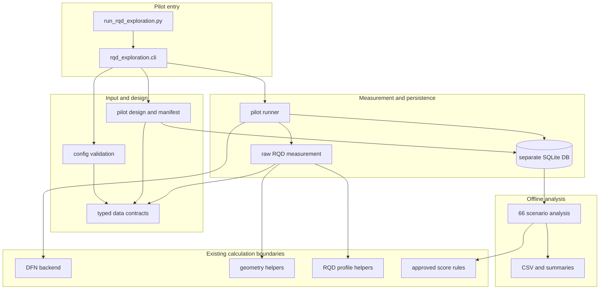
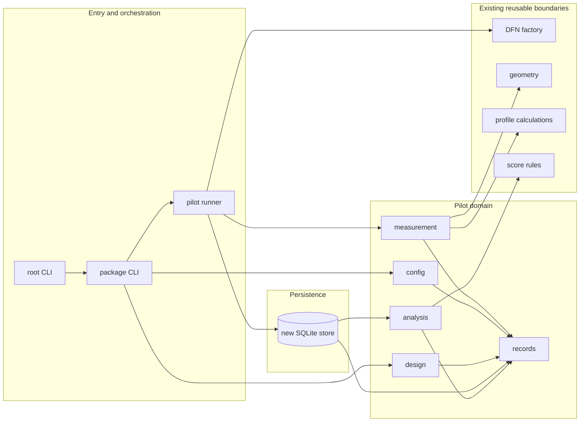

# Implementation Plan v4: RQD Exploration Pilot

- 작성일: 2026-10-28
- 상태: 파일럿 기반 구현 준비 계획. 코드 구현·simulation 실행 승인이 아님.
- 전략·요구사항 기준: [RQDExplorationStrategy_20261026/plan.md](RQDExplorationStrategy_20261026/plan.md)
- 범위: 최초 10-signature pilot의 입력·설계·RQD 측정·저장/재개·후처리/보고 준비와 사용자 검토 인계.
- 제외: 자동 batch controller(T011), 미승인 충분성·예산 배분·weight 정책, 사용자 확인 없는 simulation 실행.
- 상세화: 2026-10-28 사용자 요청에 따라 §5의 T001–T011을 §5.1의 Phase/Step으로 분해했다.
  실행 중 충돌·미정 사항은 §1.1의 결정 절차를 따르며, 본 갱신은 기능 구현이나 실행이 아니다.

## 1. 문서 역할과 우선순위

구현 관련 주 기준 문서는 다음 두 파일이다.

1. **전략 및 요구사항의 권위 문서:** `Specification/RQDExplorationStrategy_20261026/plan.md`.
   사용자 합의, 연구 의미, 입력·출력 원칙, 승인값, 미결 정책과 수용 기준을 관리한다.
2. **실행 순서 및 작업 인계 문서:** `Specification/ImplementationPlan_v4.md` (이 문서).
   파일럿 구현의 순서, 작업 간 의존성, 테스트 전략과 완료 경계를 관리한다.

두 문서가 불일치하면 전략 계획의 최신 timestamped 사용자 합의를 우선하고, 구현계획을
그에 맞게 갱신한다. 상세 schema/API를 다루는 T002 검토를 포함해, 이 계획은 상세 자료
계약 자체를 대신하지 않는다.

### 1.1 상충·미정 사항의 기록 → 결정 → 구현 절차

- **기준:** 전략 plan은 연구 의미·승인값의 권위, implementation plan은 작업 순서·검증의
  기준이다. 보관 문서와 기존 코드는 참고 근거이며 두 현행 문서의 최신 합의를 덮어쓰지 않는다.
  아래 D001처럼 이미 timestamped 합의로 해소되는 차이는 근거를 기록해 정합화하고 재질문하지 않는다.
- **새 선택 발견:** 실행자가 아래 대장에 `Dnnn`, 발견 시각, 양쪽 문서의 절·상충 문구,
  영향을 받는 Step/REQ, 선택지·권고·영향을 기록한다. 상태는 `open`으로 두고 의존 Step만
  `blocked` 처리한다. 미결값을 기본값·임시 성공·추측한 알고리즘으로 대체하지 않는다.
- **사용자 결정:** 동작·범위·자료 의미가 바뀌는 선택은 관련 질문을 묶어 사용자에게 제시한다.
  응답을 받기 전에는 권고를 승인으로 간주하지 않는다. 다른 독립 Step은 진행할 수 있다.
- **동기화:** 승인 시 원문 취지·시각·적용 범위·대체한 결정·근거를 전략 plan에 기록하고,
  이 문서의 대장·Step·계약·의존성과 필요 시 checkpoint를 함께 갱신한다.
- **구현 재개:** 승인 계약에 맞춘 검증 조건을 먼저 확정하고 영향 코드·테스트만 변경한다.
  상태는 `open → decided → applied → verified`로 추적한다. `decided`에는 승인 근거가
  필요하고, `verified`에는 문서 또는 코드의 검증 증거가 필요하다. 문서 정정과 기능 완료는 별개다.
- **단계 인계:** 완료 Step·산출물·검증 명령/결과·남은 D-ID·다음 실행 가능 Step을 이 문서에
  기록한다. 양쪽 문서에 task 체크박스를 유지할 경우 T-ID 완료 상태도 함께 맞춘다.

#### 결정·충돌 대장 (2026-10-28 상세 계획 기준)

| ID / 상태 | 확인 사항·근거 | 처리 및 결정 경계 | 영향 Step |
|---|---|---|---|
| D001 / verified (문서) | 이 문서의 “G0 전부 미승인”으로 읽히는 설명과 전략 §5·§11.2·§11.4의 pilot G0 간소 계약 승인 상태가 다름 | 최신 전략을 적용한다. 이미 승인된 schema version 1, ID·상태·evidence·JCS/SHA-256을 재결정하지 않는다. 남은 통합 테이블/열/FK/NULL/check 및 fingerprint 필드 묶음만 T002에서 제시·확인한다. 두 문서와 checkpoint 정합화 확인; G0와 T002 검토 완료를 동일시하지 않음 | P1.01, P1.03–P1.05 |
| D002 / open | 간소 개념 계약은 승인됐으나 일관된 SQLite DDL, 실행 snapshot 필드, raw dataset serialization 묶음은 §11.4에서 미완료 | 새 설계 선택만 질문한다. 계약 확인 후 records/config/store/analysis의 해당 필드를 구현한다 | P1.03–P1.05; T002,T006,T008 |
| D003 / open | RFC 8785 준수 요구와 새 의존성 추가를 계획하지 않는 제약을 함께 만족해야 함 | 설치 환경의 지원 기능과 공식 test vectors를 확인한다. 일반 `json.dumps(sort_keys=True)`를 JCS로 간주하지 않는다. 새 패키지나 직접 구현이 필요하면 정확성·복잡도·대안을 제시해 결정받는다 | P1.07 |
| D004 / open | 부분 실패 관측 보존은 승인됐으나 pilot 중 재시도 선택·실행 예산 차감·중단 작업 복구 세부가 미완료 | 동일 seed 재시도를 독립 realization로 세지 않는 원칙을 유지한다. 자동 retry/부분 관측 병합/유리한 attempt 선택을 임의 도입하지 않고 pilot에 필요한 처리만 결정받는다 | P4.02, P4.04–P4.05 |
| D005 / open | raw BH/face와 66 scenario는 확정. 참조 profile·보고 field의 pilot 범위와 일부 support/대응 계산 세부는 확인 필요 | detection·밀도·P32 등 전략의 분석 요구를 목록화해 필요한 evidence와 산출 가능성을 확인한다. threshold 자동 추정은 제외하고, 추가 측정/필드가 필요하면 구현 전에 범위를 결정받는다 | P1.03, P5.03–P5.04 |
| D006 / deferred | 축별 step, 후속 block/N·배분, 충분성·bin 전환·weight 등은 전략 §11.2.1–2의 post-pilot 항목 | 파일럿에서 값을 추정해 채우지 않는다. 결과 검토와 별도 승인 전 Phase 7/T011 차단 | P6.04, P7.01–P7.03 |

대장의 `open`은 이미 승인된 원칙까지 다시 미정으로 만든다는 뜻이 아니다. 발견된 차이가
단순 전사 오류인지 새 동작 선택인지 먼저 구별한다. 상세 계약 초안은 이 문서의 해당 Step
검토 기록에 넣으며, 별도 문서가 필요하면 목적·위치를 합의해 두 기준 문서에서 연결한다.

관련 계약·분석 문서와 기존 소스는 필요한 세부 근거를 위해 함께 참조한다.

- 전략 계약: [DesignSpec_20260922.md](../obsolete/Specification/DesignSpec_20260922.md), 특히 5.9.
- 종료·재개 배경: [EulerCampaignSaturationIncident_20261005.md](../obsolete/Specification/EulerCampaignSaturationIncident_20261005.md).
- 점수표 및 분석 문맥: [obsolete/Analysis/README.md](../obsolete/Analysis/README.md), [obsolete/tools/tabulate_qprime_scores.py](../obsolete/tools/tabulate_qprime_scores.py).
- 기존 RQD/profile·geometry·실행 경로의 원본: `obsolete/src_obs/euler_campaign/`. v4 재사용 사본은
  신규 `src/euler_campaign/`에 필요한 계산 경계만 포함한다.
- 원본 소스 보관: 기존 `src/` 전체는 변경 전 상태 보존을 위해 `obsolete/src_obs/`로 이동했다.
  v4가 참조하는 계산 모듈은 그 보관본에서 신규 `src/`로 복사하며, 이후 v4 변경은 신규
  `src/`에서 수행한다.
- 프로젝트 사용법과 테스트 실행 기준: [readme.md](../readme.md), `src/test/`.
- 기존 설계 근거: [q-handbook_2025_english_final.pdf](../obsolete/Specification/q-handbook_2025_english_final.pdf).

별도 constitution, project topology, architecture/data-model artifact는 확인되지 않았다.
구현계획은 이를 새로 가정하지 않으며, codebase 재사용 경계와 pilot 자료 계약의 남은
선택은 전략 계획 및 T002 검토를 따른다.

## 2. 요약

별도 `rqd_exploration` 모드로 승인된 최초 pilot을 준비한다. 실행 전 YAML 입력을 검증하고,
고정 Jn block별 randomized LHS 설계와 manifest를 생성한다. 기존 DFN factory와 BH/face
RQD/profile 계산을 재사용하되, 새 모드의 1 m face station 순회 및 raw observation 의미는
기존 Euler 동작과 분리한다. 원자료·attempt·manifest를 새 SQLite DB namespace에 저장해
중단/재개 및 후처리가 가능하도록 하고, 고정 Jn에 Jr/Ja 66개 조합을 적용하는 분석 CSV와
요약을 산출한다.

초기 pilot 설정은 계획서의 승인 조건(두 block: Jn 0.5 및 1, 각각 1 set·N=5,
design seed 39 및 36, 공통 당초 realization seed 43, 총 10개 signatures, 여섯 동등
`Q′ > 400` target goals, domain/tunnel/BH 형상, 1 m BH/face 간격, 승인 bounds·분포)을
그대로 사용한다. Pilot manifest 생성과 자료 계약 검토는 허용되지만 사용자가 설정과 DB 내
manifest payload를 확인하기 전 simulation을 실행하지 않는다. 실행마다 최대 simulation
수를 명시해야 하며, 승인된 10개 작업 목록·재시도 처리와의 일관성을 실행 전에 확인한다.
첫 pilot만으로 충분성·반복성·전체 관계 규명 또는 후속 자동 탐색을 선언하지 않는다.

## 3. 기술적 맥락

| 항목 | 계획 |
|---|---|
| 언어/런타임 | 기존 Python 프로젝트와 현재 프로젝트 환경을 사용한다. Python 버전이나 환경을 임의 상향하지 않는다. |
| 주요 의존성 | 기존 NumPy/SciPy (`scipy.stats.qmc.LatinHypercube`), YAML parser, SQLite 및 MLX 경로를 재사용한다. 새 의존성은 추가하지 않는다. SciPy API는 구현 시 설치 버전으로 확인한다. |
| 저장 | 신규 단일 SQLite DB, DB 내 고정 JSON manifest payload, 사용자 YAML 원본 bytes provenance. 기존 Euler DB/설정/결과와 분리된 run namespace. |
| 실행 방식 | 별도 `run_rqd_exploration.py` CLI. simulation backend는 기존 정책을 따르고 MLX 오류 시 CPU로 묵시 전환하지 않는다. |
| 보고 | scenario CSV, DFN–RQD 응답 요약, bin 도달성/support 진단, BH/face 대응 요약. 대형 결과는 행 단위/청크 방식으로 처리 가능성을 검토한다. |
| 성능 | 수치 SLA는 미정. pilot 규모에서 먼저 runtime·peak memory·raw/derived 출력 크기를 측정해 보고한다. |
| 범위 제약 | 탐색 결과는 research-only다. 자동 threshold 선정, 현장 안전성 판단, pilot 후 자동 batch 및 미승인 정책은 구현하지 않는다. |

### 기존 코드 재사용 경계

- 기존 `obsolete/src_obs/euler_campaign/`에서 `dfn.py`, `mlx_backend.py`, `models.py`, `ports.py`,
  `simulator.py`, `geometry.py`, `profiles.py`, `qprime.py`와 관련 `.pyi`를 신규
  `src/euler_campaign/`로 복사했다. 복사본은 v4의 재사용 경계이며 원본 snapshot은
  `obsolete/src_obs/`에서 보존한다.
- `src/core/joint_models.py`는 DFN factory의 import dependency로 필요한 파일만 복사했다.
  신규 `src/core/__init__.py`는 archived core modules 전체를 import하지 않는 최소 namespace다.
- 신규 `src/euler_campaign/profiles.py`의 BH Deere 및 face Priest–Hudson 측정 계산과
  clipping/boundary 처리는 공통 helper로 추출하거나 재사용한다. 기존 public 함수, `.pyi`
  계약, 결과 의미는 보존한다.
- 기존 face Q′ 기반 굴진장 순회와 새 모드의 1 m 고정 face 평가 순회는 별도 경로로 둔다.
- 기존 `campaign.py`, `euler.py`, `campaign_store.py`의 controller/state와 저장소를 새 모드에
  그대로 재사용하지 않는다. Euler DB 및 결과를 수정하거나 재사용하지 않는다.
- `obsolete/tools/tabulate_qprime_scores.py`의 승인된 score set·경계·정확도 계약을 공유하되 기존
  정적 표 산출 동작은 보존한다.

## 3.1 새 모드의 전체 구조

새 모드는 기존 Euler campaign controller를 개조하거나 복제하지 않고, pilot의 입력부터
재분석까지 책임이 분리된 독립 Python package로 구성한다. 기존 코드는 검증된 DFN 생성,
기하 질의, RQD 측정 계산 같은 좁은 계산 경계에서만 재사용한다.

```text
run_rqd_exploration.py          # 얇은 실행 진입점
          │
          ▼
src/rqd_exploration/cli.py      # CLI parsing, preview/explicit confirmation, exit status
          │
          ├── config.py         # YAML → validated immutable input + fingerprints
          ├── design.py         # target ledger + pilot LHS + frozen manifest payload
          ├── runner.py         # pilot execution/resume orchestration; no adaptive controller
          │       ├── measurement.py  # one realization → raw BH + fixed face observations
          │       └── store.py        # separate SQLite persistence/checkpoints
          └── analysis.py       # immutable raw observations → 66 scenarios + reports/CSV

records.py                      # shared typed records/enums across new package
src/euler_campaign/             # reused calculation/backend boundaries only
  dfn.py, geometry.py           # DFN creation and geometry primitives
  mlx_backend.py, simulator.py  # existing backend / simulator boundary
  models.py, ports.py           # shared models and backend contracts
  profiles.py, qprime.py        # shared measurement and score calculations
src/core/joint_models.py        # required DFN factory dependency
```

### 모듈 책임 및 경계

| 새 모듈 | 단일 책임 | 의존/금지 경계 |
|---|---|---|
| `records.py` | 검증된 입력·block/signature·manifest·planned location·attempt·raw observation·derived score의 타입 계약 | SQLite, CLI, Euler campaign controller를 import하지 않는 하위 계약 계층. 상세 필드와 enum은 T002 승인 계약을 따른다. |
| `config.py` | YAML 원본 bytes 보존, 명시적 입력 validation, normalized execution snapshot 및 execution fingerprint 준비 | 실행·DB 쓰기를 하지 않는다. 누락된 필수 설정이나 범위 밖 값을 임의 기본값으로 대체하지 않는다. |
| `design.py` | 승인 target ledger, 고정 pilot block LHS, 좌표 변환, 독립 α/κ stream, 재현 가능한 signature 및 manifest payload 생성 | DFN simulation·DB 접근을 하지 않는다. T011의 다음 batch 후보 선택과 adaptive updates는 포함하지 않는다. |
| `measurement.py` | 단일 DFN realization에서 raw BH interval과 Q′/Jr/Ja 독립 face station의 RQD·support·scanline evidence를 산출 | Jr/Ja score 분석, SQLite 저장, batch 정책을 하지 않는다. 공통 산식만 Euler profiles/geometry와 공유한다. |
| `store.py` | 새 SQLite DB schema, manifest/provenance, 작업·attempt·location 상태·raw observation, atomic checkpoint와 재개 조회 | 기존 Euler DB/store를 열거나 수정하지 않는다. 입력 fingerprint 불일치를 성공형 fallback으로 처리하지 않는다. |
| `runner.py` | 승인된 pilot 작업을 순서대로 수행하고 예산/attempt 상태를 적용하며 `measurement`와 `store`를 조정 | CLI argument parsing/CSV rendering과 목표별 adaptive 후보 선택을 맡지 않는다. 실행에 필요한 최대 simulation 수는 필수 사용자 입력이다. |
| `analysis.py` | 저장 raw data를 읽어 고정 Jn의 Jr/Ja 66개 파생 점수, reachability/support diagnostics, 요약 및 CSV 생성 | raw observation 또는 실행 manifest를 변경하지 않는다. 재분석은 simulation을 재호출하지 않는다. |
| `cli.py` + root script | 명령·옵션 처리, validate/preview/run/resume/analyze 진입과 명시적 사용자 확인, 사람이 읽을 오류/종료 코드 | 도메인 계산이나 SQL을 직접 구현하지 않는다. root script는 package CLI를 호출하는 얇은 shim만 둔다. |

### 데이터 흐름과 import 방향

1. CLI가 `config`를 호출해 YAML 원문과 검증된 snapshot을 만들고, 사용자가 확인할 설계/
   manifest preview를 제공한다.
2. `design`은 승인된 pilot 값으로 목표와 10개 signature를 결정적으로 구성한다.
   Manifest는 신규 DB 안에 저장될 payload이며 독립 manifest 파일을 만들지 않는다.
3. 사용자의 설정/manifest 확인과 필수 실행별 maximum simulation 입력을 확인한 다음에만
   `runner`가 작업을 시작한다. `runner`는 기존 DFN 생성 boundary로 각 realization을 만들고,
   `measurement`가 BH/face raw observations를 산출한다.
4. `store`는 실제 산출 observation과 planned-location 상태를 생성 attempt에 연결해
   보존한다. 각 작업 완료 checkpoint는 transaction으로 기록해 resume 시 중복 생성을
   피한다. Attempt 실패와 그 전에 성공적으로 생성된 observation은 각각 보존한다.
5. `analysis`는 저장된 raw snapshot을 입력으로만 사용해 derived score/report를 다시 만든다.
   분석 규칙 변경은 analysis fingerprint에 반영하며 실행 fingerprint와 구별한다.

허용되는 의존 방향은 `cli → config/design/runner/store/analysis`,
`runner → config/design/measurement/store + 기존 DFN backend`,
`measurement → records + 기존 geometry/profile 계산`,
`design/config/store/analysis/runner → records`다. `records`는 다른 새 계층에 의존하지
않는다. 새 모듈끼리 순환 import를 만들지 않으며 기존 `campaign.py`, `euler.py`,
`campaign_store.py`를 호출하는 의존성도 두지 않는다. 최종 schema·API·fingerprint 필드의
정확한 형태는 G0와 T002 검토를 거쳐 확정한다.

## 3.2 폴더 구조 및 소스 구성도

아래는 현재 마련한 골격과 파일럿 구현의 **목표 구조**를 함께 표시한다.
루트 진입점은 package CLI에 연결했으나 현재 CLI는 미구현 안내와 종료 코드 2만 반환한다.
`config/rqd_exploration_pilot.yml`은 주석만 있는 placeholder로, 승인되거나 실행 가능한
입력이 아니다. `results/rqd_exploration/`은 `.gitkeep`으로 위치만 준비했다.
그 밖의 새 모듈은 골격이며 실제 기능과 테스트는 각 task에서 구현한다. T002 승인 전에는
설정값·DB schema를 임의 확정하지 않는다. 이전 자료는 `obsolete/`에서 참조 전용으로 보존한다.

```text
QSimEx/
├── readme.md
├── Specification/
│   ├── ImplementationPlan_v4.md
│   └── RQDExplorationStrategy_20261026/
│       ├── plan.md
│       └── checkpoints/
├── run_rqd_exploration.py             # CLI 연결; 현재는 미구현 안내만 반환
├── config/
│   └── rqd_exploration_pilot.yml      # 주석만 있는 placeholder; T002 후 작성
├── src/
│   ├── rqd_exploration/               # 신규 독립 pilot 기능
│   │   ├── __init__.py
│   │   ├── cli.py                     # 명령 분기와 사용자 확인 gate
│   │   ├── records.py                 # 타입이 명시된 입력/실행/관측 계약
│   │   ├── config.py                  # YAML 읽기, 검증, fingerprint 준비
│   │   ├── design.py                  # 목표 ledger, LHS, signature, manifest
│   │   ├── measurement.py             # 한 DFN realization의 BH/face 원자료 측정
│   │   ├── runner.py                  # pilot 실행·resume orchestration
│   │   ├── store.py                   # 전용 SQLite schema와 원자적 checkpoint
│   │   └── analysis.py                # 저장 원자료 기반 score/CSV/요약
│   ├── euler_campaign/                # src_obs에서 복사한 계산 경계
│   │   ├── dfn.py, geometry.py        # DFN 생성 및 기하 계산
│   │   ├── mlx_backend.py             # 기존 simulation backend 정책
│   │   ├── models.py, ports.py        # 모델 및 backend 계약
│   │   ├── simulator.py, qprime.py    # 실행/score 계산 경계
│   │   └── profiles.py                # 기존 BH/face 공통 측정 계산
│   │       # geometry/models/ports/profiles/qprime의 .pyi도 보존
│   ├── core/
│   │   ├── __init__.py
│   │   └── joint_models.py            # DFN factory의 기존 import dependency
│   └── test/
│       ├── __init__.py
│       ├── test_euler_*.py            # 재사용 경계 관련 회귀 테스트
│       └── test_rqd_exploration_*.py  # 구현 시 추가
├── obsolete/                         # 이전 자료 보관; v4 실행 경로 아님
│   ├── src_obs/                      # 이전 src 전체 원본 snapshot
│   ├── Specification/                # 이전 문서·설계 계약·PDF
│   ├── Analysis/, cases/, config/
│   ├── tools/                        # 기존 tabulate_qprime_scores.py 포함
│   └── results/, output/, outputs/, trial/, validation/, legacy*/
└── results/
    └── rqd_exploration/                # 위치만 준비; T002에서 계약 확정
        ├── .gitkeep
        └── <run_id>/                   # 실행 시 생성; 현재 없음
            ├── exploration.sqlite3     # manifest payload + attempts + raw observations
            └── reports/                # 재생성 가능한 scenario CSV와 요약
```

<!-- mermaid-checked: no \n, no em-dash/en-dash, no {} in labels, subgraphs are id["label"], arrows are -->|"label"|, all subgraphs closed by end, ids unique -->


<!-- mermaid-checked: no \n, no em-dash/en-dash, no {} in labels, subgraphs are id["label"], arrows are -->|"label"|, all subgraphs closed by end, ids unique -->


### 파일별 기능 요약

| 경로 | 신규/기존 | 핵심 기능 |
|---|---|---|
| `run_rqd_exploration.py` | 신규 | package CLI로 넘기는 얇은 진입점. 실험·SQL 로직을 두지 않는다. |
| `src/rqd_exploration/cli.py` | 신규 | `validate`/preview, pilot manifest 확인, `run`/`resume`, `analyze` 명령을 연결하고 사용자 확인·종료 코드를 관리한다. 실제 subcommand 이름은 구현 전 CLI 계약에서 확정한다. |
| `src/rqd_exploration/records.py` | 신규 | 설정·signature·manifest·작업/attempt·planned location·raw observation·derived row의 공용 typed records를 둔다. |
| `src/rqd_exploration/config.py` | 신규 | YAML bytes 읽기, required field와 bounds 검증, normalized snapshot 및 execution fingerprint 준비. |
| `src/rqd_exploration/design.py` | 신규 | 목표 ledger, pilot의 두 고정 Jn block, randomized LHS와 좌표변환, 별도 α/κ 추출, 결정적 manifest 구성. 후속 후보 생성은 하지 않는다. |
| `src/rqd_exploration/measurement.py` | 신규 | 한 realization의 1 m BH interval과 1 m face station 측정, raw RQD·support·scanline 및 상태 evidence 구성. |
| `src/rqd_exploration/runner.py` | 신규 | 사용자가 확인한 pilot 작업을 실행하고 simulation backend, measurement, store를 조정하며 중단/재개를 진행한다. |
| `src/rqd_exploration/store.py` | 신규 | 새 DB schema와 transaction, attempt/location/raw observation 저장, 원자적 완료 checkpoint 및 fingerprint 기반 재사용 검증. |
| `src/rqd_exploration/analysis.py` | 신규 | 불변 raw RQD에서 고정 Jn별 66개 Jr/Ja 결과를 계산하고 support·도달성·대응 보고/CSV를 생성한다. |
| `src/euler_campaign/{dfn,geometry,mlx_backend,models,ports,simulator,qprime}.py` | `obsolete/src_obs/`에서 복사한 재사용 코드 | DFN 생성, 기하/실행/backend/score 계산 경계. Euler campaign controller는 신규 트리에 포함하지 않는다. |
| `src/euler_campaign/profiles.py` | `obsolete/src_obs/`에서 복사한 재사용 코드 | BH Deere·face Priest–Hudson 공통 산식/경계 처리를 재사용한다. 기존 API와 반환 의미를 보존한다. |
| `src/core/joint_models.py` | `obsolete/src_obs/`에서 복사한 dependency | DFN factory의 기존 import dependency. 다른 legacy core module은 복사하지 않는다. |
| `obsolete/tools/tabulate_qprime_scores.py` | 기존 재사용 | 점수 집합과 bin 경계의 기준. 정적 표 생성 동작을 유지하고 필요하면 공통 계산부만 분리한다. |
| `src/test/test_rqd_exploration_*.py` | 신규 | 모듈별 deterministic unit/integration 테스트. 기존 unittest 실행 흐름에 포함한다. |

현재 `src/rqd_exploration/`의 모듈 파일은 package 경로만 마련한 placeholder이며, 동작 구현은
T001 이후 해당 task에서 수행한다. 신규 `src/`에는 v4 재사용 경계에 필요한 계산 코드와
일부 기존 회귀 테스트만 선택적으로 복사한다. 기존 `src/` 전체는 `obsolete/src_obs/`에 원래 폴더
구조로 보존하며, archived code를 수정하지 않는다.

### 책임 경계 한눈에 보기

```text
입력·승인:    config -> design -> manifest preview
실행:         CLI confirmation -> runner -> DFN backend -> measurement -> store
재개:         runner -> store checkpoint -> 미완료 작업만 실행
재분석:       store raw observations -> analysis -> score rules -> CSV/report
후속 탐색:    T011 별도 승인 전에는 없음
```

기존 코드 재사용은 계산 경계로 제한한다. 신규 모드의 controller·저장소·상태 흐름은
독립적으로 작성하며, 이를 위해 기존 Euler 코드에 필요한 변경이 발견되면 public API를
유지하는 최소 공통-helper 추출과 회귀 테스트를 우선한다. 단순 복사로 알고리즘을 이중
관리하지 않는다.

## 4. 구현 원칙 확인

| 원칙 | 확인 |
|---|---|
| 기존 기능 보존 | PASS — 기존 Euler 실행·저장·결과 계약은 유지하고 신규 모드와 namespace를 분리한다. |
| 연구 목적과 관측 의미 | PASS — DFN–RQD 관계를 미지로 취급하며 목표 RQD를 DFN 생성값으로 사용하지 않는다. Jr/Ja는 후처리 scenario다. |
| 자료 provenance | PASS — raw RQD·실제 support·측정 evidence·계획 위치 상태·생성 attempt를 구별하고 파생 점수를 원자료에 덮어쓰지 않는다. |
| 명시적 승인 | PASS — 필수 수치 누락은 오류 처리한다. 실제 실행은 사용자가 입력·manifest를 확인한 뒤 직접 수행한다. |
| 미결 정책 경계 | PASS — 파일럿 후 결정할 값은 hidden default로 채우지 않는다. T011 자동 batch controller는 정책 승인 전 범위 밖이다. |
| constitution/topology | 해당 문서가 확인되지 않아 별도 원칙·G-group을 가정하지 않는다. |

## 5. 구현 단계와 작업

기존 전략 계획의 T-ID와 REQ-ID를 유지한다. 체크박스는 실행 상태 추적용이며 이 문서를
작성하는 것으로 어떤 task가 완료되거나 구현이 승인된 것은 아니다.

### Phase 1 — pilot 범위 및 자료 계약 준비

#### Step 1.1 — 계약·승인 입력 확인

- **Requirements:** REQ-001, REQ-002, REQ-008, REQ-010
- **기준:** 전략 계획 §§3–5, 11.2, 11.2.1–11.2.2.
- **완료 조건:** 승인값/미결값 구분, 원본 YAML 및 normalized input, execution fingerprint
  범위, 데이터 상태와 관계가 구체화되어 사용자 검토를 통과한다. 정확한 SQLite schema,
  field/check/FK/NULL 정의는 T002 검토 산출물로 제시한다.
- [ ] T001 [Plan:1.1] `Specification/RQDExplorationStrategy_20261026/plan.md`의 최신 합의·G0/G1/G2 상태를 확인해 구현 범위, 실행 금지 경계, 파일럿 입력 목록을 정리한다.
- [ ] T002 [Plan:1.1] `src/rqd_exploration/records.py`, `config.py`를 위한 YAML 입력·SQLite/manifest의 남은 통합 자료 계약을 제시·확인하고 승인 범위에서 구현한다. Pilot G0의 기존 간소 계약 승인을 다시 미정으로 돌리지 않는다. Legacy case adapter의 생성용 placeholder는 분석 관측값으로 취급하지 않는다.

### Phase 2 — pilot 목표 ledger와 고정 LHS manifest

#### Step 2.1 — 조건부 초기 설계

- **Requirements:** REQ-001, REQ-002, REQ-007, REQ-009, REQ-011
- **기준:** 전략 계획 §11.2 안건 6 및 각 결정 기록; pilot의 고정 목표·Jn 도달성·LHS 좌표 변환.
- **완료 조건:** 동일 입력/design seed에서 manifest가 재현되며, bounds·set ordering·seed·signature ID·여섯 동등 high-bin target goal 연결 및 Jn별 산술 도달성(초기 우선순위: Jn 0.5의 5개 조합, Jn 1의 1개 조합)을 검증하고 검증 실패를 명시한다. Simulation은 실행하지 않는다.
- [ ] T003 [Plan:2.1] `src/rqd_exploration/design.py`에 pilot 목표 ledger, 고정 Jn별 도달성, 승인된 block당 N=5 LHS, 좌표 변환, 별도 α/κ RNG stream, 재현 가능한 설계·DB manifest payload 생성을 구현한다.

### Phase 3 — 측정 계산과 원자료 관측 생성

#### Step 3.1 — RQD 계산 재사용 및 새 측정 순회

- **Requirements:** REQ-003, REQ-004, REQ-008
- **기준:** 전략 계획 §§3, 4.1–4.2, 4.5, 4.16 및 11.2 안건 6.
- **완료 조건:** 기존 측정 함수/API regression이 보존되고 새 모드 BH 1 m interval과 Q′/Jr/Ja 독립 face 1 m station을 산출한다. 실제 support, 무교차, boundary·unavailable 상태 및 재계산 가능한 최소 evidence가 관측에 연결된다.
- [ ] T004 [Plan:3.1] `src/euler_campaign/profiles.py`의 BH/face 기하·RQD 공통 계산을 분리 또는 재사용 가능하게 하되 기존 public 함수, `.pyi`와 결과 의미를 보존한다.
- [ ] T005 [Plan:3.1] `src/rqd_exploration/measurement.py`에 단일 realization의 BH/고정 face raw measurement를 구현하고 `src/rqd_exploration/runner.py`에서 기존 DFN factory를 호출해 이를 연결한다. Raw RQD·scanline·support·상태·최소 측정 evidence를 생성하며 Jr/Ja는 RQD 및 station 선정에 관여하지 않는다.

### Phase 4 — 별도 저장, 재개와 사용자 실행 CLI

#### Step 4.1 — durable store 및 명시적 pilot 실행

- **Requirements:** REQ-007, REQ-008, REQ-009, REQ-010
- **기준:** 전략 계획 §§4.5, 4.16 및 11.2.1 예산·종료 경계.
- **완료 조건:** SQLite transaction/checkpoint로 관측과 attempt 상태를 보존하고 resume 시 이미 완료된 작업을 중복 생성하지 않는다. 입력 fingerprint 불일치는 재사용을 거부한다. 사용자 제공 최대 simulation 수를 검증하며, 설정/manifest 확인 없는 simulation 실행을 허용하지 않는다.
- [ ] T006 [Plan:4.1] `src/rqd_exploration/store.py`에 별도 SQLite 작업·manifest·원자료 profile 저장, 원자적 완료 checkpoint, fingerprint 검증, 계획 위치 상태와 실패 attempt 이력 저장을 구현한다.
- [ ] T007 [Plan:4.1] `src/rqd_exploration/runner.py`와 `run_rqd_exploration.py`에서 승인 작업 목록 실행·resume·명시적 상태·필수 실행별 maximum simulation 입력·MLX 정책을 연결한다. Euler DB/설정은 변경하지 않는다.

### Phase 5 — 점수 후처리 및 파일럿 보고

#### Step 5.1 — scenario 분석·요약

- **Requirements:** REQ-005, REQ-006, REQ-009
- **기준:** 전략 계획 §§1–3, 4.5 및 §8 수용 기준.
- **완료 조건:** 원자료는 불변이며 raw RQD와 계산 하한 적용을 분리한다. 고정 Jn별 각 raw observation에 정확히 66개 Jr/Ja 조합을 산출하고 score bin·도달성·실제 support를 구분한다. CSV 규모를 미리 추정한다.
- [ ] T008 [Plan:5.1] `src/rqd_exploration/analysis.py`에 저장 RQD와 고정 Jn을 사용한 Jr/Ja 66개 scenario 점수를 구현하고, `obsolete/tools/tabulate_qprime_scores.py`와 점수·정확한 경계 규칙을 공유한다.
- [ ] T009 [Plan:5.1] `src/rqd_exploration/analysis.py` 및 `run_rqd_exploration.py` 재분석 경로에서 scenario CSV, DFN–RQD 요약, 실제 bin support/inverse 진단, 수평 BH별 face 대응 분포·불일치, 독립 realization 및 원본 support 수를 산출한다.

### Phase 6 — 파일럿 검증·문서화·사용자 인계

#### Step 6.1 — pilot handoff

- **Requirements:** REQ-003–REQ-010 (REQ-011의 초기 목표 ledger 포함)
- **기준:** 전략 계획 §§8–11.3 및 이 문서 §7.
- **완료 조건:** pilot 범위 테스트와 검증 명령·manifest preview를 사용자에게 제공한다. 사용자가 검토·직접 실행한 결과를 확인해 11.2.1 post-pilot decision register를 갱신한다. 이 단계의 완료는 T011 승인이나 G3/G4 통과를 뜻하지 않는다.
- [ ] T010 [Plan:6.1] `Specification/RQDExplorationStrategy_20261026/plan.md`, `readme.md`에 새 모드의 pilot 의미·사용자 실행 절차·기존 Euler와 차이·제한 및 pilot 후 결정을 기록하고 검증 결과를 인계한다. `obsolete/Analysis/README.md`는 과거 분석 근거로 참조만 하며 새 실행 안내를 덧쓰지 않는다.

### 별도 후속 단계 — 승인 후 자동 batch controller

- **Requirements:** REQ-007, REQ-009, REQ-011, REQ-012, REQ-013
- **Gate:** 파일럿 산출물 검토와 별도 사용자 승인. 충분성·비교 적격성·후보/참조 배분·종료·weight를 임의로 결정하지 않는다.
- [ ] T011 [Plan:5.2] `src/rqd_exploration/design.py`, `analysis.py`, `runner.py`, `store.py`의 bin-conditional adaptive batch controller는 §9의 정책 gate가 승인된 후에만 별도 계획·구현한다. 현재 파일럿 구현 batch에서는 실행하지 않는다.

### 의존성 및 순서

```text
T001 → T002 → T003
T001 → T004 → T005
T002 → T006
T003 + T005 + T006 → T007
T002 + T005 → T008 → T009
T007 + T009 → T010
T003 + T007 + T009 + post-pilot policy approval → T011 (deferred)
```

T004와 T006은 자료 계약 승인 후 독립적으로 진행할 수 있다. T010은 파일럿 handoff이며
T011에 의존하지 않는다. T011은 이 계획의 파일럿 범위 밖이다.

## 5.1 Phase → Step 상세 실행 계획

### 단위·상태·검증 규칙

- **Phase:** 검토 가능한 기능 묶음. 기존 Phase 1–6과 T-ID를 유지하고 후속 T011만 Phase 7로 표시한다.
- **Step:** 실제 착수·완료를 기록하는 단위. `P2.01`처럼 Phase 내 연속 번호로 식별하며 상위 T-ID와
  `[Plan:X.Y]`를 연결한다. 새 T번호를 부여해 전략 plan의 작업 목록을 중복 생성하지 않는다.
- **공통 완료 조건:** 승인 범위 충족, 관련 D-ID 해소, 산출물 저장, 검증 증거 기록,
  두 문서의 상태 정합 확인. 테스트가 요구되는 기능 Step은 테스트를 실행하지 못하면
  완료가 아니라 `검증 대기`다. 보관 파일을 runtime import하거나 변경하지 않는다.
- **초기 상태:** 아래 36개 Step은 모두 미착수다. 폴더·CLI 오류 골격과 기존 84개
  회귀 테스트 통과는 준비 증거일 뿐 T001–T011 또는 새 기능 검증 완료가 아니다.
  새 테스트는 해당 기능 구현 시 추가하며 빈 테스트 파일로 완료 표시하지 않는다.
- **실행 경계:** 실제 pilot simulation과 G3/G4 사용자 검토는 사용자가 수행한다.
  비simulation 검증도 수행 주체와 명령을 단계별로 인계하고, 사용자 실행으로 정한 검증을
  구현자가 대신 실행한 것으로 보고하지 않는다. Full pilot DFN을 자동 테스트에 끼워 넣지 않는다.

Stage는 별도 관리하지 않는다. 기존 중간 묶음을 제거하고 각 Phase 아래 Step을 직접 배치한다.
작업 내용·T-ID·승인 gate·선행 조건은 유지하며 실행 기록도 Step 단위로 남긴다.

| Phase | Step 수 | 상위 작업 | 검토 가능한 종료점 |
|---|---|---|---|
| 1 — 범위·계약·입력 | 8 | T001,T002 | 통합 계약 확인과 승인 입력 검증 |
| 2 — 목표·LHS·manifest | 4 | T003 | simulation 없는 10-signature 설계 preview |
| 3 — 계산·raw 측정 | 5 | T004,T005 | 계산 회귀와 evidence 재계산 검증 |
| 4 — 저장·실행·재개·CLI | 7 | T006,T007 | 격리 DB에서 실행/확인/재개 검증 |
| 5 — 점수·대응 분석 | 5 | T008,T009 | 관측당 66행과 불변 원자료 재분석 |
| 6 — 사용자 pilot·인계 | 4 | T010 | 실행 전 인계와 사용자 관측 후 결정 기록 |
| 7 — 후속 자동 탐색 | 3 | T011 deferred | 별도 정책 승인 후 상세 재계획·구현·검증 |

### Phase 1 — 범위 확인·자료 계약·입력 기반

**상위:** T001,T002 / Plan 1.1 / REQ-001,002,008,010.
**진입:** 두 기준 문서와 현재 골격. **종료:** pilot 입력·자료 계약의 구현 가능 범위가
명확하고 승인된 입력 검증이 동작한다. D002–D005 중 이 단계에 필요한 선택이 남으면 해당 Step 차단.

- [ ] P1.01 — T001 [Plan:1.1] 두 기준 문서의 최신 결정·G0–G4·REQ 목록을 대조한다.
  승인된 pilot 수치/자료 규칙, 미결 일반 정책, 제외 범위를 §1.1 대장과 전략 §11.4에 맞춘다.
  **증거:** 승인/미결 대조표와 각 D-ID의 실제 근거.
- [ ] P1.02 — T001 [Plan:1.1] `src/`, `config/`, root CLI, 결과 골격과 보관 경계를 확인한다.
  현행 회귀 기준·환경 버전·검증 수행 주체를 기록한다.
  **증거:** 기존 84-test 기준과 변경 전 명령/결과. 이는 pilot 측정 검증이 아니다.

- [ ] P1.03 — T002 [Plan:1.1] 이 문서에 `records.py`/`config.py`/`store.py`의 통합
  계약표를 제시한다. 원 YAML bytes, schema version 1, block/sample/job/attempt/위치/관측/
  scanline/목표/scenario의 관계와 생성 주체, 입력 단위·필수성·NULL/check/FK를 대응시킨다.
  승인된 내부 row ID·text 설계 ID와 `running/succeeded/failed`, 위치 4상태를 유지한다.
- [ ] P1.04 — T002 [Plan:1.1] 실행/원본 provenance/raw dataset/analysis snapshot의
  필드·제외 항목·정렬·version·digest를 대조한다. dataset에 위치 상태·support·evidence를
  포함하고 attempt metadata·파생 점수는 제외한다. D002–D005의 새 선택만 사용자에게 제시한다.
- [ ] P1.05 — T002 [Plan:1.1] 결정 응답을 전략 plan과 대장에 반영해 통합 계약을 고정한다.
  미결 필드는 구현을 보류하고, 검토된 필드를 `src/rqd_exploration/records.py`의 타입으로 옮긴다.
  **종료 증거:** 필드표·승인 근거·관련 Step의 차단/해제 목록.

- [ ] P1.06 — T002 [Plan:1.1] `src/rqd_exploration/config.py`에 YAML bytes 읽기,
  명시적 형식/단위/bounds/정수·유한 실수/geometry 검증 및 normalized input을 구현한다.
  주석뿐인 현재 YAML은 유효 입력으로 처리하지 않는다. 오류·누락값에 암묵 default를 넣지 않는다.
- [ ] P1.07 — T002 [Plan:1.1] 승인된 방식으로 RFC 8785 UTF-8/SHA-256을 구현한다.
  안전 정수 범위, 동등 숫자 표기, 배열 순서, 재시도 동일 입력, 결과 관련 입력 변경,
  YAML bytes digest와 execution digest의 독립성을 검증한다. D003 미해소면 이 Step 보류.
- [ ] P1.08 — T002 [Plan:1.1] 승인 계약에 따라 `config/rqd_exploration_pilot.yml`을
  실제 검토용 초안으로 채우고 기존 DFN 모델 adapter를 연결한다.
  `src/test/test_rqd_exploration_config.py`에서 승인값·경계·잘못된 YAML/NaN/Inf/
  안전 정수 초과·값 누락을 검증한다. **종료 증거:** 사용자 검토용 설정과 오류 사례 결과.

### Phase 2 — 실행 전 목표 ledger·LHS·manifest

**상위:** T003 / Plan 2.1 / REQ-001,002,007,009,011.
**진입:** Phase 1의 승인 입력/타입/fingerprint. **종료:** 10개 작업과 물리 위치·목표를
재현 가능한 payload로 제시할 수 있다. Simulation·독립 manifest 파일은 만들지 않는다.

- [ ] P2.01 — T003 [Plan:2.1] `src/rqd_exploration/design.py`에 고정 Jn별 목표
  ledger를 구성한다. 여섯 동등 high-bin 목표와 Jn 0.5의 5개/Jn 1의 1개 산술 도달성을
  검산한다. 66개 scenario 전체 보존과 초기 목표 우선순위를 구별한다.
- [ ] P2.02 — T003 [Plan:2.1] block당 N=5, design seeds 39/36의 randomized LHS를
  생성한다. P32 로그 변환, 반경쌍 정렬/order-statistic 의미, 전체 방향 bounds,
  별도 α/κ RNG stream과 signature별 공통 값을 승인 규칙 그대로 구현한다.

- [ ] P2.03 — T003 [Plan:2.1] `design.py`에서 최종 signature, SciPy/runtime 버전,
  공통 realization seed 43, 계획 BH interval/face station·예정 support, text 설계 ID,
  job·위치 식별 관계 및 목표 목록을 DB용 frozen JSON payload로 구성한다.
- [ ] P2.04 — T003 [Plan:2.1] `src/test/test_rqd_exploration_design.py`에서 동일 입력의
  재현성, block당 5개/총 10개, 각 LHS 층화와 변환 후 분포 구분, strict radius 순서,
  signature ID·seed·설정 변경을 검증한다. 실패 표본을 버리거나 clamp하지 않는다.
  **종료 증거:** payload preview와 검증 결과. DB 영속화는 T006, 사용자 실행 승인은 별도다.

### Phase 3 — 기존 계산 경계와 독립 raw 측정

**상위:** T004,T005 / Plan 3.1 / REQ-003,004,008.
**진입:** P1.05의 측정 계약. Phase 2 전체 종료는 공통 계산 작업의 선행 조건이 아니다.
**종료:** 작은 결정론적 fixture에서 Q′ 독립 측정과 evidence 재계산이 검증된다.

- [ ] P3.01 — T004 [Plan:3.1] `src/euler_campaign/profiles.py`, `geometry.py`의
  재사용 가능한 계산을 확인하고 필요한 경우에만 최소 helper를 추출한다.
  `.pyi`, 기존 BH/face API, clipping·무교차 convention·가변 굴진장 결과를 유지한다.
  [Source: src/euler_campaign/profiles.py] [Source: src/euler_campaign/geometry.py]
- [ ] P3.02 — T004 [Plan:3.1] 기존 `src/test/test_euler_profiles.py`,
  `test_euler_geometry.py` 등 관련 회귀를 확인한다. `obsolete/` 원본 수정이나 구형 controller
  복원 없이 계산 경계의 동작 보존 증거를 남긴다.

- [ ] P3.03 — T005 [Plan:3.1] `src/rqd_exploration/measurement.py`에 BH 1 m interval과
  전체 tunnel의 고정 face 1 m 순회를 구현한다. 시작/끝 station 포함 규칙·partial support는
  승인 계약을 따르며, Q′/Jr/Ja가 station·RQD에 영향을 주지 않게 한다.
- [ ] P3.04 — T005 [Plan:3.1] raw RQD·실제 support·chainage/ENU·무교차와
  최소 scanline evidence를 records에 연결한다. 유효 RQD가 없으면 관측 행을 조작하지 않고
  계획 위치 상태를 반환한다. `runner.py`에는 단일 DFN factory 연결 경계만 마련한다.
- [ ] P3.05 — T005 [Plan:3.1] `src/test/test_rqd_exploration_measurement.py`에서
  교차 없음/중복/endpoint/0.1 m piece, clipping·support 없음·polyline vertex,
  evidence 재계산 및 Jr/Ja 변경 불변성을 검증한다.
  **종료 증거:** 위치·관측·evidence 대응 fixture와 기존 회귀 결과.

### Phase 4 — SQLite 영속화·실행·재개·CLI

**상위:** T006,T007 / Plan 4.1 / REQ-007,008,009,010.
**진입:** 통합 저장 계약. Runner 통합은 T003,T005,T006 완료 후.
**종료:** 작은 격리 fixture에서 저장·중단/재개·확인 gate가 검증된다. Pilot 자동 실행은 제외.

- [ ] P4.01 — T006 [Plan:4.1] `src/rqd_exploration/store.py`에 승인 DDL과
  transaction 경계를 구현한다. 원 YAML bytes·fingerprints·DB manifest payload와
  작업/attempt/계획 위치/유효 관측/evidence를 저장하고 FK·NULL/check를 실제 검증한다.
- [ ] P4.02 — T006 [Plan:4.1] 부분 실패의 이미 산출된 유효 관측 보존, 원자적 완료
  checkpoint, resume 조회·불일치 거부를 구현한다. 중단 시 `running` attempt 복구와
  재시도 자료 선택은 D004의 결정대로 처리한다. 단일 거대 rollback으로 유효 관측을 잃지 않는다.
- [ ] P4.03 — T006 [Plan:4.1] `src/test/test_rqd_exploration_store.py`에서 임시 SQLite
  재열기·부분 실패·transaction 경계·중복 완료·손상 상태·fingerprint mismatch를 검증한다.
  관측 없는 `unavailable`과 실패 attempt의 유효 관측을 별도로 확인한다.

- [ ] P4.04 — T007 [Plan:4.1] `src/rqd_exploration/runner.py`에 frozen job 목록의
  실행·resume를 연결한다. 완료 job은 재생성하지 않고 seed 재시도는 별도 attempt로 남긴다.
  신규 후보 생성·임의 seed 교체·자동 retry는 승인 범위 밖이면 실행하지 않는다.
- [ ] P4.05 — T007 [Plan:4.1] 필수 maximum simulation 검증·카운트·상한 도달 시
  미완료 목표의 `unresolved_at_budget`을 구현한다. MLX preflight 오류를 명시하고 CPU fallback은
  금지한다. `src/test/test_rqd_exploration_runner.py`에서 중단/재개·실패·예산을 검증한다.

- [ ] P4.06 — T007 [Plan:4.1] `src/rqd_exploration/cli.py`에 승인 CLI 계약에 따른
  validate/preview/run/resume 분기와 exit status를 구현한다. Root script는 얇은 shim을 유지한다.
  설정·manifest·예산 확인 전 backend 실행 0회를 검증하고 거절/잘못된 입력을 명시적으로 처리한다.
- [ ] P4.07 — T007 [Plan:4.1] `src/test/test_rqd_exploration_cli.py`에서 subprocess
  오류·미확인 실행 거부·예산 누락·DB mismatch·정상 preview를 검증한다.
  **종료 증거:** 임시 DB 통합 시나리오와 사용자가 검토할 실행 명령. Simulation 실행 승인 아님.

### Phase 5 — 66 scenario·대응 분석·재분석

**상위:** T008,T009 / Plan 5.1 / REQ-005,006,009.
**진입:** T002 계약과 T005 관측 fixture. 순수 점수 계산은 runner/CLI 완료와 독립적으로 진행 가능.
**종료:** 불변 원자료를 재생성 없이 분석하고 결과 규모·자료 제한을 보고한다.

- [ ] P5.01 — T008 [Plan:5.1] `src/rqd_exploration/analysis.py`에 raw RQD와 계산용
  `max(raw_RQD,10)`을 구별해 고정 Jn별 66개 Jr/Ja와 bin을 산출한다.
  `obsolete/tools/tabulate_qprime_scores.py`는 읽기 근거로만 사용하고 runtime import하지 않는다.
  [Source: obsolete/tools/tabulate_qprime_scores.py]
- [ ] P5.02 — T008 [Plan:5.1] 승인된 점수·정확한 경계 규칙과 raw dataset/analysis
  fingerprint를 검증한다. `src/test/test_rqd_exploration_analysis.py`에서 0/10/100 RQD,
  bin 경계·`Q′ > 400`, 관측당 66행, 규칙/자료 변경 digest 구별을 확인한다.

- [ ] P5.03 — T009 [Plan:5.1] `analysis.py`에서 DFN–RQD, BH별 face 대응 분포·불일치,
  목표 거리·도달 support/inverse 진단과 D005에서 확인한 참조 profile을 산출한다.
  독립 signature/realization·retry·관측·scenario 수를 구별하고 결측/비교 불가를 표시한다.
- [ ] P5.04 — T009 [Plan:5.1] CSV 열·정렬·단위·분모·NULL 표기·요약 계약을 확인해
  `results/rqd_exploration/<run_id>/reports/`로 출력한다. DB writes 없이 raw snapshot을
  고정해 재분석하며 raw 자료 변경 시 분석 fingerprint를 구별한다. CSV 확장 행수를 사전 산정한다.
- [ ] P5.05 — T009 [Plan:5.1] `cli.py`의 analyze 경로와 analysis/CLI 테스트를 연결한다.
  재분석 전후 원자료 불변·동일 규칙 출력 재현·simulation 호출 0회·중복 파생 행 미누적을
  검증한다. **종료 증거:** 작은 fixture의 66배 행수와 support/표본 수가 맞는 CSV·요약.

### Phase 6 — 실행 전 인계·사용자 pilot·관측 후 결정

**상위:** T010 / Plan 6.1 / REQ-003–011 (REQ-012/013의 구현 완료는 포함하지 않음).
**진입:** T003–T009의 해당 기능·검증 완료. **종료:** 사용자 pilot 산출물 검토와 후속
결정 기록. 사용자 실행 전에는 `실행 전 인계 완료 / pilot 검증 대기`로 구별한다.

- [ ] P6.01 — T010 [Plan:6.1] 두 기준 문서와 `readme.md`에 승인 설정·DB manifest
  preview·환경/버전·검증 명령/결과·예상 관측/CSV 규모·출력 위치·resume 절차를 정리한다.
  tests pass/skip/fail 및 실제 MLX 경로 검증 여부를 구별한다.
- [ ] P6.02 — T010 [Plan:6.1] §7 수용 기준과 D-ID를 대조해 미완료·위험·사용자
  확인 항목을 제시한다. 사용자가 설정·manifest·maximum simulation을 확인하기 전에는 실행
  명령을 자동 수행하지 않는다. G3는 사용자 검토 결과를 받아 기록하며 G4를 대신 통과시키지 않는다.

- [ ] P6.03 — T010 [Plan:6.1] 사용자가 실행한 10-signature pilot의 DB/manifest/
  분석 식별자와 실제 완료/실패·runtime·memory·출력 크기·유효 support를 확인한다.
  실행되지 않았다면 그대로 대기한다. 단일 seed 자료로 독립 반복성을 주장하지 않는다.
- [ ] P6.04 — T010 [Plan:6.1] 전략 §11.2.1과 이 문서 §8에 관측·제한·사용자 결정/
  보류·후속 작업을 기록한다. T010 완료 여부와 별도로 T011은 차단 상태를 유지하고,
  추가 simulation·대규모 실행은 별도 승인으로 분리한다.

### Phase 7 — post-pilot 정책 승인 후 별도 자동 탐색 (deferred)

**상위:** T011 / Plan 5.2 / REQ-007,009,011,012,013.
**현재 상태:** 전 Step deferred. 아래는 착수 gate와 분해 범위만 정하며 지금 구현하지 않는다.

- [ ] P7.01 — T011 [Plan:5.2] 두 기준 문서에 비교 적격성·결측/실패/재시도·co-best
  실행 배분·충분성·후보 소진/전환/종료·weight의 미결 정책을 관측 근거와 함께 결정한다.
- [ ] P7.02 — T011 [Plan:5.2] 승인 정책을 `design.py`, `analysis.py`, `runner.py`,
  `store.py`의 상태/전이·후보 생성·실행 배분·결정적 resume Step으로 추가 분해한다.
  그 후에만 별도 구현 batch와 정책 검증 사례를 확정한다. 현재 계획으로 자동 구현 착수하지 않는다.
- [ ] P7.03 — T011 [Plan:5.2] 승인 후 구현·검증 결과 및 사용자 G3/G4 검토를 기록한다.
  최초 pilot 완료를 일반 탐색/최종 경계/현장 안전성 완료로 승격하지 않는다.

### 실제 실행 순서와 병렬 경계

1. **먼저:** P1.01–P1.08. 계약 단계에서는 D002–D005 중 pilot 필수 범위만 결정한다.
2. **계약 후 독립 작업:** P1.05 이후 Phase 3의 측정과 P4.01–P4.03의 store를 진행할 수 있다.
   Phase 2는 P1.08 이후 시작한다. P3.04가 `runner.py`를 연결할 때 P4.04와 동시에 편집하지 않는다.
3. **통합:** T003+T005+T006 완료 후 P4.04–P4.07. T002+T005 후 P5.01–P5.02를 진행하고,
   P5.03–P5.05의 DB 재분석은 T006에, P5.05의 analyze CLI 통합은 P4.07에 의존한다.
4. **인계:** T007+T009 → P6.01–P6.02 → 사용자 실행 → P6.03–P6.04.
   사용자 검토 대기를 기능 실패로 숨기지 않는다.
5. **후속:** P6.04와 정책 gate 승인 후에만 P7.02의 상세 재계획·별도 구현을 시작한다.

표의 순서가 의존성을 대신하지 않는다. 기존 coarse DAG의 `T001 → T004`는 실제로
**측정 계약 P1.05 확인까지** 필요하고, T006도 같은 계약에 의존한다.
단계별 검증은 §7의 표준 명령을 관련 테스트 파일 범위로 먼저 실행하고 공통 계산/
import 경계 변경 시 기존 회귀로 확장한다. 모델·store·CLI의 실패 사례를 성공형 결과로 대체하지 않는다.

### Step 실행 기록 양식

각 Step 종료 시 아래 형식으로 이 절 하단에 누적한다. 모든 실행마다 새 문서를 만들지 않는다.

| 시각 | Step / 상위 T-ID | 상태 | 변경·산출물 | 검증 명령·결과 / 사용자 확인 | 관련 D-ID / 다음 Step |
|---|---|---|---|---|---|
| 2026-10-28 | 계획 상세화만 수행 | 문서 검증 완료 | §1.1·§5.1 및 두 checkpoint | Python/PyYAML 문서 검사: 13 REQ·11 T-ID·36 Step 대응, 의존성 cycle 없음, YAML 파싱·로컬 링크 28개 통과. 기능 구현·simulation 미실행 | D001 문서 정합화; 첫 착수 P1.01 |

## 6. 대상 구조와 산출물

```text
QSimEx/
├── readme.md
├── Specification/
│   ├── ImplementationPlan_v4.md
│   └── RQDExplorationStrategy_20261026/
│       ├── plan.md
│       └── checkpoints/
├── config/
│   └── rqd_exploration_pilot.yml      # 현재 주석만 있는 placeholder
├── run_rqd_exploration.py             # CLI 연결; 현재는 미구현 안내만 반환
├── src/
│   ├── rqd_exploration/               # 신규 독립 모듈
│   │   ├── __init__.py
│   │   ├── records.py
│   │   ├── config.py
│   │   ├── design.py
│   │   ├── measurement.py
│   │   ├── runner.py
│   │   ├── store.py
│   │   ├── analysis.py
│   │   └── cli.py
│   ├── euler_campaign/
│   │   ├── dfn.py, geometry.py        # 복사한 DFN/기하 재사용 경계
│   │   ├── mlx_backend.py             # 복사한 기존 backend
│   │   ├── models.py, ports.py        # 복사한 모델/backend 계약
│   │   ├── simulator.py, qprime.py    # 복사한 실행/score 계산 경계
│   │   └── profiles.py                # 복사한 BH/face 공통 계산
│   │       # geometry/models/ports/profiles/qprime의 .pyi도 보존
│   ├── core/
│   │   ├── __init__.py
│   │   └── joint_models.py            # 필요한 기존 core dependency만 복사
│   └── test/
│       ├── __init__.py
│       ├── test_euler_*.py            # 재사용 경계 관련 회귀 테스트
│       └── test_rqd_exploration_*.py  # 구현 시 추가
├── obsolete/                         # 이전 폴더의 내부 구조와 파일 보존
│   ├── src_obs/
│   ├── Specification/
│   ├── Analysis/, cases/, config/, tools/
│   └── results/, output/, outputs/, trial/, validation/, legacy*/
└── results/
    └── rqd_exploration/
        ├── .gitkeep                  # 출력 폴더 골격만 버전 관리
        └── <run_id>/                 # 실행 시 생성; T002에서 저장 계약 확정
```

출력 DB·CSV는 신규 run namespace에 둔다. `obsolete/cases/euler/results/euler_campaigns/`를 새
저장소로 사용하거나 덮어쓰지 않는다. DB table/column layout, output root와 provenance
제외/보존 규칙은 T002 검토·승인에 따른다. 세부 모듈 책임 및 데이터 흐름도는 §3.1–3.2를
참조한다.

현재 `src/rqd_exploration/`의 모듈은 package 경로만 마련한 placeholder이며, 동작 구현은
해당 task에서 수행한다. 신규 `src/`에는 v4 재사용 경계에 필요한 계산 코드와 일부 기존
회귀 테스트만 선택적으로 복사했다. 이전 `src/` 전체는 `obsolete/src_obs/`에 원래 폴더 구조대로
보존하며 archived code는 수정하지 않는다.

2026-10-28 구조 정합화 이후 루트 작업 영역에는 v4용 `src/`, 두 기준 문서를 포함한
`Specification/`, `readme.md`, `run_rqd_exploration.py`, `config/`, `results/` 및
저장소·개발 환경 설정을 둔다. 실제 설정값·실행 결과와 테스트는 각 구현 task에서
작성하며, 빈 테스트 파일이나 가상의 DB·CSV를 만들지 않는다. 기존 도구와 자료를
참조할 때는 `obsolete/` 경로를 사용하고, 새 코드의 runtime import나 실행 출력 대상으로
보관 영역을 사용하지 않는다. 점수표의 승인된 계산 계약을 새 코드에 공유하는 방식은
T008에서 정하며, 보관된 파일 자체는 변경하지 않는다.

## 7. 테스트 및 검증 전략

### 유형 및 사용자 흐름

- **appType:** Python desktop/scientific application의 batch CLI + local SQLite. HTTP API,
  rendered HTML, browser UI는 이번 범위에 없다.
- **검증 흐름**
  1. YAML 입력 검증 → 승인 pilot 설계 → 동일 입력에서 동일 LHS/manifest 생성.
  2. signature 실행 → BH raw observation 및 전체 고정 face station/support 생성 → DB 저장.
  3. 중단/재개 → 완료 작업 중복 없이 이어 실행하고 fingerprint mismatch는 거부.
  4. 저장 원자료 재분석 → 66개 scenario 결과, bin/support/도달성 및 CSV 요약 생성.
  5. dry-run/preview 및 확인 gate → 사용자 명시 입력·확인 없이는 simulation 미실행.
- **Primary validation stack:** 프로젝트의 표준 `unittest` + 소규모 deterministic fixtures,
  temporary SQLite, 새 모드 CLI의 격리된 테스트 invocation; 기존 회귀 테스트.
- **Infra tier:** 파일럿은 local SQLite로 충분하므로 Docker/container 외부 DB를 요구하지 않는다.
  SQLite는 실제 저장 대상이자 integration test 대상으로 사용하고 테스트 DB는 temporary
  directory에서 격리한다.
- **Browser tier:** 해당 없음. 사용자 인터페이스는 CLI이며 HTTP/HTML/browser journey를 만들지 않는다.
- **외부 의존성:** DFN generation과 필요 시 MLX는 기존 simulation backend를 통해 테스트한다.
  입력·설계·점수 산술·저장·resume는 deterministic fixture 또는 backend boundary로 독립
  검증한다. 승인 pilot 검증에서는 CPU fallback이나 mocked simulation을 실제 실행 증거로
  대체하지 않는다.
- **Test base/utilities:** 기존 `unittest`, temporary directories/SQLite, 작은 결정론적 profile
  fixture, 고정 seeds를 사용한다. 테스트 간 파일/DB를 공유하지 않으며 teardown에서 정리한다.
- **Canonical test command:** `conda run -n dlo-cq python -m unittest discover -s src/test -p 'test_*.py' -v`
  (프로젝트 [readme.md](../readme.md)에 기재된 명령). 환경이 다르면 현재 권장 conda 환경과
  interpreter를 확인하되 별도 테스트 체계를 만들지 않는다.
- **기존 회귀 자산:** 신규 `src/test/`에는 재사용 경계와 관련된
  `test_euler_dfn.py`, `test_euler_geometry.py`, `test_euler_mlx.py`,
  `test_euler_models.py`, `test_euler_profiles.py`, `test_euler_qprime.py`를 복사했다.
  나머지 구형 테스트는 원래 폴더 구조대로
  `obsolete/src_obs/test/`에 보존한다. 복사된 회귀 테스트 하위집합을 먼저 실행한다. 기존 campaign
  controller 테스트는 그 controller를 신규 `src/`로 복사하지 않았으므로 이 v4 소스 트리의
  테스트 명령에 포함하지 않는다.
- **Validation rule:** 각 구현 task는 관련 unit/integration 테스트를 실행하고 pass/fail/skip
  및 정확한 명령을 기록한다. 실패한 관련 테스트가 있으면 task 완료로 보고하지 않는다.
  Simulation은 자동 테스트에서 pilot 규모로 무단 실행하지 않으며 사용자 승인 경계에서 수행한다.

### Acceptance criteria

1. 반복 생성한 동일 pilot input/design seed가 동일 manifest·signature parameter set을 만든다.
2. bounds, N, seed, LHS 좌표/변환과 α/κ RNG stream 규칙이 승인값을 준수하며 오류를 숨기지 않는다.
3. RQD와 face station 생성이 Jr/Ja 시나리오에 독립적이고, BH/face raw RQD·실제 support·
   no-crossing/boundary 상태가 정확히 구분된다.
4. 기존 Euler public API와 대표 결과·굴진장·최약 절리·무교차 convention이 regression에서 유지된다.
5. SQLite commit/resume는 부분 실패의 유효 관측·attempt 상태를 보존하고, fingerprint 불일치나
   손상된 상태를 성공형 기본값으로 처리하지 않는다.
6. analysis는 raw observation을 바꾸지 않고 정확히 66개의 결과와 관측/score/support 관계를 보존한다.
7. 최대 simulation 수 누락/비유효 값은 명시적 오류이며, 예산 종료와 완료·실패 상태가 혼합되지 않는다.
8. CLI 설정/manifest 확인 없이 simulation을 시작하지 않으며 기존 Euler DB/설정에 쓰지 않는다.
9. scenario CSV와 요약의 출력 규모·독립 realization 수·원자료 support 수를 표시하고, 파일럿 제한을 설명한다.
10. pilot 결과로 충분성·일반 자동 탐색 완료·현장 안전성을 선언하지 않는다.

## 8. 파일럿 이후 결정 register

파일럿 산출물 검토 시 [전략 계획 §11.2.1](RQDExplorationStrategy_20261026/plan.md)의
표를 기준으로 다음 사항을 기록한다.

- `P32`, `size_r_min`, `size_r_max`, `β` 축별 작은/큰 step 값과 근거.
- `Q′ > 400` 목표를 더 탐색할지, 사용자 검토 후 다음 bin으로 전환할지.
- 후속 block/Jn/set-count, 각 block의 N 및 target/candidate 간 예산 배분.
- 반복 확인이 필요한 후보와 검증 seed 계획(4.10–4.12 적용).
- profile별 충분성·경계 해석, 추가 자료 수집 필요성과 잠정/미식별 상태.
- 일반 실행의 상한 수치, 실제 비용/시간 집계 및 종료 정책.
- 타겟 bin × signature weight 산식·하한·회복을 도입할지. 별도 승인 전까지는 증거만 기록.

결정 기록에는 확인한 파일럿 manifest/DB와 분석 산출물 식별자, 실제 관측 범위, 표본 수,
제한사항, 승인/보류된 선택, 다음 단계와 담당자가 포함되어야 한다. 하나의 pilot seed만으로
독립 반복성이나 일반 충분성을 추론하지 않는다.

## 9. 자동 batch controller 착수 gate

T011 이전에 다음 정책을 사용자와 합의하고 전략 계획 §11.2에 기록해야 한다.

1. 결측·비교 불가·실패 attempt·재시도와 공통 유효 support가 seed별 진전 및 후보 선정에
   미치는 영향.
2. 복수 목표·복수 참조·co-best 후보 간 실행 기회와 예산을 배분하는 규칙.
3. 목표별 충분성, 후보 소진, 예산 종료, bin 전환 및 기타 조기 종료의 구분/상태 전이.
4. bin × signature weight 산식·감소·하한·성공 근거 회복 규칙 또는 자동 weight 미사용 결정.
5. pilot 이후 선택된 step/bounds 처리와 정체·방향 전환이 결정적으로 재개되는 방식.

위 gate가 미완료면 T011은 blocked/deferred로 유지한다. 파일럿용 data/design/measurement/
analysis/CLI의 구현은 미결 자동 탐색 규칙을 추정하지 않는 범위에서 진행할 수 있다.

## 10. Requirement Mapping

| REQ ID | 설명 | Plan Items | Task IDs | 구현 증거 |
|---|---|---|---|---|
| REQ-001 | 미지 응답·사전 LHS 설계 | 1.1, 2.1 | T001–T003 | config validation, design manifest, reproducibility tests |
| REQ-002 | 조건군/Jn 고정·기하/점수 분리 | 1.1, 2.1 | T001–T003 | validated block/target ledger and signature design |
| REQ-003 | BH/face raw RQD·support·evidence 보존 | 3.1, 6.1 | T004,T005,T010 | observation records and measurement tests |
| REQ-004 | Q′ 독립 고정 face station | 3.1, 6.1 | T004,T005,T010 | station/support records and independence tests |
| REQ-005 | raw RQD 기반 66 조합 점수 | 5.1, 6.1 | T008–T010 | scenario analysis and boundary tests |
| REQ-006 | 도달성·관측·support 의미 분리 | 5.1, 6.1 | T008–T010 | audit/report outputs |
| REQ-007 | 진행·resume·예산·실패 처리 | 2.1, 4.1, 6.1 | T003,T006,T007,T010; T011 deferred | SQLite state/checkpoint, CLI budget validation, resume tests |
| REQ-008 | 기존 Euler 보존 및 결과 구분 | 1.1, 3.1, 4.1, 6.1 | T001,T002,T004–T007,T010 | separate namespace and Euler regression suite |
| REQ-009 | provenance·독립 realization 구분 | 2.1, 4.1, 5.1 | T003,T006–T009; T011 deferred | manifest, observation/attempt links, report counts |
| REQ-010 | 승인 경계와 사용자 실행 | 1.1, 4.1, 6.1 | T001,T002,T006,T007,T010 | explicit input/confirmation gates and documentation |
| REQ-011 | inverse 목표·초기 배분 | 2.1, 6.1 | T003,T010; post-pilot update deferred | target ledger, reachability audit and pilot handoff |
| REQ-012 | BH 우선 자동 후보 갱신 | deferred 5.2 | T011 deferred | requires approved adaptive selection policy |
| REQ-013 | 참조·지속·종료 분리 | deferred 5.2 | T011 deferred | requires approved controller state/transition policy |

## 11. 적용 지침 및 복잡도

- **Guidelines:** 프레임워크/언어 migration이 아니므로 migration transformation guideline은 적용하지 않는다.
  Python 코드는 기존 repository 관례와 타입/테스트 패턴을 따른다.
- **Complexity tracking:** constitution 위반이나 예외 계층 도입을 계획하지 않아 별도 정당화 항목 없음.
- **중요 경계:** pilot 이외의 일반 자동 batch와 simulation은 승인된 별도 task가 아니다.
