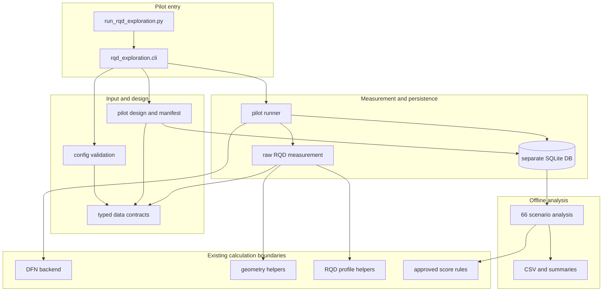
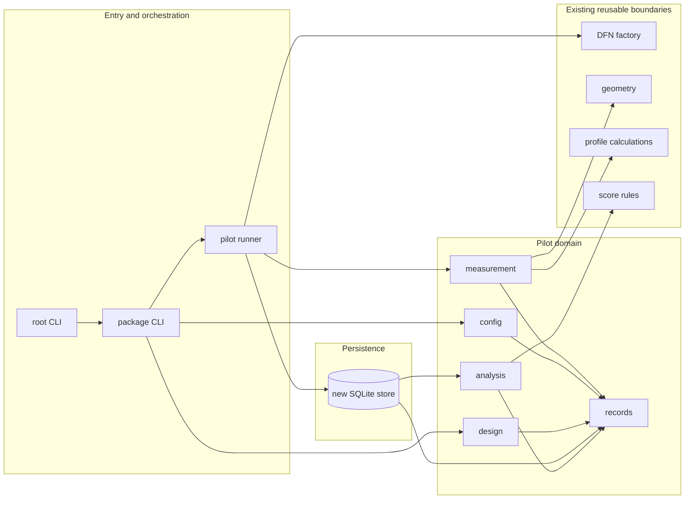

# Implementation Plan v4: RQD Exploration and Cumulative Batch Workflow

- 작성일: 2026-10-28
- 상태 (2026-10-30 22:30 +09:00): 초기 고정 10-signature pilot과 P6.04 분석 완료.
  누적 workflow CUM.01–CUM.07 구현·검증 완료. 다음은 CUM.08 통합 회귀·설정 준비·문서화다.
  CUM.04는 exact YAML bytes와 실행 runtime을 batch identity로 사용한다. Schema v4를 유지하며
  v2/v3 DB는 거부한다. CUM.06 분석 테이블은 v4 store 초기화 시 additive하게 생성한다.
- 전략·요구사항 기준: [RQDExplorationStrategy_20261026/plan.md](RQDExplorationStrategy_20261026/plan.md)
- 범위: 최초 10-signature pilot의 이력과 §5.2의 조건 변경형 append-only 누적 batch workflow. 누적 workflow는 T011 자동 후보 선택과 분리한다.
- 초기 pilot에서 제외: 자동 batch controller(T011). 후속 구현 범위는 2026-10-30 19:11 사용자 재확인에 따라 모든 새 batch를 기존 원자료와 누적 분석에 추가하는 workflow로 재검토한다. 미승인 충분성·예산 배분·weight 정책 및 사용자 확인 없는 simulation 실행은 계속 제외한다.
- 상세화: 2026-10-28 사용자 요청에 따라 §5의 T001–T011을 §5.1의 Phase/Step으로 분해했다.
  실행 중 충돌·미정 사항은 §1.1의 결정 절차를 따르며, 본 갱신은 기능 구현이나 실행이 아니다.
- **Deprecated (2026-10-30 20:02 +09:00):** 기존 pilot의 `target_goals` / 목표 bin 도달성 장부는
  새 누적 workflow에서 폐기한다. 이것은 DFN 입력인 Jn을 선택하거나 검증하는 기능이 아니다.
  신규 workflow는 Jn을 DFN 입력으로 받아 Jn/Jr/Ja 조건별 전체 bin support를 분석한다.
  과거 pilot 계획·결과의 `Q′ > 400` 목표 기록은 역사적 기록으로만 보존하며 새 실행 계약에 적용하지 않는다.
- 이 문서의 CUM.01–CUM.09가 현재 누적 workflow의 구현 계약이다. 그 이전 pilot 단계·테이블·manifest/
  goal-ledger 설명은 당시 pilot의 역사적 설계 기록이며, CUM 결정과 충돌하면 적용하지 않는다.

## 현재 상태 및 다음 재개 지점 (2026-10-30 20:02 +09:00)

### 사용자 요청 결과 삭제 및 변경 계획 (2026-10-30 19:18 +09:00)

사용자의 삭제 요청에 따라 기존 pilot DB `sqlite/qsimex-rqd-pilot.sqlite`와 해당 pilot report
디렉터리 `results/rqd_exploration/qsimex-rqd-pilot-20261030-1535/reports/`를 제거했다.
삭제 후 두 경로가 존재하지 않음을 확인했다. 원본 설정 YAML, pilot2 설정, 코드 및 문서는 보존했다.
이는 과거 pilot 실행/분석의 기록은 남기되 결과 데이터 산출물은 제거한 것이다.

사용자가 원하는 다음 실행은 Jn/Jr/Ja 등 조건을 단계적으로 바꾸면서 원관측을 append-only로 누적하고,
bin coverage를 계속 확인하는 것이다. 기존 pilot의 목표 bin 장부/`target_goals` 기능은 이 목적에
필요하지 않으며 신규 누적 workflow에서 폐기한다. 과거 pilot에 대한 기술·결과 기록은 당시 실행의
역사적 설명으로 남기되, 현재 설정/구현 계약과 혼동되지 않도록 deprecated로 표시한다.

1. **설정 계약과 validation 일반화**
   - Q′ 후처리용 Jn grid는 기존 값들을 보존하되, 신규 DFN 실행 `fixed_jn`은 사용자 선택에 따라
     `{2, 4, 9, 15, 20}`만 허용한다: 2→1 set, 4→2, 9→3, 15→4, 20→5.
     무작위 절리 성분이 필요한 3/6/12는 해당 DFN 모델링 기능이 구현되기 전 실행 입력에서 거부한다.
     15→4와 20→5는 사용자가 선택한 대표/근사 구성임을 manifest와 보고서에 표시한다.
     과거 pilot의 Jn 0.5/1 데이터는 신규 실행 조건에서 제외한다.
     현재 design validation은 점수 grid의 Jn 값을 DFN 입력으로 받아들이지만, 신규 누적 실행은
     확정한 DFN 실행용 Jn 집합과 set-count 매핑만 허용한다. 기존 target-goal validation 및
     `target_goals` 필드는 새 누적 workflow에서 제거한다. Bin coverage는 goal 목록 없이
     관측의 전체 Jr/Ja score grid에서 계산한다.
   - Jn/Jr/Ja의 역할을 분리한다: Jn 및 set 구성은 DFN 생성조건, Jr/Ja는 현재 구현상 사후 점수화 조건.
     Jr/Ja 값이나 조합이 변해도 DFN을 재생성하지 않고 보존된 원관측을 재분석한다.
   - Barton mapping을 검증 가능한 조건 입력으로 반영한다. 3/6/12 random-joint categories는 현재
     후속 범위로 제외한다. 별도 random-joint DFN 모델을 나중에 구현하려면 추가 성분의 orientation/
     dispersion과 P32 배분을 명시하고 사용자와 다시 합의한다.
   - 기존 pilot `target_goals`, high-bin goal ledger 및 목표 도달성 경로는 신규 누적 workflow에서
     deprecated/제거한다. 이를 필수 설정·manifest·분석·보고 입력으로 요구하지 않는다.
2. **동일 DB에 여러 batch append**
   - 기존 저장소는 각 행을 manifest/batch 키로 분리하므로, 기존 데이터를 지우거나 덮어쓰지 않고
     새 config/manifest batch를 같은 DB에 등록·실행하는 명시 경로를 추가한다.
   - 기존 `resume`은 같은 batch의 중단 재개로 유지하고, 새 batch 추가는 별도 명령/옵션으로 구분한다.
     내부 batch ID는 자동 생성·보존하여 사용자가 manifest 식별자를 수작업하지 않게 한다.
   - transaction, 중복 설정/실행 방지, 새 batch 등록 후 중단/재개, 재시도 lineage 및 원자료 불변성을
     검증한다. 기존 DB가 없을 때는 누적 DB를 초기 생성하는 흐름도 같은 계약으로 지원한다.
3. **누적 분석·bin 중심 보고**
   - 선택된 모든 성공 batch 원관측을 누적 analysis dataset revision으로 읽고, dataset provenance와
     분석 조건/Jr/Ja catalog를 revision/fingerprint에 포함한다.
   - 새 결과가 들어오면 이전 관측을 정확히 한 번 포함해 re-score하고, 구 revision/analysis 결과는
     immutable하게 남긴다. 중복 seed·반복 실행은 provenance로 추적하고 independent signature/
     realization 수를 과대계상하지 않는 정책을 테스트한다.
   - 우선 보고서는 Jn × Jr × Ja × modality/profile × Q′ bin별 valid positive support, 점유 여부,
     independent signature/realization 수, sample count를 중심으로 한다. BH 길이와 face 면적,
     또는 상이한 Jr/Ja 파생 점수 support를 합산하지 않는다.
   - 보고서에는 전체 누적 bin coverage와 batch별 유입/변화량을 나란히 표시해 “이번 추가분”과
     “전체 누적분”을 혼동하지 않게 한다.
4. **통합 검증 및 수동 실행 인계**
   - pilot2를 포함해 config validation → memory-only preview → batch append/resume → cumulative analyze
     경로를 테스트한다. `target_goals`가 없는 pilot2가 유효하고 전체 bin coverage를 수행할 수 있어야 한다.
     기존 Jn 0.5/1 high-bin 목표는 신규 목표로 변환하지 않고 역사적 기록으로만 남긴다.
   - regression tests로 여러 Jn batch 추가, 기존 데이터 불변, Jr/Ja 재분석의 DFN call 0회,
     all-bin coverage totals, duplicate/retry/provenance, report cap 및 heartbeat를 확인한다.
   - 구현·테스트와 사용자 승인 후에도 실제 DFN/simulation은 사용자가 직접 실행한다. 구현 단계에서는
     pilot DB나 GPU simulation을 실행하지 않는다.

**별도 후속 설계가 필요한 DFN 표현:** random-joint set의 방향 분포/κ 및 P32 배분; Jn 20 crushed/earthlike
상태의 DFN 표현; 누적 revision에서 제외할 attempt/retry 및 동일 realization 처리 기준; 우선 보고서에서
bin occupancy를 지원량 외에 어떤 측정 단위/최소 표본으로 표현할지. 이 값들은 이번 계획에서 임의로 확정하지 않는다.

### 누적 탐색 요구사항 업데이트 (2026-10-30 19:11 +09:00)

사용자의 핵심 목적은 실행 가능한 단위로 simulation을 나누어 수행하고, Jn/Jr/Ja 등 조건을 변경하면서
기존 결과를 보존·누적해 bin coverage를 확장하는 것이다. `resume`은 동일 frozen manifest의 중단/미완료
작업 재개이지 새 조건 추가가 아니며, 이 요구를 만족하지 않는다. 새 batch/manifest는 사용자 과학적
워크플로에서 불필요한 수동 식별자 관리 부담이 되지 않도록 provenance 목적으로 내부 관리되어야 한다.

- Append-only raw observation history: 설정, batch, attempt, 조건 및 provenance를 보존하고 기존 결과를
  덮어쓰지 않는다. 조건별 적격성과 재시도 처리 정책은 설계 시 명시한다.
- Jn은 DFN generation input이다. 기록된 Barton 대응에 따라 새 Jn/절리군 조합을 batch로 추가할 수 있어야
  한다. Random-joint Jn 상태는 현재 모델에서 표현 지원 여부 확인/구현을 별도 표시한다.
- Jr/Ja는 현재 post-processing scenario axes다. 이들의 분석 조합/범위를 바꾸는 것만으로 DFN을 재생성하지
  않고 raw observations를 재점수화하며, analysis configuration/version을 분리 보존한다.
- Cumulative analysis는 여러 batch의 원관측을 집계하되 Jn/Jr/Ja/modality/profile별 bin support와 독립
  signature/realization을 구분한다. BH 길이/face 면적 및 파생 시나리오 점수를 독립 관측처럼 합산하지 않는다.
- 현재 `run`은 기존 DB 경로를 거부하고, `resume`은 frozen manifest 일치를 요구하며, `analyze`는 단일
  manifest revision 대상이다. 따라서 end-to-end 누적은 아직 지원되지 않는다. Pilot2는 Jn 2/4 설계와
  0.5/1 target_goals가 불일치하므로 이 상태로 실행하지 않는다. **이것은 19:18 당시의 상태 기록이며,
  20:02 결정으로 target_goals 기능은 신규 workflow에서 폐기되었다.**
- 다음 기술 단계는 §5.2의 CUM.01 누적 workflow 계약 확정이다. 그 뒤 CUM 단계는 한 단계씩 순서대로
  진행하고, 각 단계의 검증·기록·사용자 확인 후 다음 단계로 넘어간다. 사용자 검토 전에는 코드 구현을
  시작하지 않으며, 실제 simulation은 구현·검증과 분리해 사용자가 직접 실행한다.

- **최신 상태 — T010 pilot 및 P6.04 분석 완료 (2026-10-30 16:42 +09:00):**
  사용자가 resume 실행 로그를 공유했다. Assistant는 16:32경
  `sqlite/qsimex-rqd-pilot.sqlite`를 `mode=ro`/`query_only=ON`으로 확인했다.
  10/10 jobs에 attempt 하나씩 있으며 전부 `succeeded`; failed/running 0, location status 1,210건은
  전부 `observed` (BH 600, face 610), raw observation도 1,210건 모두 valid다. 각 job은 BH 60 +
  face 61 observations를 저장했다. 새 resume invocation은 이미 완료된 8개를 skip하고, 기존 running
  attempt sample 3을 재개 완료, sample 4를 새로 실행 완료해 invocation `simulation_count=2`,
  `termination_reason=jobs_complete`로 정상 종료했다. 사용자 로그상 sample 3은 1,530.9초,
  sample 4는 0.3초였다. DB attempts의 runtime 합은 약 2,178.97초이며 이는 stored attempt runtime 합,
  전체 벽시계 시간을 뜻하지 않는다.
  - Raw RQD 산술 평균(동일 weight의 개별 observations; support-weighted 분석 아님):
    `jn-half` BH n=300 mean 90.56, range 39.31–100; face n=305 mean 93.67, range 68.08–100.
    `jn-one` BH n=300 mean 90.48, range 10.17–100; face n=305 mean 80.44, range 1.58–100.
  - 사용자의 `analyze` 승인 후 16:41 +09:00에 정식 분석을 실행했다. Dataset revision 1건
    (SHA-256 `6d18312e975fbaf079d23916e93a7b5c4d8483e7e737a73f83f756cd983efd5e`),
    analysis run 1건 (fingerprint `2a83f1755b1d9e1fc0c41a0024b79af6986c5f80c96fe6ee112e63f9a7ea23c3`),
    derived score 79,860건이 생성됐다. 66 scenarios × 1,210 observations와 일치한다.
    Raw observations는 변경되지 않았고 simulation은 시작하지 않았다.
  - CSV 10개와 `report_summary.json`은
    [pilot reports](results/rqd_exploration/qsimex-rqd-pilot-20261030-1535/reports/)에 생성됐다.
    실제 CSV data rows 합계는 127,232건이며 각 파일 cap 이하이다.
  - 여섯 BH target goal은 모두 `comparable`, 유효 support 300/300 m, signature/realization 각 5개다.
    Reached support fractions: `high-jn-1-jr-4-ja-075` 82%;
    `high-jn-half-jr-2-ja-075` 84.33%; `high-jn-half-jr-3-ja-075` 99%;
    `high-jn-half-jr-3-ja-1` 91%; `high-jn-half-jr-4-ja-075` 100%;
    `high-jn-half-jr-4-ja-1` 99%. 이는 관측 표본의 지지 길이 비율이지 통계적 보장은 아니다.
  - 실행은 사전 고정된 10-job manifest를 모두 소진했다. 결과를 반영해 signature를 갱신하거나 다음 batch를
    생성하지 않았다. 현재 구현 계획은 adaptive batch controller T011을 후속 정책 검토로 보류한다.
    전략의 고수준 흐름은 관측 기반 다음 batch 갱신을 설명하므로 “초기 10개만 실행”과 “관측에 따라
    signature를 갱신하며 반복” 중 pilot이 어느 범위여야 하는지 정책 차이가 남는다. 다음 batch/추가 DFN 실행 전
    사용자의 의도를 확인해야 한다.
  - 사용자 로그에서 sample 3은 25분 30.9초 동안 시작/완료 외 단계 로그가 없었다. 이는 새 계측 코드가
    실행 전에 이미 시작한 프로세스에 소급 적용되지 않아 단계별 heartbeat를 남기지 못한 것과 일치한다.
    구체적으로 DFN generation, BH intersection, face measurement 중 어느 단계가 시간을 사용했는지는
    이번 실행 자료로 구분할 수 없다. 새 60초 heartbeat는 다음 invocation부터 적용된다.
  - 실행 전 DB 확인은 read-only였다. 이후 `analyze`는 사용자 승인 범위에서 DB revision/analysis/score
    및 report files를 생성했다. 추가 simulation 또는 다음 batch는 실행하지 않았다.
    다음 단계는 signature update에 대한 전략-구현 범위 차이를 사용자와 합의하는 것이다.

- **완료:** Phase 1–4 (T001–T007, P1.01–P4.07) 구현·검증. 특히 전체 175개 테스트 통과.
  이미 완료한 작업을 다시 시작하거나 재실행할 필요가 없다.
- **완료:** T008/P5.01–P5.02의 승인된 66-scenario 점수/bin/fingerprint 계산 및 검증.
  Focused 10개, 연관 regression 47개, 전체 185개 테스트가 통과했다.
- **완료:** T009/P5.03 분석 core. Profile별·scenario별 support weighted Q′ summaries,
  BH–face 탐색적 비짝지음 대비, BH–P32 points, 목표 거리/도달 support, location status 및
  자료 한계 표시를 구현했다. Focused 19개, 전체 194개 테스트 통과.
- **완료:** T009/P5.04 계약 기반 report exporter와 bounded row-count preflight.
  Focused report tests 6개와 전체 `dlo-cq` suite 200개가 통과했다. D012 승인은 11:02:44와
  11:06:02 +09:00에 기록했다.
- **완료:** T009/P5.05 SQLite raw dataset loader와 `analyze` CLI. `dlo-cq` 전체 207개
  테스트가 통과했다. Schema v2는 v1 DB를 migration하고 revision별 원 observation attempt
  provenance를 별도 immutable relation에 보존한다. Reanalysis는 66개 scenario score를
  `derived_scores`에 idempotently 저장하며 CSV/summary도 재현한다.
- **진행 중:** 2026-10-30 10:48:51 +09:00 사용자 지시에 따라 매 결과/진행을 timestamped로
  기록한다. 10:49:39 +09:00에 P5.04 CSV 계약 검토를 시작하고, 10:51:36 +09:00에
  산출물·열·정렬·단위·NULL·행수 제안을 문서화하고 11:02:44 및 11:06:02에 각각 형식 선택과
  exact headers/row caps 승인을 받았다.
- **결정:** D005의 P5.03 분석 범위는 사용자 승인·구현·검증했다. BH와 face는 서로 다른
  분포이며 같은 값을 기대하지 않는다. Support는 BH 길이(m)와 face 면적(m²)를 각각 보존하고,
  어떤 profile/scenario끼리도 support를 합산하지 않는다. 동일 scenario의 가중 중앙값·bin
  support 비율 차이는 탐색적 기술 대비이며 관측 짝비교·유의성 검정이 아니다. Detection/miss
  비율은 보류하며, 현재 evidence에 없는 face 총 교차 수·tunnel-axis 교차 수를 임의로 만들거나
  수집 계약을 바꾸지 않는다. CSV 열·정렬·NULL·요약 계약은 P5.04에서 별도 확인·승인했다.
- **완료:** T010/P6.01 config validation과 in-memory MLX manifest preview를 2026-10-30
  15:07:50 +09:00에 수행했다. `dlo-cq`에서 config 검증이 통과했고, 임시 review ID 기준 manifest는
  10 jobs, BH 600 locations, face 610 locations, 총 1,210 locations였다. runtime은 CPython 3.11.15,
  macOS 27.0.1 arm64, NumPy 2.4.3, SciPy 1.17.1, MLX 0.31.1, `Device(gpu, 0)`이며 MLX GPU
  preflight도 통과했다. config YAML SHA-256은 `33d1629f4cd8eead88920ae4b2d2c78ee5c01c734c4fb4401b0824a4f1959ada`,
  review manifest ID는 `p6-01-review-20261030-1507`, preview manifest SHA-256은
  `25975ab2b6eb76d4b402e4734cc034585aa2a73fed82fd2bc29e4f7fabf040d0`이다. ID와 hash는
  해당 preview에만 해당하며 최종 실행 식별자로 승인·확정된 것이 아니다.
- **완료:** T010/P6.02 pre-run 검토 자료와 설정 확인을 2026-10-30 15:44:36 +09:00에 마쳤다.
  Acceptance criteria, D-ID, limitations/risks, report caps, run/resume 경계를 제시했고 사용자가
  D002를 resolved로 선택했다. 사용자가 지정한 결과 디렉터리/파일명 `sqlite/qsimex-rqd-pilot.sqlite`,
  명령당 상한 1000을 기록했다. 최종 manifest ID `qsimex-rqd-pilot-20261030-1535`의 preview도
  통과했다. 이는 실행 준비 검토 완료이지 pilot 실행 승인이 아니다.
- **완료:** D002는 2026-10-30 15:35:46 +09:00에 사용자 선택으로 `resolved` 처리했다. 사용자는
  P1.05 자료 계약 승인 및 후속 T006/T008/T009 구현이 D002 범위를 충족한다고 판단했다.
- **실행 중단/재개 상태 (2026-10-30 15:48 당시 기록; 아래 16:32 기록으로 대체):** 사용자가 pilot 실행을 명시 승인했으나 assistant 실행 요청은 사용자 지시에 따라
  중단됐고 현재 process는 없다. DB와 manifest는 이미 생성됐다. 2026-10-30 15:48:09 +09:00의 읽기 전용
  점검에서 schema v2, 선택 manifest ID, attempt 0의 첫 job(`jn-half`/`block-half`/sample 0/seed 43)이
  `running`, runtime 0.0 sec, location state 121개 모두 `planned`, raw observations 0건으로 확인됐다.
  이는 첫 job이 완료/commit되지 않았음을 뜻한다. 중단 시점에 in-memory DFN이 생성됐는지는 영속 자료에서
  확인할 수 없으며, resume 때 이 job은 재생성될 수 있다. 이후 프로세스는 실행 중이지 않다.
- **당시 다음 단계:** 사용자가 직접 아래 `resume` 명령을 실행한다. 기존 DB가 있으므로 `run`을 다시 쓰면 안 된다
  (CLI가 기존 DB 경로를 거부함). 이번 assistant는 실행하지 않는다. 1000은 invocation별 최대 상한이며
  preview의 전체 job 수는 10이므로 최대 10개 job이 실행된다; cap 1000이 1000회 실행을 뜻하지 않는다.
- **과거 시뮬레이션 gate:** 첫 pilot 실행 전 config, manifest, DB path, cap 및 명령을 검토받았다.
  이 gate는 사용자 승인과 실행으로 충족됐으며, 다음 추가 simulation에는 새 승인과 합의가 필요하다.
- **별도 보류:** T011/Phase 7 adaptive batch controller는 pilot 결과 검토와 별도 정책 승인
  전까지 deferred이며, 현재 pilot 범위에 포함되지 않는다.
- **실행 경계 (15:48 당시):** pilot DB와 manifest는 명시 승인된 실행 시도에서 생성됐다. 첫 job은
  미완료였고 추가 실행 전 상태였다. 아래 16:32 기록에서 최종 실행 상태로 갱신했다.
- **완료 범위:** P5.05는 job별 최고 `succeeded` attempt만 snapshot에 투영하고, 실패/partial
  attempt 원자료는 보존하되 분석에서 제외한다. Immutable JCS/SHA-256 revision, analysis run,
  attempt lineage와 FK를 통한 scenario score 적재, 저장 전 CSV row-count preflight를 연결했다.
  같은 fingerprint 재실행 시 점수 행이 늘지 않으며 raw observation/status는 변경되지 않는다.
  schema-v1 revision에 새 attempt provenance가 없는 경우 이를 추측해 채우지 않고 명시적 검증
  오류로 처리한다.
- **집 재개 checklist (당시 상태: 2026-10-30 11:33:57 +09:00; 아래 P6.01 기록이 이를 갱신):**
  1. `ImplementationPlan_v4.md`, strategy plan, `tasks-to-impl.yaml`, `readme.md`의 최신 상태와
     작업 트리 변경을 확인한다. 완료한 Phase 1–5/P5.05를 재수행하지 않는다.
  2. conda `dlo-cq`만 사용한다. 삭제된 상위 `.venv`를 찾거나 만들지 않는다.
  3. P6.01에서 config validate/manifest preview, environment/runtime, job/location/goal 수,
     expected report row caps·output directory, DB schema v2 및 resume 명령을 실제 값으로 확인해
     두 기준 문서와 README에 남긴다. 이 단계는 pilot DB/DFN/simulation을 만들지 않는다.
  4. P6.02에서 acceptance criteria, D-ID, limitations, risks, config/manifest/budget/DB path와
     실행 명령을 선생님께 제시한다. 명시 승인 전 실행하지 않는다.
  5. 승인된 범위에서만 pilot을 실행한다. 중단되면 확인된 DB를 대상으로 `resume`하며, 매 invocation의
     `maximum_simulations`는 별도 상한이다. 관측 데이터가 생기면 `analyze`를 수행하고 결과를 기록한다.
  6. T011 adaptive batch controller와 추가/대규모 simulation은 별도 보류이며 자동으로 시작하지 않는다.
- **P6.01 실제 확인 결과 (2026-10-30 15:07:50 +09:00):**
  - `conda run -n dlo-cq python run_rqd_exploration.py validate --config config/rqd_exploration_pilot.yml`
    통과: 2 designs, 10 samples, 6 target goals.
  - `conda run -n dlo-cq python run_rqd_exploration.py preview --config config/rqd_exploration_pilot.yml --manifest-id p6-01-review-20261030-1507`
    통과: 10 jobs, BH 600, face 610, total 1,210 planned locations. `simulation_started=false`,
    `database_written=false`.
  - runtime: CPython 3.11.15; macOS 27.0.1 arm64; NumPy 2.4.3; SciPy 1.17.1; MLX 0.31.1;
    `Device(gpu, 0)`. MLX GPU operation preflight returned successfully.
  - 승인된 CSV 파일별 최대 row cap: observation_scenarios 79,860; profile_summaries 264;
    profile_bin_support 2,904; bh_face_distribution_contrasts 132; bh_face_bin_contrasts 1,452;
    qprime_p32 39,600; target_observations 1,800; target_summaries 6; location_status 1,210;
    unavailable_profiles 6. 합계 127,234 rows는 상한이며 실제 관측/생성 행수가 아니다.
  - 기본 보고 경로 규칙은 `results/rqd_exploration/<manifest_id>/reports`다. 현재 결과 루트에는
    `.gitkeep`만 있고 pilot DB 및 preview report directory는 없다. DB schema 구현 버전은 v2이며,
    resume는 존재하는 DB와 저장 manifest가 필요하다. 이번 preview에서는 DB나 보고서를 만들지 않았다.
  - DB path, simulation budget 및 최종 manifest ID는 사용자 검토 대상이라 미정이다. review ID/hash로
    실제 run을 시작하지 않고, 최종 ID 선정 시 해당 ID로 preview를 다시 해야 한다.
- **P6.02 최종 검토값 및 preview (2026-10-30 15:44:36 +09:00):**
  - 사용자 선택: D002 `resolved`; 프로젝트 루트 `sqlite/` directory; DB filename `qsimex-rqd-pilot.sqlite`;
    per-invocation `maximum_simulations=1000`. Assistant가 날짜 기반 manifest ID를 생성하도록 사용자가 허용했다.
  - Final review ID `qsimex-rqd-pilot-20261030-1535`; `conda run -n dlo-cq python run_rqd_exploration.py preview --config config/rqd_exploration_pilot.yml --manifest-id qsimex-rqd-pilot-20261030-1535` 통과.
    Manifest SHA-256 `9bc488720cbea5c8ba43b1e5fc0665327baaca0544a9e71911fb93dace834eea`;
    config SHA-256은 앞서 확인한 동일 값 `33d1629f4cd8eead88920ae4b2d2c78ee5c01c734c4fb4401b0824a4f1959ada`.
    10 jobs/600 BH/610 face/1,210 locations; `database_written=false`, `simulation_started=false`.
  - 당시 preview 직후에는 DB file이 없었다. 이후 사용자는 실행을 명시 승인했고 assistant run tool 호출은
    중단됐다. 현재 DB/attempt 상태와 그 다음 사용자 지시는 아래 15:48:09 기록을 따른다.
  - P6.02 review materials/settings는 완료됐지만 pilot 실행은 중단 상태다. DB/manifest는 저장됐고,
    완료된 simulation/관측 결과는 확인되지 않았다. 사용자가 직접 이어서 실행한다.
- **중단된 실행 호출 및 읽기 전용 DB 확인 (2026-10-30 15:48:09 +09:00):**
  - Assistant가 명시 승인된 `run` 명령을 호출했으나 도구 호출은 interrupted 상태로 끝났다. 사용자는
    이후 “실행은 내가 할께. 명령어만 알려줘”라고 지시했으므로 assistant는 더 실행하지 않는다.
  - Process 검사 결과 해당 명령은 현재 실행 중이지 않다. SQLite DB는
    `sqlite/qsimex-rqd-pilot.sqlite`에 존재하며 1,789,952 bytes. `conda run -n dlo-cq`의 read-only
    SQLite 조회 결과 schema version 2, 저장 manifest 1개, attempt 1개(`jn-half`, `block-half`,
    sample 0, seed 43, attempt 0, status `running`), observation 0건, location status 121건 모두 `planned`.
  - 첫 job attempt가 성공 commit 전 중단된 상태다. 미생성/미저장 DFN은 resume 시 다시 생성될 수 있다.
    기존 DB가 있으므로 다음 CLI는 `resume`이어야 한다. 실행 재개는 사용자가 직접 하며 assistant가 실행하지 않는다.
  - 10 jobs는 frozen manifest의 전체 job 수이며 한 job당 새 simulation 하나다. `maximum_simulations=1000`
    은 각 CLI 호출에서 새로 시작할 수 있는 최대 수로, 현재 10 jobs를 초과하지 못하므로 상한으로 작동하지
    않는다(이미 시작/완료한 job은 runner 상태에 따라 처리). 이는 1000개 실행 요청이 아니다.
  - 사용자 직접 재개 명령:
    `conda run -n dlo-cq python run_rqd_exploration.py resume --config config/rqd_exploration_pilot.yml --manifest-id qsimex-rqd-pilot-20261030-1535 --database sqlite/qsimex-rqd-pilot.sqlite --maximum-simulations 1000 --confirm-execution`
- **터미널 진행 로그 구현·검증 (2026-10-30 15:58:19 +09:00):**
  - `execute_frozen_jobs`에 optional progress callback을 연결해 job 시작/재개·완료·실패·중단,
    완료/실패 job skip, simulation budget 종료를 알린다. CLI는 UTC timestamp와 함께 메시지를
    stderr에 출력하고 즉시 flush한다. 실행 중인 프로세스에는 소급 적용되지 않는다.
  - Runner/CLI focused tests 12개 통과; 변경 파일 `py_compile` 통과; `git diff --check` 통과.
    Pylance signature compatibility 도구는 기존 callback 생략 호출부를 포함해 6개를
    incompatible로 표시했으나, 새 인자는 `None` 기본값의 optional keyword-only parameter이며
    기존 runner 테스트가 실제 생략 호출을 포함해 통과했다. 도구 결과는 false positive 가능성이 있어
    별도 type-check는 수행하지 않았다.
  - 로그는 job 경계 단위다. 단일 DFN 생성/측정 job 내부 heartbeat나 location별 progress는 없다.
    다음 실행에서만 적용되며 이미 실행 중인 사용자 프로세스는 변경되지 않는다.
  - 사용자는 `dlo-cq`를 활성화한 터미널에서 `python -u run_rqd_exploration.py resume ...`를
    직접 실행할 수 있다. 이는 `conda run` 출력 캡처를 피하면서 같은 승인 환경을 사용한다.
    Assistant는 재개·DB 조회/변경을 하지 않았고, 마지막 DB 확인(15:48) 이후 사용자가 실행했는지는
    알 수 없다. 다음 단계는 사용자가 직접 resume한 뒤 상태를 공유하는 것이다.
- **단계별 진행 관측성 추가 (2026-10-30 16:24:15 +09:00; 최종 검증 16:25:49):**
  - 사용자는 job 시작/끝 로그만으로는 pilot의 장시간 계산을 판단할 수 없다고 지적하고, heartbeat 60초와
    단계+BH interval/face station 카운터+DFN joint-set 상태를 선택했다.
  - 실행 단계는 DFN joint-set 샘플링(queued set 카운터), GPU array materialization, BH interval
    intersection query batches, face station iteration, persistence다. 긴 단계에는 60초마다 현재 단계,
    최신 카운터/세부 상태, 단계 경과 시간을 stderr에 flush 출력한다.
  - MLX DFN은 joint-set별 생성 연산이 지연 평가되므로 joint-set 카운터는 GPU 완료 퍼센트가 아니라
    배열 생성이 준비된 set 수다. 별도 `DFN materialization` 단계는 `mx.eval` 완료 전까지 heartbeat한다.
    Face station 카운터는 station 단위이며 한 station 내부 GPU 교차계산의 진행률은 제공하지 않는다.
    로그는 성공 보장·GPU utilization·완료 ETA가 아니다.
  - `conda run --no-capture-output -n dlo-cq python -m unittest discover -s src/test -p 'test_*.py' -q`
    전체 209개 통과. `py_compile` 및 `git diff --check` 통과; heartbeat timer, DFN materialization
    status, backend query batch counts, BH/face counters를 포함한다.
    Pilot DB는 조회·변경·실행하지 않았다. 이번 변경은 현재 실행 중인 프로세스에는 소급 적용되지 않는다.
- **P6.02 사용자 검토 패키지 (2026-10-30 15:10:43 +09:00; 사용자 응답 대기):**
  - Acceptance criteria §7.1: criteria 1–9에 구현/test evidence가 기존 P1–P5 기록에 있다. 이번 turn에서
    전체 suite는 다시 실행하지 않았다. Criterion 10(파일럿으로 충분성·일반 자동 탐색 완료·현장 안전성을
    선언하지 않음)은 pilot result review 이후에도 claim 금지 경계다. P6.01 preview 자체는 acceptance
    runtime/manifest 확인이며 pilot scientific outcome 검증이나 G3/G4 통과가 아니다.
  - Relevant D-ID: D004 resume policy verified; D005 analysis/profile scope verified (unavailable profiles,
    no detection/miss inference); D006 post-pilot policy deferred; D012 report schema and row caps resolved.
    D002 (Decision 002) concerns the integrated SQLite DDL, execution snapshot fields, and raw dataset serialization.
    The historical register said `open`, while later P1.05/T006/T008/T009 records documented approval and implementation.
    User selected `resolved` on 2026-10-30 15:35:46 +09:00, agreeing that the later contract approval and implementation
    satisfy D002's scope. Historical work-log entries remain unchanged; current register is updated below.
  - Risks/limitations: CPU fallback is unsupported; MLX GPU required. One invocation's simulation cap is not a
    cumulative campaign cap; each resume receives a new cap and run-level goal status is not persisted.
    An interrupted in-flight job before commit may regenerate its DFN on resume. The fixed 10-signature design
    uses one common realization seed; it cannot establish independent-seed repeatability or general sufficiency.
    Detection/miss, face areal density, and tunnel-axis intersection profiles are unavailable under current
    measurement contract. Report row caps are ceilings, not predicted observed rows. T011 remains deferred.
  - User review choices still open: final manifest ID (preview again using chosen ID), new DB file path, and
    positive per-invocation `maximum_simulations`. No DB path or budget is proposed as an approved default.
    `run` template:
    `conda run -n dlo-cq python run_rqd_exploration.py run --config config/rqd_exploration_pilot.yml --manifest-id <user-selected-id> --database <user-selected-new-db-path> --maximum-simulations <user-selected-positive-integer> --confirm-execution`.
    `resume` uses the same config/ID/database with a user-selected new positive per-invocation cap; it requires
    an existing DB with an exactly matching stored manifest. These are command templates, not run authorization.
  - P6.02 remains pending user review. No execution command was run; no DB, report, DFN, or simulation was created.
- 재개 시 이 현재 상태와 최신 시각 기록을 기준으로 삼고, 아래 과거 이력의
  "다음 작업" 문구는 당시 상태 기록으로만 읽는다.
- **복구 한계:** 저장 완료된 job은 재개 시 건너뛰지만, 결과 commit 전 중단된 in-flight job의
  DFN은 재생성될 수 있다. 예산은 명령별 상한이며 resume 명령마다 새 양수 상한을 받는다.
- 실패 전 commit되지 않은 현재 job은 DFN 및 측정 결과를 메모리에만 보유하므로 재개 때
  해당 job의 DFN을 다시 생성할 수 있다. 이미 완료·저장된 다른 job은 재실행하지 않는다.
- 실제 pilot DB 생성/초기화·manifest 영속화·DFN 생성·simulation은 승인되지 않았고 수행하지
  않았다. 저장 테스트는 `:memory:` 및 임시 파일 SQLite만 사용했다.
- Python 작업은 conda `dlo-cq`에서만 수행한다. 테스트·검증은 `conda run -n dlo-cq ...`를 사용한다.
  사용자가 파일럿 로그를 직접 볼 때는 동일 환경을 활성화한 뒤 `python -u ...`로 실행할 수 있다.
  사용자의 2026-10-30 요청으로 저장소 상위
  `/Users/myungkyusong/Documents/Develop/09. DFN/.venv`를 삭제했으며 다시 만들거나 사용하지 않는다.
- 마지막 검증 증거와 상세 기록은 아래 작업 이력 및 전략 plan의 최신 timestamped 기록을 따른다.
- **현재 상태 확인 (2026-10-30 15:04:43 +09:00):** 요청에 따라 기준 문서, checkpoint, README 및
  작업 트리만 확인했다. T009/P5.05가 완료됐고 T010/P6.01은 아직 시작하지 않았다. 다음 단계는
  사용자 지시 후 `dlo-cq`에서 config validate와 in-memory manifest preview를 수행하고,
  실제 runtime/규모/output/resume 정보를 기록하는 것이다. 이번 확인에서는 Python 명령이나
  pilot 작업을 실행하지 않았다. 작업 트리에 이미 있던 미커밋 변경은 보존했다.

## 1. 문서 역할과 우선순위

구현 관련 주 기준 문서는 다음 두 파일이다.

1. **전략 및 요구사항의 권위 문서:** `Specification/RQDExplorationStrategy_20261026/plan.md`.
   사용자 합의, 연구 의미, 입력·출력 원칙, 승인값, 미결 정책과 수용 기준을 관리한다.
2. **실행 순서 및 작업 인계 문서:** `Specification/ImplementationPlan_v4.md` (이 문서).
   파일럿 구현의 순서, 작업 간 의존성, 테스트 전략과 완료 경계를 관리한다.

두 문서가 불일치하면 전략 계획의 최신 timestamped 사용자 합의를 우선하고, 구현계획을
그에 맞게 갱신한다. 상세 schema/API를 다루는 T002 검토를 포함해, 이 계획은 상세 자료
계약 자체를 대신하지 않는다.

### 1.1 상충·미정 사항의 기록 → 결정 → 구현 절차

- **기준:** 전략 plan은 연구 의미·승인값의 권위, implementation plan은 작업 순서·검증의
  기준이다. 보관 문서와 기존 코드는 참고 근거이며 두 현행 문서의 최신 합의를 덮어쓰지 않는다.
  아래 D001처럼 이미 timestamped 합의로 해소되는 차이는 근거를 기록해 정합화하고 재질문하지 않는다.
- **새 선택 발견:** 실행자가 아래 대장에 `Dnnn`, 발견 시각, 양쪽 문서의 절·상충 문구,
  영향을 받는 Step/REQ, 선택지·권고·영향을 기록한다. 상태는 `open`으로 두고 의존 Step만
  `blocked` 처리한다. 미결값을 기본값·임시 성공·추측한 알고리즘으로 대체하지 않는다.
- **사용자 결정:** 동작·범위·자료 의미가 바뀌는 선택은 관련 질문을 묶어 사용자에게 제시한다.
  응답을 받기 전에는 권고를 승인으로 간주하지 않는다. 다른 독립 Step은 진행할 수 있다.
- **동기화:** 승인 시 원문 취지·시각·적용 범위·대체한 결정·근거를 전략 plan에 기록하고,
  이 문서의 대장·Step·계약·의존성과 필요 시 checkpoint를 함께 갱신한다.
- **구현 재개:** 승인 계약에 맞춘 검증 조건을 먼저 확정하고 영향 코드·테스트만 변경한다.
  상태는 `open → decided → applied → verified`로 추적한다. `decided`에는 승인 근거가
  필요하고, `verified`에는 문서 또는 코드의 검증 증거가 필요하다. 문서 정정과 기능 완료는 별개다.
- **단계 인계:** 완료 Step·산출물·검증 명령/결과·남은 D-ID·다음 실행 가능 Step을 이 문서에
  기록한다. 양쪽 문서에 task 체크박스를 유지할 경우 T-ID 완료 상태도 함께 맞춘다.
- **다음 단계 승인:** 다음 Step 제안은 착수 승인이 아니다. 완료 결과·검증·한계와 다음 후보를
  보고하고 사용자 지시를 기다린다. 별도 지시 전에는 제안된 다음 Step을 시작하지 않는다.
- **현재 상태:** 과거 재개 메모는 이력으로 보존한다. 최신 완료/대기 상태는 문서 앞부분의
  timestamped 현재 상태와 가장 최근 작업 로그로 확인하며, 오래된 재개 지시를 현재 상태로
  해석하지 않는다.

#### 결정·충돌 대장 (2026-10-28 상세 계획 기준)

| ID / 상태 | 확인 사항·근거 | 처리 및 결정 경계 | 영향 Step |
|---|---|---|---|
| D001 / verified (문서) | 이 문서의 “G0 전부 미승인”으로 읽히는 설명과 전략 §5·§11.2·§11.4의 pilot G0 간소 계약 승인 상태가 다름 | 최신 전략을 적용한다. 이미 승인된 schema version 1, ID·상태·evidence·JCS/SHA-256을 재결정하지 않는다. 남은 통합 테이블/열/FK/NULL/check 및 fingerprint 필드 묶음만 T002에서 제시·확인한다. 두 문서와 checkpoint 정합화 확인; G0와 T002 검토 완료를 동일시하지 않음 | P1.01, P1.03–P1.05 |
| D002 / resolved (2026-10-30 15:35:46 +09:00) | 통합 SQLite DDL, execution snapshot 필드, raw dataset serialization 계약의 확정 여부. 과거에는 미완료로 기록됐으나 후속 P1.05 계약 승인 및 T006/T008/T009 구현 기록과 대조 필요 | 사용자는 후속 P1.05 자료 계약 승인과 T006/T008/T009 구현이 범위를 충족한다고 판단해 resolved를 선택했다. 이 선택은 미해결인 별도 pilot 실행값이나 실행 승인을 뜻하지 않는다. | P1.03–P1.05; T002,T006,T008,T009 |
| D003 / resolved (P1.07a) | RFC 8785 준수 구현 방식과 dependency 제약 결정이 남아 있었음 | 사용자 확인(2026-10-29): `rfc8785==0.1.4`를 의존성으로 사용한다. 공통 utility와 RFC 동작 테스트를 P1.07a에서 구현했다 | P1.07a |
| D004 / verified (P4.02 storage boundary) | 중단된 `running` attempt의 재개 정책과 전체 attempt runtime 범위가 미정이었다 | 사용자 합의(2026-10-29): 재실행 시 같은 attempt ID를 복구하고 이미 저장된 관측은 보존·건너뛰며 `planned` 위치만 이어간다. 새 attempt/retry를 자동 생성하지 않는다. runtime 범위는 준비부터 최종 저장까지이며 중단시간은 제외한 활성 실행 구간을 합산한다. 비정상 종료로 잃은 구간은 마지막 checkpoint 누적값을 lower bound로 표시한다. Runner timer 연결은 P4.04에서 수행한다. | P4.02–P4.05 |
| D005 / verified (P5.03 scope) | raw BH/face와 66 scenario는 확정. 참조 profile·일부 support/대응 계산 범위 확인이 필요했음 | 사용자 결정(2026-10-30): 현행 자료로 가능한 profile만 구현하고 missing input profile은 unavailable로 표시한다. BH·face는 서로 다른 분포로 보고 같아야 한다고 가정하지 않는다. Modality/profile/scenario별 actual support를 분리한다(BH m, face m²). 같은 scenario의 가중 중앙값·bin support 비율 차이는 관측을 짝짓지 않는 탐색적 기술 대비로만 표시한다. Detection/miss는 산식 승인 전 보류한다. 추가 측정·필드·pilot DB 변경은 하지 않는다. P5.04 CSV schema details remain there | P5.03–P5.04 |
| D012 / resolved (P5.04 CSV contract) | Scenario·profile·contrast·P32·target·location state를 계획된 10개 CSV로 제공한다. 제안된 exact headers/order/sorting/units·pilot row caps, pre-write bounded count preflight, literal `\\N` NULL, RFC 8785 canonical `report_summary.json`, payload에서 생성 시각 제외 및 별도 작업 로그 기록을 승인했다. | 2026-10-30 10:48:51 +09:00 timestamp 원칙과 P5.04 착수, 10:49:39 pilot 규모 확인, 10:51:36 제안 문서화, 11:02:44 형식 선택 및 11:06:02 상세 header/cap 승인. | P5.04 |
| D006 / deferred | 축별 step, 후속 block/N·배분, 충분성·bin 전환·weight 등은 전략 §11.2.1–2의 post-pilot 항목 | 파일럿에서 값을 추정해 채우지 않는다. 결과 검토와 별도 승인 전 Phase 7/T011 차단 | P6.04, P7.01–P7.03 |
| D007 / applied (초안) | 전략 §10.2의 2026-10-28 10:27·10:34 합의는 composite-key 구성 필드를 SQLite PK/FK로 직접 사용하고 opaque ID를 만들지 않도록 한다. 구현계획 D001은 승인된 “내부 row ID”를 유지한다고 기록해 키 방식이 불명확했다. | 사용자 확인(2026-10-29): SQLite에서 composite PK/FK만 사용하고 정수 surrogate row ID는 두지 않는다. 내부 정수 row ID로 읽힐 수 있는 D001 표현은 이 범위에서 composite-key 결정으로 구체화한다. 초안 관계에 반영; 최종 field/DDL 계약은 P1.05에서 고정한다. | P1.03–P1.05; T002,T006 |
| D008 / applied (P1.04) | 논리 payload·JCS/SHA-256 규칙은 합의됐으나 SQLite 내 canonical snapshot의 bytes/text 저장 표현, source reference requiredness, evidence 교차점 표현 및 revision predecessor NULL 규칙은 미확정이었다. | 사용자 확인(2026-10-29): canonical JCS UTF-8 bytes는 BLOB, SHA-256은 lowercase hex TEXT; YAML source reference는 optional nullable; evidence 교차 위치는 evidence row의 sorted numeric JSON array; revision 1의 predecessor/reason은 NULL, 후속 revision은 직전 revision과 correction reason 필수. P1.04 검토안에 반영; 통합 field/DDL은 P1.05에서 고정한다. | P1.04–P1.05; T002,T006,T008 |
| D009 / applied (P1.05) | Frozen manifest는 SQLite 안의 fixed JSON payload로 승인됐으며, 결과 저장에는 manifest의 design/job/location/goal key를 참조하는 composite FK가 필요하다. JSON payload 단독으로는 해당 내부 key의 FK를 SQLite가 검사할 수 없다. | 사용자 확인(2026-10-29): frozen JSON payload와 sample/goal/job/planned-location composite FK에 필요한 최소 relational key/index rows를 함께 둔다. Payload가 설계 원본이고 projection은 immutable FK index이며 생성 시 payload와 일치 여부를 검증한다. 중복 식별값은 payload와 projection에 각각 한 번 나타나며 별도 의미를 갖는 독립 원본은 아니다. | P1.05; T002,T006,T008 |
| D010 / applied (P1.05) | attempt별 location state 및 모든 partial observation의 이력 보존은 합의됐지만, attempt metadata를 빼는 immutable raw dataset revision에 같은 job의 복수 attempt 자료를 투영하는 규칙은 미정이었다. | 사용자 확인(2026-10-29): job별 가장 높은 `attempt_index`의 `succeeded` attempt 하나만 status/observation을 dataset에 투영한다. 실패 attempt와 partial observations는 전체 이력에 보존하되 dataset에는 합치지 않는다. 성공 attempt가 없으면 planned locations는 `planned`로 두고 observation을 포함하지 않는다. | P1.05; T002,T006,T008; D004 |
| D011 / applied (P1.05) | Manifest payload, evidence intersection JSON array, measurement method version 및 attempt runtime의 정확한 SQLite/Python scalar representation과 method-version requiredness는 미정이었다. | 사용자 확인(2026-10-29): manifest JSON payload와 evidence intersection array는 UTF-8 JSON `TEXT`, method version은 필수 `TEXT`/`str`, attempt runtime은 `REAL` seconds로 저장한다. Canonical dataset snapshot은 별도 JCS UTF-8 BLOB이며 evidence TEXT 값을 digest input으로 직접 사용하지 않고 정렬된 숫자 배열로 재구성한다. | P1.05; T002,T006 |

#### P1.01 기준 문서 대조 결과 (2026-10-29)

전략 plan §5·§6·§11.2–11.4와 이 문서 §1.1·§2·§5.1을 대조했다. 아래 구분은
기존 사용자 합의를 구현 관점으로 정리한 것이며 새로운 설계값이나 실행 승인이 아니다.

| 구분 | 대조 결과 | 근거 및 영향 |
|---|---|---|
| 승인된 pilot 기반 | 최초 10 signatures: Jn 0.5/1의 2개 block, block별 N=5, design seed 39/36, 공통 realization seed 43. randomized LHS, 승인된 bounds·좌표변환, domain/tunnel/BH 형상, 1 m BH·face 측정, 여섯 동등 `Q′ > 400` 목표를 사용한다. G0 간소 계약에서 YAML + 단일 SQLite와 DB 내 manifest payload, schema version 1, ID/status/evidence, JCS/SHA-256 및 실행/분석 fingerprint 분리는 재결정하지 않는다. | 전략 §5·§11.2 안건 6·§11.4; 구현계획 §1.1 D001·§2·§5.1 P2.01–P2.03 |
| REQ 범위 연결 | REQ-001–010은 pilot 기반의 설계·측정·저장·분석·사용자 실행 경계를 포괄한다. REQ-011은 초기 목표 ledger에도 적용되며 자동 갱신 부분은 후속이다. REQ-012/013은 T011/Phase 7의 후속 자동 탐색 범위다. | 전략 §2·§9; 구현계획 §5·§10 |
| 아직 필요한 계약 결정 | 통합 SQLite 테이블·열·FK/NULL/check 제약, 실행 snapshot 및 fingerprint 입력 필드, pilot raw dataset serialization의 일관된 범위는 T002에서 제시·검토한다. CSV의 열·정렬·NULL·요약 계약과 출력 행수도 확정해야 한다. | 구현계획 §1.1 D002–D004; P1.03–P1.07, P4.02·P4.04–P4.05, P5.04–P5.05 |
| 후속 또는 제외 | 충분성·비용/시간 집계·목표별 자동 예산 배분·step·정체/방향 전환·bin 전환·weight와 일반 자동 batch는 pilot 관측 후 별도 논의·승인 전 구현하지 않는다. simulation은 사용자가 입력·manifest·maximum simulation을 확인한 뒤 직접 실행한다. threshold 자동 선정, 현장 안전성 판단 및 기존 Euler 자료/설정의 변경·소급 변환은 이번 범위 밖이다. | 전략 §1.1·§5·§11.2.1–11.2.2; 구현계획 §2·§8–§9; D006 |
| Gate 상태 | G0는 pilot 간소 자료 계약만 승인되었고 통합 T002 계약은 남아 있다. G1은 pilot 설계값이 확정되었으나 구현·검증은 미완료다. G2는 공통 당초 seed, 최고 target, 실행별 최대 simulation 입력과 상한 도달 상태 처리만 정해졌고 충분성·배분 등은 미결이다. G3는 구현 후 사용자 검증 대기, G4는 소규모 검증 후 benchmark 및 대규모 실행 승인 대기다. | 전략 §5·§11.2; 구현계획 §1.1·§2·§5.1 |

#### P1.02 현재 구조·회귀 기준 확인 결과 (2026-10-29)

프로젝트 루트 `06. QSimEx`에서 README의 표준 명령을 실행하고 현재 파일·저장 경계를
확인했다.

| 확인 항목 | 결과 |
|---|---|
| 프로젝트·보관 경계 | 현재 프로젝트는 `master` branch의 Git 저장소다. `src/`는 현재 유지할 계산 경계와 v4 package/test만 포함하고, 이전 전체 source와 관련 test는 `obsolete/src_obs/` 아래 보존한다. runtime import/수정 대상은 신규 `src/`로 한정한다. |
| 새 모드 골격 | `src/rqd_exploration/`에 `records.py`, `config.py`, `design.py`, `measurement.py`, `runner.py`, `store.py`, `analysis.py`, `cli.py`가 있으나 확인 시점에는 모듈 docstring만 있는 골격이다. root `run_rqd_exploration.py`는 package CLI를 호출하고, CLI는 미구현 안내와 종료 코드 2를 반환한다. |
| 입력·결과 위치 | `config/rqd_exploration_pilot.yml`은 실행 가능한 값이 없는 주석 placeholder다. `results/rqd_exploration/`에는 `.gitkeep`만 있으며 `.gitignore`는 실제 결과를 제외한다. 보관된 결과/설정 폴더는 현행 실행 대상이 아니다. |
| 환경·회귀 기준 | 프로젝트 README가 지정한 `conda run -n dlo-cq python -m unittest discover -s src/test -p 'test_*.py' -v`를 프로젝트 루트에서 실행했다. Python 3.11.15, NumPy 2.4.3, SciPy 1.17.1, macOS 27.0.1 arm64 환경에서 **84 tests, 0.731s, OK**. 실행 주체: 구현 assistant; 이는 현행 재사용 경계 회귀 기준이며 새 파일럿 기능 검증이나 simulation이 아니다. |
| 작업 트리 상태 | 확인 시점 Git status는 `master...origin/master`였으며, 수정 파일은 직전 P1.01에서 갱신한 두 기준 문서뿐이었다. P1.02에서는 코드·설정·결과물을 변경하지 않았다. |

#### P1.03 통합 자료 계약표 초안 및 반영 결과 (2026-10-29)

아래는 전략 plan §10.2–10.9의 기존 자료 의미와 저장 합의를 `records.py`/`config.py`/
`store.py` 구현 경계에 대응한 **검토용 초안**이다. 행·속성 명칭은 설명용이며 확정 API가
아니다. 이미 승인된 자료 의미는 재질문하지 않고, `TBD`는 사용자 확인 전 구현하지 않는다.

| 자료군 / 논리 테이블 | 보존 자료와 생성 시점 | 키·관계 초안 | 필수·NULL·CHECK/FK 초안 |
|---|---|---|---|
| 원 설정 provenance (`input_provenance`) | 입력 YAML exact bytes와 SHA-256, source reference. config 입력 시 1회 보존하며 normalized execution snapshot과 분리 | manifest ID가 provenance record를 composite FK로 참조; 내부 surrogate row ID 없음 | bytes·digest 필수; 원문을 parse/re-serialize하지 않음. source reference의 필수성은 P1.04 검토 |
| Frozen manifest (`manifest` JSON payload in SQLite) | `schema_version=1`, text manifest ID, canonical units/frame, source YAML reference/digest; designs/blocks/samples/LHS axes·bounds·변환/signature·Jn/seed/fingerprint; target-goal ledger; jobs·예정 BH/face 물리 위치와 예정 support. 설계 확정 시 immutable payload | manifest ID는 text key; JSON에 deterministic composite-key 구성 요소를 명시. target goal과 physical location은 별도 collection. | manifest/schema version 필수. 독립 manifest 파일은 만들지 않음. JSON bytes/text 저장 표현 및 세부 구조는 P1.04 |
| Design sample (`design_samples`, manifest 내 collection) | design/block/sample index, LHS 재현 설정·signature 입력 | `(manifest_id, design_id, block_id, sample_index)` composite PK; manifest FK | 식별자·index·승인 설계값 필수; FK 구성 요소 모두 not-null. 단위·bounds는 승인 canonical 설정과 일치 |
| Execution job (`jobs`) | 고정 design sample·realization seed·normalized execution snapshot 및 JCS/SHA-256 digest. 설계 때 frozen manifest로부터 고정 | `(manifest_id, design_id, block_id, sample_index, realization_seed, execution_fingerprint_digest)` composite PK/FK | seed·snapshot·digest·관련 design sample 필수. seed는 안전 정수 범위; fingerprint 입력은 실제 적용 canonical 값. Jr/Ja·Q′/bin·attempt metadata 제외 |
| Planned location 및 상태 (`planned_locations`, `location_status`) | manifest에 planned BH interval/face station, modality/profile/index, chainage/ENU, 예정 support를 저장. 각 attempt-location 상태는 `planned/observed/unavailable/missing` | planned location key `(job_key, modality, profile_id, location_index)`. 사용자 확인(2026-10-29): 상태 key는 `(job_key, attempt_index, modality, profile_id, location_index)`; attempt/location 복합 FK를 사용 | 예정 위치·예정 support는 raw observation과 별도. 상태 CHECK는 네 합의값만 허용. 위치상태와 attempt 상태 혼합 금지 |
| Attempt (`attempts`) | job별 attempt index, 상태 `running/succeeded/failed`, UTC RFC 3339 시작/종료, runtime. 시작 시 생성, 종료 시 상태 갱신 | `(job_key, attempt_index)` composite PK; job composite FK | job FK 필수; 상태 CHECK 위 값만 허용. 오류 code/message/traceback 등 진단자료는 저장하지 않음. 종료시각/runtime의 running·terminal별 NULL/check는 P1.04에서 구체화 |
| Raw observation (`observations`) | 실제 raw RQD가 산출된 BH 원 interval 또는 face station만 생성. modality/method/version, actual support, zero-cross provenance 및 원천 attempt 연결 | `(attempt_key, planned_location_key)` composite PK/FK | raw RQD·method/version·valid actual support 필수; raw RQD는 [0,100]. RQD가 없으면 행 대신 위치상태만 기록. 목표 기여는 observation 본문에 합치지 않음 |
| Measurement evidence (`measurement_evidence`) | BH interval의 내부 line-relative 교차 위치(m); face station의 하위 scanline 시작점·방향·유효 길이·내부 교차 위치. 최소 evidence로 raw RQD 재계산 가능 | `(observation_key, scanline_index)` composite PK/FK. BH는 interval 측정 line, face는 각 scanline을 동일 evidence 관계로 표현하는 초안 | line 길이·교차 위치는 canonical m, ENU geometry와 일치; 길이/교차 목록 검증 및 정렬·endpoint/dedup 규칙은 기존 측정 합의와 일치. 정확한 열·자료형은 P1.04 |
| Goal contribution (`goal_contributions`) | 분석에서 관측이 기여한 목표의 별도 다대다 relation | 합의 key `(analysis_run_id, goal_id, observation_id)` composite PK; analysis·goal·observation composite FK | 세 참조 필수. 동일 relation 중복 금지; 원 실행의 목표 의도를 분석 후 변경하지 않음 |
| Raw dataset revision (`dataset_revisions`) | planned-location status, raw observations, support, evidence를 포함하는 불변 canonical snapshot. `schema_version=1`, deterministic ID order, JCS UTF-8/SHA-256 digest. 보정은 새 revision | 사용자 확인(2026-10-29): `(manifest_id, revision_index)` composite PK; digest는 별도 content identifier. predecessor relation/NULL 세부는 P1.04 제안 대상으로 남김 | snapshot·schema version·digest 필수. 보정 사유·이전 revision relation의 requiredness/NULL은 P1.04에서 구체화. Attempt metadata/error 및 파생 score 제외 |
| Analysis run / derived results (`analysis_runs`, `derived_scores`) | dataset revision/digest, versioned analysis fingerprint; raw RQD의 계산용 floor, 고정 Jn의 Jr/Ja scenario별 Q′·bin 파생값 | analysis run이 dataset revision을 참조; 파생 점수는 analysis·raw observation·scenario에 연결 | raw observation 불변. Jr/Ja/Q′/bin은 analysis 자료로만 저장하며 execution fingerprint/raw dataset digest에서 제외. score schema 세부는 P1.04 |

**사용자 확인 (2026-10-29):** composite PK/FK만 사용하고 정수 surrogate row ID는 두지 않음,
location status는 attempt별로 보존, dataset revision은 `(manifest_id, revision_index)` 복합키로
식별하고 digest는 별도 content identifier로 둔다. 이는 P1.03의 관계표·키 선택을 확정한다.
source reference 필수성, JSON/JCS bytes 저장 표현, 정확한 field type/NULL/CHECK 및 evidence 열은
P1.04에서 제안·검토하고, 통합 계약 전체는 P1.05에서 확정한다.

P1.03 **완료 (관계/키 초안 제시 및 사용자 선택 반영)**. 이는 T002 또는 G0 상세 통합 계약
전체가 완료되었다는 뜻은 아니다.

#### P1.04 Provenance·fingerprint·dataset·analysis snapshot 검토안 및 결정 (2026-10-29)

전략 plan §10.2–10.9의 확정된 자료 의미를 해시 단위별로 나눴다. 아래는 직렬화 경계를
명확히 하기 위한 검토안이며, 승인된 RFC 8785 JCS UTF-8 + SHA-256 계약을 바꾸지 않는다.
JSON 속성 spelling·정확한 SQL type/DDL과 아직 질문이 필요한 저장 선택은 P1.05 전에 확정하지 않는다.

| 자료/digest | Snapshot에 포함 | 제외 | 정렬·version·digest |
|---|---|---|---|
| 원 YAML provenance | 사용자 제공 YAML의 exact source bytes; 그 바이트열에 대한 SHA-256 | YAML parse 결과, whitespace/comment 제거본, execution/analysis 입력 | 원본 bytes를 보존하고 정규화·canonical JSON으로 바꾸지 않음. SHA-256은 exact bytes의 무결성 reference |
| Execution fingerprint | 실제 실행기에 전달되는 정규화 입력: schema/canonicalization/digest metadata; 고정 Jn 및 joint-set DFN 입력; domain/BH/tunnel geometry; realization seed; BH/face 측정 설정·경계 규칙; generator/measurement 버전; backend/device/runtime. 길이 m, P32 m²/m³, 각도 degree, ENU coordinates로 표현 | YAML 표기·source bytes, design/manifest/block/sample ID, target-goal 목적, attempt 번호/시각/status/error/log/output path, Jr/Ja scenario, Q′/bin | execution `schema_version=1`; RFC 8785 JCS의 UTF-8 bytes + SHA-256. 의미 있는 ordered input arrays는 입력 순서를 유지. same normalized input+seed retry는 같은 digest |
| Frozen design manifest | 고정 design/block/sample, N/design seed·ordered axes·canonical bounds·분포/변환, signature inputs, fixed Jn/realization seed, job별 execution snapshot/digest, target-goal ledger, planned physical locations/support 및 YAML provenance reference/digest | 실행 후 attempt 결과와 raw/derived output | versioned JSON payload를 SQLite에 한 번 저장하고 불변으로 취급; text manifest ID와 composite-key 구성값을 포함. 이는 fingerprint payload와 별개 자료 |
| Raw dataset revision | `schema_version=1`; 해당 immutable revision의 planned-location 상태, 실제 raw observation, actual support, BH interval/face scanline measurement evidence | attempt metadata·error detail, execution fingerprint 재복제, Jr/Ja별 파생 Q′/bin score 및 analysis output | collection records를 결정적 composite-key 순으로 canonical serialize; 내부 ordered axis/scanline/intersection 자료는 물리 순서/chainage 순. RFC 8785 JCS UTF-8 + SHA-256. revision key는 `(manifest_id, revision_index)`, digest는 content identifier |
| Analysis fingerprint | 별도 analysis `schema_version=1`; 대상 raw dataset revision key+digest; 공식/RQD 계산 규칙 및 floor=10; 승인 Jr/Ja scenario set; bin/catalog·경계; 분석 설정·구현 버전 | raw observation 복제, attempt metadata, 실제 derived score rows | versioned RFC 8785 JCS UTF-8 + SHA-256. 동일 분석 규칙/설정과 dataset만 같은 fingerprint |
| Derived result | analysis run과 observation/scenario에 연결된 계산용 RQD, Jr/Ja 조합별 Q′·bin 등 | raw dataset snapshot/digest의 내용 변경 | analysis fingerprint가 정한 규칙으로 생성하는 파생 자료; 원 raw RQD·support/evidence를 수정하지 않음 |

**정렬 초안:** raw dataset의 top-level collection은 정해진 composite primary-key tuple의
각 구성요소를 순서대로 비교해 정렬한다. 숫자 index는 numeric order, text 식별자는 UTF-8
bytewise order를 제안한다. BH interval·face station/scanline은 profile 및 chainage/index의
물리·계획 순서를 보존하고, line-relative intersection은 오름차순으로 저장한다. JSON object의
property order와 숫자 표기는 RFC 8785가 canonicalize한다. Exact sort comparator 및 nested
array 직렬화는 P1.05에서 기록한다.

**사용자 결정 반영 (D008, 2026-10-29):**

1. Execution/raw dataset/analysis canonical snapshot은 RFC 8785 JCS UTF-8 byte열 그대로
   SQLite BLOB으로 보존하고, SHA-256 digest는 lowercase hex TEXT로 별도 저장한다. 각
   snapshot과 digest는 같은 canonical byte열을 기준으로 한다.
2. 원 YAML exact bytes와 SHA-256을 provenance의 권위 자료로 보존한다. 별도 source path/URI
   reference는 optional nullable이다.
3. BH interval/face scanline evidence의 line-relative 교차 위치는 evidence row 내 sorted
   numeric JSON array로 보존하며 별도 교차점 child table은 만들지 않는다. Raw dataset
   canonical serialization에서도 그 순서를 유지한다.
4. Dataset revision 1은 predecessor key와 correction reason을 NULL로 허용한다. 후속 보정
   revision은 같은 manifest의 직전 revision을 predecessor로 참조하고 correction reason을
   필수로 기록한다. 각 revision은 불변으로 유지한다.

Attempt의 합의된 UTC RFC 3339 시각·`running/succeeded/failed` 상태, location 상태와의 독립,
오류 진단자료 미저장 및 실패 attempt에서 산출된 유효 관측 보존은 선택사항이 아니며 이 표의
기반 계약이다. status별 시간/runtime CHECK는 terminal 상태만 종료시각을 갖도록 P1.05에서
DDL로 명시하되, 새로운 실행 복구·재시도 정책을 이 Step에서 만들지 않는다. Profile/report의
pilot 산출 범위와 support 대응 세부는 D005/P5.03–P5.04에서 확인하며, threshold 자동 추정은 제외한다.

**남은 D004 경계:** dataset snapshot의 필드·digest 규칙은 확정된 자료 단위에 적용하지만,
동일 planned location이 여러 attempt에서 관측되었을 때 어떤 observation/status를 특정
dataset revision에 포함할지는 자동으로 정하지 않는다. 오류 수정 후 재실행이 정상 완료된
경우 수정 후 정상 결과만 연구 분석에 사용한다는 합의는 유지한다. 그 밖의 실패/부분 결과
선정 및 interrupted `running` attempt 복구는 D004/P1.05에서 다루며, history 보존과
analysis dataset membership을 구분한다.

P1.04 **완료 (검토안 제시 및 사용자 결정 반영)**. 이 결정은 D008을 해소하지만,
통합 field/DDL, 정확한 type·NULL/CHECK/FK 및 fingerprint 필드 전체를 확정하지는 않는다.
그 통합은 P1.05에 남긴다. D004/D005의 관련 경계도 별도 미결로 유지한다.

#### P1.05 통합 자료 계약 (완료, 2026-10-29)

아래는 P1.03 관계·키 초안과 P1.04 저장/digest 결정을 하나로 합친 구현 계약안이다.
P1.05는 문서·자료 타입 계약 단계로 한정한다. DB DDL은 P4.01, configuration parser와
fingerprint 구현은 P1.06–P1.07에서 수행한다. D009–D011 선택과 아래 통합 field/key/null/CHECK 계약 전체를 사용자 확인으로 승인했다.
아래 계약은 records.py/DDL 구현의 기준이며, 구현은 계획된 후속 Step에서 수행한다.

**공통 저장/type 규칙**

| 의미 | SQLite/Python representation | 필수 제약 |
|---|---|---|
| composite-key 식별자와 enum | `TEXT` / `str` | PK/FK 구성 요소 `NOT NULL`; opaque integer/UUID ID 금지. manifest 내 고정 식별자는 명시적 text |
| 순번·seed·boolean·schema version | `INTEGER` / `int` / `bool` | index/seed/version은 정수이며 seed/fingerprint 정수는 `−(2^53−1)..2^53−1`; boolean은 `0/1`만 허용 |
| RQD·거리·면적·각도 등 측정 수치 | `REAL` / finite `float` | RQD `[0,100]`; 길이 m, 면적 m², P32 m²/m³, 각도 degree. NaN/Inf 금지. 일반 양수/0 허용 경계는 개별 필드 의미에 한정 |
| canonical snapshot | `BLOB` / `bytes` | RFC 8785 JCS UTF-8 bytes를 그대로 보존; SHA-256 lowercase 64-hex `TEXT` 별도 보존 |
| 원 YAML | `BLOB` / `bytes` | exact input bytes와 그 SHA-256. optional source reference `TEXT NULL` |
| UTC 시각·간단 reason | `TEXT` / `str` | 시각은 timezone-aware RFC 3339 UTC `Z`; 상세 error code/message/traceback은 저장하지 않음 |

**논리 엔터티·필드·제약 통합 계약**

| Entity | Composite PK 및 FK | 필수/조건부 필드·CHECK |
|---|---|---|
| `manifest` | PK `(manifest_id)`; manifest ID는 text. `schema_version`은 row 내 version | version=1; `manifest_json TEXT NOT NULL` frozen payload와 원 YAML provenance 연결. 독립 manifest 파일 없음. D009에 따라 projection key rows와 일치 여부 검증 |
| `input_provenance` | PK/FK `(manifest_id)` → `manifest` | `yaml_bytes BLOB NOT NULL`, `yaml_sha256 TEXT NOT NULL`; optional `source_reference TEXT NULL`; digest는 정확한 bytes의 SHA-256 |
| `design_samples` | PK `(manifest_id, design_id, block_id, sample_index)`; FK `(manifest_id)` → `manifest` | text IDs, integer sample index, 고정 Jn, signature 입력과 LHS 재현 설정을 manifest payload에 포함. 실제 축/bounds/변환은 승인값 사용 |
| `target_goals` | PK `(manifest_id, goal_id)`; FK `(manifest_id)` → `manifest` | target/bin/catalog ID, 고정 Jn, Jr/Ja scenario ID·값, required calculation RQD 및 산술 도달성. goal은 physical location과 분리 |
| `jobs` | PK `(manifest_id, design_id, block_id, sample_index, realization_seed, execution_fingerprint_digest)`; FK to `design_samples` composite key | seed, normalized execution snapshot BLOB, digest 필수. snapshot은 실제 실행 입력/버전/backend/runtime 포함; goal·attempt·analysis score 제외 |
| `planned_locations` | PK `(job key, modality, profile_id, location_index)`; FK to `jobs` | modality `BH/face`; location/profile/index, planned chainage/interval, ENU-referenced geometry as in manifest, modality-specific planned support. planned support never substitutes actual support |
| `attempts` | PK `(job key, attempt_index)`; FK to `jobs` | status `running/succeeded/failed`; `started_at_utc` 필수, terminal이면 `finished_at_utc` 필수, running이면 NULL; `runtime_seconds REAL NULL` while running, terminal duration `>=0`; runtime unit is seconds (D011). Error detail omitted |
| `location_status` | PK `(job key, attempt_index, modality, profile_id, location_index)`; FK to same attempt and planned location | status in `planned/observed/unavailable/missing`; per-attempt provenance. `observed` must correspond to an observation; other statuses must not create a null-RQD observation. Cross-table consistency enforced transactionally |
| `observations` | PK `(job key, attempt_index, modality, profile_id, location_index)`; composite FK to status/planned location and attempt | Actual raw observation rows only: `raw_rqd REAL NOT NULL CHECK 0..100`, `method_id TEXT NOT NULL`, `method_version TEXT NOT NULL`, `is_valid INTEGER CHECK 0/1`, `exclusion_reason TEXT NULL`, `zero_cross INTEGER CHECK 0/1`; if invalid, reason required, otherwise NULL. BH: `start_m/end_m`, `support_length_m`; face: `chainage_m`, `support_area_m2`, `advance_distance_m` (NULL only for initial reference face). Modality-specific columns mutually exclusive |
| `measurement_evidence` | PK `(observation key, scanline_index)`; composite FK to `observations` | BH interval has its measured line length and sorted line-relative intersection positions; face has scanline index, start ENU, direction, actual valid length and sorted intersection positions. Position list is sorted numeric JSON UTF-8 `TEXT` (D011); no separate intersection table. Derived intersection count/line RQD/station average are not redundantly stored |
| `dataset_revisions` | PK `(manifest_id, revision_index)`; FK to `manifest`; self-FK `(manifest_id, previous_revision_index)` | revision 1: predecessor/reason NULL; later correction revision: immediate previous revision and `correction_reason TEXT NOT NULL`; immutable `dataset_snapshot BLOB`, schema_version=1, SHA-256 digest. Snapshot contains planned-location statuses, selected raw observations, support/evidence; excludes attempt metadata/errors and derived scores |
| `dataset_revision_observations` | PK `(manifest_id, revision_index, observation location key)`; FK to dataset revision and composite FK to source `observations` | One immutable relation per snapshot observation records the selected source `attempt_index`, excluded from the canonical raw snapshot itself. Added in store schema v2; v1 stores migrate additively. Existing revision rows without this provenance are not guessed/backfilled |
| `analysis_runs` | PK `(manifest_id, revision_index, analysis_fingerprint_digest)`; FK to dataset revision | version=1 analysis snapshot BLOB/digest, dataset key+digest, analysis rules/config/implementation version. No raw-data copy |
| `derived_scores` | PK `(analysis key, observation key, jr, ja)`; FK to analysis and observation | fixed Jn, Jr, Ja, `calculation_rqd=max(raw_rqd,10)`, continuous Q′, bin ID and zero-cross convention provenance; immutable raw observation |
| `goal_contributions` | PK `(analysis key, goal_id, observation key)`; FK to analysis, goal and observation | many-to-many; duplicate contribution prohibited; reanalysis does not alter original execution goal |

The `method_version` scalar is required `TEXT`/`str` per D011. Composite key components are expanded from the job/observation keys
shown in the table, with no surrogate identifiers. Exact public Python class/property names can be
chosen consistently when materializing `records.py`.

**P1.05에서 확인한 결정**

1. **D009 — manifest와 relational integrity.** 사용자 확인(2026-10-29): DB에 frozen JSON payload를 보존하면서
   sample/goal/job/location의 key와 FK에 필요한 최소 projection tables도 둔다. Payload는
   설계 원본, projection은 immutable FK index이며 생성 시 projection이 payload와 일치하는지
   검증한다. 중복 식별값은 payload와 FK index projection 간의 구조적 중복이며 projection은
   독립적인 source of truth가 아니다.
2. **D010 — canonical dataset에 담을 retry 결과.** 사용자 확인(2026-10-29): job별 가장 최근 `succeeded` attempt 하나만
   상태/관측을 투영하고, 실패 attempt와 partial observations는 전체 이력에는 보존하되 분석
   dataset에는 합치지 않는다. `succeeded`가 하나도 없으면 그 job의 계획 위치는 dataset에서
   `planned`로 남기고 observation은 포함하지 않는다. 성공 attempt가 복수이면 높은
   `attempt_index`의 성공 결과를 선택한다.
3. **D011 — scalar serialization.** 사용자 확인(2026-10-29): frozen manifest payload와 sorted evidence intersection array는 UTF-8 JSON `TEXT`, measurement method version은 필수 `TEXT`/`str`, attempt elapsed runtime은 `REAL` seconds다. Canonical dataset digest는 evidence text의 bytes가 아니라 재구성된 정렬 숫자 배열을 포함하는 JCS UTF-8 snapshot BLOB에서 계산한다.
4. **미결 실행 세부:** `running` attempt가 프로세스 중단 뒤 발견되면 자동 재개/failed 전환/사용자 선택 중
   어느 동작을 할지와 attempt별 runtime 측정 시작·끝 기준은 D004/P4.02에서 별도 결정한다.
   P1.05에서 임의로 상태 전이를 만들지 않는다.

D009–D011의 선택과 위 통합 field/key/null/CHECK 계약 전체를 사용자 확인으로 승인해
P1.05를 완료했다. D004의 interrupted `running` 복구 및 runtime 측정 시작/끝 기준은
별도 미결이며, 이번 저장 type 결정으로 해소되지 않는다. 실패/부분 관측 history 보존과
dataset membership은 D010에 따른다.

#### P1.06 YAML 입력 검증 계약 및 결과 (완료, 2026-10-29)

사용자 확인에 따라 YAML은 root `schema_version`, 공통 `geometry`·`measurements`, block별
`designs`, 필수 `target_goals`로 구성한다. Geometry에는 ENU frame, domain size/grid spacing,
tunnel vertices/radius, borehole start/direction/length를 명시한다. Measurements에는 BH
interval과 face advance를 각각 m 단위로 명시한다. 각 design에는 ID, block ID, 고정 Jn, N,
design/realization seed, block-common 방향 bounds, signature-common `size_alpha`/`fisher_kappa`
난수 설정 및 joint-set별 P32·반경 bounds를 둔다. Bounds는 lower/upper/unit/coordinate/상단
endpoint inclusivity를 명시하고, 반경 순서 변환은 `ordered_log_pair`로 기록한다.

`target_goals`는 목표 ID·target-bin ID·catalog ID·고정 Jn·Jr/Ja scenario ID와 값을 모두
명시한다. 초기 pilot용으로 catalog `primary_profile_10bin_v1`의 `qprime_gt_400` 도달 가능
조합 6개를 빠짐없이 한 번씩 포함하고, 각 목표 Jn에 대응하는 design이 있어야 한다. 필요
calculation RQD와 산술 도달성은 승인된 공식으로 P2.1에서 계산해 manifest에 기록한다.

Parser는 exact source YAML bytes와 SHA-256 provenance를 보존하고, immutable normalized
dataclasses를 반환한다. UTF-8·YAML·schema version, 누락/미지/중복 key, 단위, bounds,
finite number, safe integer, ID/scenario 일관성, goal/design 관계, geometry 및 fixed 1 m 측정
간격을 검증한다. 필수값 누락은 오류이며 default를 보충하지 않는다. Comment-only placeholder는
거부한다. 오류에서는 멈춰 원인을 파악·수정한 뒤 재검증하며, 영향이 없다고 확인된 경우에만
근거를 남겨 fallback을 허용한다. 이 Step은 실행 fingerprint/JCS, LHS 생성, pilot YAML 작성
또는 simulation을 포함하지 않는다.

대장의 `open`은 이미 승인된 원칙까지 다시 미정으로 만든다는 뜻이 아니다. 발견된 차이가
단순 전사 오류인지 새 동작 선택인지 먼저 구별한다. 상세 계약 초안은 이 문서의 해당 Step
검토 기록에 넣으며, 별도 문서가 필요하면 목적·위치를 합의해 두 기준 문서에서 연결한다.

관련 계약·분석 문서와 기존 소스는 필요한 세부 근거를 위해 함께 참조한다.

- 전략 계약: [DesignSpec_20260922.md](../obsolete/Specification/DesignSpec_20260922.md), 특히 5.9.
- 종료·재개 배경: [EulerCampaignSaturationIncident_20261005.md](../obsolete/Specification/EulerCampaignSaturationIncident_20261005.md).
- 점수표 및 분석 문맥: [obsolete/Analysis/README.md](../obsolete/Analysis/README.md), [obsolete/tools/tabulate_qprime_scores.py](../obsolete/tools/tabulate_qprime_scores.py).
- 기존 RQD/profile·geometry·실행 경로의 원본: `obsolete/src_obs/euler_campaign/`. v4 재사용 사본은
  신규 `src/euler_campaign/`에 필요한 계산 경계만 포함한다.
- 원본 소스 보관: 기존 `src/` 전체는 변경 전 상태 보존을 위해 `obsolete/src_obs/`로 이동했다.
  v4가 참조하는 계산 모듈은 그 보관본에서 신규 `src/`로 복사하며, 이후 v4 변경은 신규
  `src/`에서 수행한다.
- 프로젝트 사용법과 테스트 실행 기준: [readme.md](../readme.md), `src/test/`.
- 기존 설계 근거: [q-handbook_2025_english_final.pdf](../obsolete/Specification/q-handbook_2025_english_final.pdf).

별도 constitution, project topology, architecture/data-model artifact는 확인되지 않았다.
구현계획은 이를 새로 가정하지 않으며, codebase 재사용 경계와 pilot 자료 계약의 남은
선택은 전략 계획 및 T002 검토를 따른다.

## 2. 요약

별도 `rqd_exploration` 모드로 승인된 최초 pilot을 준비한다. 실행 전 YAML 입력을 검증하고,
고정 Jn block별 randomized LHS 설계와 manifest를 생성한다. 기존 DFN factory와 BH/face
RQD/profile 계산을 재사용하되, 새 모드의 1 m face station 순회 및 raw observation 의미는
기존 Euler 동작과 분리한다. 원자료·attempt·manifest를 새 SQLite DB namespace에 저장해
중단/재개 및 후처리가 가능하도록 하고, 고정 Jn에 Jr/Ja 66개 조합을 적용하는 분석 CSV와
요약을 산출한다.

초기 pilot 설정은 계획서의 승인 조건(두 block: Jn 0.5 및 1, 각각 1 set·N=5,
design seed 39 및 36, 공통 당초 realization seed 43, 총 10개 signatures, 여섯 동등
`Q′ > 400` target goals, domain/tunnel/BH 형상, 1 m BH/face 간격, 승인 bounds·분포)을
그대로 사용한다. Pilot manifest 생성과 자료 계약 검토는 허용되지만 사용자가 설정과 DB 내
manifest payload를 확인하기 전 simulation을 실행하지 않는다. 실행마다 최대 simulation
수를 명시해야 하며, 승인된 10개 작업 목록·재시도 처리와의 일관성을 실행 전에 확인한다.
첫 pilot만으로 충분성·반복성·전체 관계 규명 또는 후속 자동 탐색을 선언하지 않는다.

## 3. 기술적 맥락

| 항목 | 계획 |
|---|---|
| 언어/런타임 | conda `dlo-cq` 환경을 사용한다. `.venv`를 만들거나 사용하지 않는다. Python 버전이나 환경을 임의 상향하지 않는다. |
| 주요 의존성 | 기존 NumPy/SciPy (`scipy.stats.qmc.LatinHypercube`), YAML parser, SQLite 및 MLX 경로를 재사용한다. 새 의존성은 추가하지 않는다. SciPy API는 구현 시 설치 버전으로 확인한다. |
| 저장 | 신규 단일 SQLite DB, DB 내 고정 JSON manifest payload, 사용자 YAML 원본 bytes provenance. 기존 Euler DB/설정/결과와 분리된 run namespace. |
| 실행 방식 | 별도 `run_rqd_exploration.py` CLI. simulation backend는 기존 정책을 따르고 MLX 오류 시 CPU로 묵시 전환하지 않는다. |
| 보고 | scenario CSV, DFN–RQD 응답 요약, bin 도달성/support 진단, BH/face 대응 요약. 대형 결과는 행 단위/청크 방식으로 처리 가능성을 검토한다. |
| 성능 | 수치 SLA는 미정. pilot 규모에서 먼저 runtime·peak memory·raw/derived 출력 크기를 측정해 보고한다. |
| 범위 제약 | 탐색 결과는 research-only다. 자동 threshold 선정, 현장 안전성 판단, pilot 후 자동 batch 및 미승인 정책은 구현하지 않는다. |

### 기존 코드 재사용 경계

- 기존 `obsolete/src_obs/euler_campaign/`에서 `dfn.py`, `mlx_backend.py`, `models.py`, `ports.py`,
  `simulator.py`, `geometry.py`, `profiles.py`, `qprime.py`와 관련 `.pyi`를 신규
  `src/euler_campaign/`로 복사했다. 복사본은 v4의 재사용 경계이며 원본 snapshot은
  `obsolete/src_obs/`에서 보존한다.
- `src/core/joint_models.py`는 DFN factory의 import dependency로 필요한 파일만 복사했다.
  신규 `src/core/__init__.py`는 archived core modules 전체를 import하지 않는 최소 namespace다.
- 신규 `src/euler_campaign/profiles.py`의 BH Deere 및 face Priest–Hudson 측정 계산과
  clipping/boundary 처리는 공통 helper로 추출하거나 재사용한다. 기존 public 함수, `.pyi`
  계약, 결과 의미는 보존한다.
- 기존 face Q′ 기반 굴진장 순회와 새 모드의 1 m 고정 face 평가 순회는 별도 경로로 둔다.
- 기존 `campaign.py`, `euler.py`, `campaign_store.py`의 controller/state와 저장소를 새 모드에
  그대로 재사용하지 않는다. Euler DB 및 결과를 수정하거나 재사용하지 않는다.
- `obsolete/tools/tabulate_qprime_scores.py`의 승인된 score set·경계·정확도 계약을 공유하되 기존
  정적 표 산출 동작은 보존한다.

## 3.1 새 모드의 전체 구조

새 모드는 기존 Euler campaign controller를 개조하거나 복제하지 않고, pilot의 입력부터
재분석까지 책임이 분리된 독립 Python package로 구성한다. 기존 코드는 검증된 DFN 생성,
기하 질의, RQD 측정 계산 같은 좁은 계산 경계에서만 재사용한다.

```text
run_rqd_exploration.py          # 얇은 실행 진입점
          │
          ▼
src/rqd_exploration/cli.py      # CLI parsing, preview/explicit confirmation, exit status
          │
          ├── config.py         # YAML → validated immutable input + fingerprints
          ├── design.py         # target ledger + pilot LHS + frozen manifest payload
          ├── runner.py         # pilot execution/resume orchestration; no adaptive controller
          │       ├── measurement.py  # one realization → raw BH + fixed face observations
          │       └── store.py        # separate SQLite persistence/checkpoints
          └── analysis.py       # immutable raw observations → 66 scenarios + reports/CSV

records.py                      # shared typed records/enums across new package
src/euler_campaign/             # reused calculation/backend boundaries only
  dfn.py, geometry.py           # DFN creation and geometry primitives
  mlx_backend.py, simulator.py  # existing backend / simulator boundary
  models.py, ports.py           # shared models and backend contracts
  profiles.py, qprime.py        # shared measurement and score calculations
src/core/joint_models.py        # required DFN factory dependency
```

### 모듈 책임 및 경계

| 새 모듈 | 단일 책임 | 의존/금지 경계 |
|---|---|---|
| `records.py` | 검증된 입력·block/signature·manifest·planned location·attempt·raw observation·derived score의 타입 계약 | SQLite, CLI, Euler campaign controller를 import하지 않는 하위 계약 계층. 상세 필드와 enum은 T002 승인 계약을 따른다. |
| `config.py` | YAML 원본 bytes 보존, 명시적 입력 validation, normalized execution snapshot 및 execution fingerprint 준비 | 실행·DB 쓰기를 하지 않는다. 누락된 필수 설정이나 범위 밖 값을 임의 기본값으로 대체하지 않는다. |
| `design.py` | 승인 target ledger, 고정 pilot block LHS, 좌표 변환, 독립 α/κ stream, 재현 가능한 signature 및 manifest payload 생성 | DFN simulation·DB 접근을 하지 않는다. T011의 다음 batch 후보 선택과 adaptive updates는 포함하지 않는다. |
| `measurement.py` | 단일 DFN realization에서 raw BH interval과 Q′/Jr/Ja 독립 face station의 RQD·support·scanline evidence를 산출 | Jr/Ja score 분석, SQLite 저장, batch 정책을 하지 않는다. 공통 산식만 Euler profiles/geometry와 공유한다. |
| `store.py` | 새 SQLite DB schema, manifest/provenance, 작업·attempt·location 상태·raw observation, atomic checkpoint와 재개 조회 | 기존 Euler DB/store를 열거나 수정하지 않는다. 입력 fingerprint 불일치를 성공형 fallback으로 처리하지 않는다. |
| `runner.py` | 승인된 pilot 작업을 순서대로 수행하고 예산/attempt 상태를 적용하며 `measurement`와 `store`를 조정 | CLI argument parsing/CSV rendering과 목표별 adaptive 후보 선택을 맡지 않는다. 실행에 필요한 최대 simulation 수는 필수 사용자 입력이다. |
| `analysis.py` | 저장 raw data를 읽어 고정 Jn의 Jr/Ja 66개 파생 점수, reachability/support diagnostics, 요약 및 CSV 생성 | raw observation 또는 실행 manifest를 변경하지 않는다. 재분석은 simulation을 재호출하지 않는다. |
| `cli.py` + root script | 명령·옵션 처리, validate/preview/run/resume/analyze 진입과 명시적 사용자 확인, 사람이 읽을 오류/종료 코드 | 도메인 계산이나 SQL을 직접 구현하지 않는다. root script는 package CLI를 호출하는 얇은 shim만 둔다. |

### 데이터 흐름과 import 방향

1. CLI가 `config`를 호출해 YAML 원문과 검증된 snapshot을 만들고, 사용자가 확인할 설계/
   manifest preview를 제공한다.
2. `design`은 승인된 pilot 값으로 목표와 10개 signature를 결정적으로 구성한다.
   Manifest는 신규 DB 안에 저장될 payload이며 독립 manifest 파일을 만들지 않는다.
3. 사용자의 설정/manifest 확인과 필수 실행별 maximum simulation 입력을 확인한 다음에만
   `runner`가 작업을 시작한다. `runner`는 기존 DFN 생성 boundary로 각 realization을 만들고,
   `measurement`가 BH/face raw observations를 산출한다.
4. `store`는 실제 산출 observation과 planned-location 상태를 생성 attempt에 연결해
   보존한다. 각 작업 완료 checkpoint는 transaction으로 기록해 resume 시 중복 생성을
   피한다. Attempt 실패와 그 전에 성공적으로 생성된 observation은 각각 보존한다.
5. `analysis`는 저장된 raw snapshot을 입력으로만 사용해 derived score/report를 다시 만든다.
   분석 규칙 변경은 analysis fingerprint에 반영하며 실행 fingerprint와 구별한다.

허용되는 의존 방향은 `cli → config/design/runner/store/analysis`,
`runner → config/design/measurement/store + 기존 DFN backend`,
`measurement → records + 기존 geometry/profile 계산`,
`design/config/store/analysis/runner → records`다. `records`는 다른 새 계층에 의존하지
않는다. 새 모듈끼리 순환 import를 만들지 않으며 기존 `campaign.py`, `euler.py`,
`campaign_store.py`를 호출하는 의존성도 두지 않는다. 최종 schema·API·fingerprint 필드의
정확한 형태는 G0와 T002 검토를 거쳐 확정한다.

## 3.2 폴더 구조 및 소스 구성도

아래는 현재 마련한 골격과 파일럿 구현의 **목표 구조**를 함께 표시한다.
루트 진입점은 package CLI에 연결했으나 현재 CLI는 미구현 안내와 종료 코드 2만 반환한다.
`config/rqd_exploration_pilot.yml`은 P1.08에서 승인값을 담은 검토용 초안으로 작성했으며
실행 승인은 별도다. `results/rqd_exploration/`은 `.gitkeep`으로 위치만 준비했다.
입력 검증/fingerprint serializer/adapter 외 모듈은 골격이며 해당 task에서 구현한다. T002 승인 전에는
설정값·DB schema를 임의 확정하지 않는다. 이전 자료는 `obsolete/`에서 참조 전용으로 보존한다.

```text
QSimEx/
├── readme.md
├── Specification/
│   ├── ImplementationPlan_v4.md
│   └── RQDExplorationStrategy_20261026/
│       ├── plan.md
│       └── checkpoints/
├── run_rqd_exploration.py             # CLI 연결; 현재는 미구현 안내만 반환
├── config/
│   └── rqd_exploration_pilot.yml      # P1.08 검토용 초안; 실행 승인은 별도
├── src/
│   ├── rqd_exploration/               # 신규 독립 pilot 기능
│   │   ├── __init__.py
│   │   ├── cli.py                     # 명령 분기와 사용자 확인 gate
│   │   ├── records.py                 # 타입이 명시된 입력/실행/관측 계약
│   │   ├── config.py                  # YAML 읽기, 검증, fingerprint 준비
│   │   ├── design.py                  # 목표 ledger, LHS, signature, manifest
│   │   ├── measurement.py             # 한 DFN realization의 BH/face 원자료 측정
│   │   ├── runner.py                  # pilot 실행·resume orchestration
│   │   ├── store.py                   # 전용 SQLite schema와 원자적 checkpoint
│   │   └── analysis.py                # 저장 원자료 기반 score/CSV/요약
│   ├── euler_campaign/                # src_obs에서 복사한 계산 경계
│   │   ├── dfn.py, geometry.py        # DFN 생성 및 기하 계산
│   │   ├── mlx_backend.py             # 기존 simulation backend 정책
│   │   ├── models.py, ports.py        # 모델 및 backend 계약
│   │   ├── simulator.py, qprime.py    # 실행/score 계산 경계
│   │   └── profiles.py                # 기존 BH/face 공통 측정 계산
│   │       # geometry/models/ports/profiles/qprime의 .pyi도 보존
│   ├── core/
│   │   ├── __init__.py
│   │   └── joint_models.py            # DFN factory의 기존 import dependency
│   └── test/
│       ├── __init__.py
│       ├── test_euler_*.py            # 재사용 경계 관련 회귀 테스트
│       └── test_rqd_exploration_*.py  # 구현 시 추가
├── obsolete/                         # 이전 자료 보관; v4 실행 경로 아님
│   ├── src_obs/                      # 이전 src 전체 원본 snapshot
│   ├── Specification/                # 이전 문서·설계 계약·PDF
│   ├── Analysis/, cases/, config/
│   ├── tools/                        # 기존 tabulate_qprime_scores.py 포함
│   └── results/, output/, outputs/, trial/, validation/, legacy*/
└── results/
    └── rqd_exploration/                # 위치만 준비; T002에서 계약 확정
        ├── .gitkeep
        └── <run_id>/                   # 실행 시 생성; 현재 없음
            ├── exploration.sqlite3     # manifest payload + attempts + raw observations
            └── reports/                # 재생성 가능한 scenario CSV와 요약
```

<!-- mermaid-checked: no \n, no em-dash/en-dash, no {} in labels, subgraphs are id["label"], arrows are -->|"label"|, all subgraphs closed by end, ids unique -->


<!-- mermaid-checked: no \n, no em-dash/en-dash, no {} in labels, subgraphs are id["label"], arrows are -->|"label"|, all subgraphs closed by end, ids unique -->


### 파일별 기능 요약

| 경로 | 신규/기존 | 핵심 기능 |
|---|---|---|
| `run_rqd_exploration.py` | 신규 | package CLI로 넘기는 얇은 진입점. 실험·SQL 로직을 두지 않는다. |
| `src/rqd_exploration/cli.py` | 신규 | `validate`/preview, pilot manifest 확인, `run`/`resume`, `analyze` 명령을 연결하고 사용자 확인·종료 코드를 관리한다. 실제 subcommand 이름은 구현 전 CLI 계약에서 확정한다. |
| `src/rqd_exploration/records.py` | 신규 | 설정·signature·manifest·작업/attempt·planned location·raw observation·derived row의 공용 typed records를 둔다. |
| `src/rqd_exploration/config.py` | 신규 | YAML bytes 읽기, required field와 bounds 검증, normalized snapshot 및 execution fingerprint 준비. |
| `src/rqd_exploration/design.py` | 신규 | 목표 ledger, pilot의 두 고정 Jn block, randomized LHS와 좌표변환, 별도 α/κ 추출, 결정적 manifest 구성. 후속 후보 생성은 하지 않는다. |
| `src/rqd_exploration/measurement.py` | 신규 | 한 realization의 1 m BH interval과 1 m face station 측정, raw RQD·support·scanline 및 상태 evidence 구성. |
| `src/rqd_exploration/runner.py` | 신규 | 사용자가 확인한 pilot 작업을 실행하고 simulation backend, measurement, store를 조정하며 중단/재개를 진행한다. |
| `src/rqd_exploration/store.py` | 신규 | 새 DB schema와 transaction, attempt/location/raw observation 저장, 원자적 완료 checkpoint 및 fingerprint 기반 재사용 검증. |
| `src/rqd_exploration/analysis.py` | 신규 | 불변 raw RQD에서 고정 Jn별 66개 Jr/Ja 결과를 계산하고 support·도달성·대응 보고/CSV를 생성한다. |
| `src/euler_campaign/{dfn,geometry,mlx_backend,models,ports,simulator,qprime}.py` | `obsolete/src_obs/`에서 복사한 재사용 코드 | DFN 생성, 기하/실행/backend/score 계산 경계. Euler campaign controller는 신규 트리에 포함하지 않는다. |
| `src/euler_campaign/profiles.py` | `obsolete/src_obs/`에서 복사한 재사용 코드 | BH Deere·face Priest–Hudson 공통 산식/경계 처리를 재사용한다. 기존 API와 반환 의미를 보존한다. |
| `src/core/joint_models.py` | `obsolete/src_obs/`에서 복사한 dependency | DFN factory의 기존 import dependency. 다른 legacy core module은 복사하지 않는다. |
| `obsolete/tools/tabulate_qprime_scores.py` | 기존 재사용 | 점수 집합과 bin 경계의 기준. 정적 표 생성 동작을 유지하고 필요하면 공통 계산부만 분리한다. |
| `src/test/test_rqd_exploration_*.py` | 신규 | 모듈별 deterministic unit/integration 테스트. 기존 unittest 실행 흐름에 포함한다. |

현재 `src/rqd_exploration/`에는 입력 검증/fingerprint serializer/adapter를 구현했으며,
나머지 모듈은 해당 task에서 구현한다. 신규 `src/`에는 v4 재사용 경계에 필요한 계산 코드와
일부 기존 회귀 테스트만 선택적으로 복사한다. 기존 `src/` 전체는 `obsolete/src_obs/`에 원래 폴더
구조로 보존하며, archived code를 수정하지 않는다.

### 책임 경계 한눈에 보기

```text
입력·승인:    config -> design -> manifest preview
실행:         CLI confirmation -> runner -> DFN backend -> measurement -> store
재개:         runner -> store checkpoint -> 미완료 작업만 실행
재분석:       store raw observations -> analysis -> score rules -> CSV/report
후속 탐색:    T011 별도 승인 전에는 없음
```

기존 코드 재사용은 계산 경계로 제한한다. 신규 모드의 controller·저장소·상태 흐름은
독립적으로 작성하며, 이를 위해 기존 Euler 코드에 필요한 변경이 발견되면 public API를
유지하는 최소 공통-helper 추출과 회귀 테스트를 우선한다. 단순 복사로 알고리즘을 이중
관리하지 않는다.

## 4. 구현 원칙 확인

| 원칙 | 확인 |
|---|---|
| 기존 기능 보존 | PASS — 기존 Euler 실행·저장·결과 계약은 유지하고 신규 모드와 namespace를 분리한다. |
| 연구 목적과 관측 의미 | PASS — DFN–RQD 관계를 미지로 취급하며 목표 RQD를 DFN 생성값으로 사용하지 않는다. Jr/Ja는 후처리 scenario다. |
| 자료 provenance | PASS — raw RQD·실제 support·측정 evidence·계획 위치 상태·생성 attempt를 구별하고 파생 점수를 원자료에 덮어쓰지 않는다. |
| 명시적 승인 | PASS — 필수 수치 누락은 오류 처리한다. 실제 실행은 사용자가 입력·manifest를 확인한 뒤 직접 수행한다. |
| 미결 정책 경계 | PASS — 파일럿 후 결정할 값은 hidden default로 채우지 않는다. T011 자동 batch controller는 정책 승인 전 범위 밖이다. |
| constitution/topology | 해당 문서가 확인되지 않아 별도 원칙·G-group을 가정하지 않는다. |

## 5. 구현 단계와 작업

기존 전략 계획의 T-ID와 REQ-ID를 유지한다. 체크박스는 실행 상태 추적용이며 이 문서를
작성하는 것으로 어떤 task가 완료되거나 구현이 승인된 것은 아니다.

### Phase 1 — pilot 범위 및 자료 계약 준비

#### Step 1.1 — 계약·승인 입력 확인

- **Requirements:** REQ-001, REQ-002, REQ-008, REQ-010
- **기준:** 전략 계획 §§3–5, 11.2, 11.2.1–11.2.2.
- **완료 조건:** 승인값/미결값 구분, 원본 YAML 및 normalized input, execution fingerprint
  범위, 데이터 상태와 관계가 구체화되어 사용자 검토를 통과한다. 정확한 SQLite schema,
  field/check/FK/NULL 정의는 T002 검토 산출물로 제시한다.
- [x] T001 [Plan:1.1] `Specification/RQDExplorationStrategy_20261026/plan.md`의 최신 합의·G0/G1/G2 상태를 확인해 구현 범위, 실행 금지 경계, 파일럿 입력 목록을 정리한다.
- [x] T002 [Plan:1.1] `src/rqd_exploration/records.py`, `config.py`를 위한 YAML 입력·SQLite/manifest의 남은 통합 자료 계약을 제시·확인하고 승인 범위에서 구현한다. Pilot G0의 기존 간소 계약 승인을 다시 미정으로 돌리지 않는다. Legacy case adapter의 생성용 placeholder는 분석 관측값으로 취급하지 않는다.

### Phase 2 — pilot 목표 ledger와 고정 LHS manifest

#### Step 2.1 — 조건부 초기 설계

- **Requirements:** REQ-001, REQ-002, REQ-007, REQ-009, REQ-011
- **기준:** 전략 계획 §11.2 안건 6 및 각 결정 기록; pilot의 고정 목표·Jn 도달성·LHS 좌표 변환.
- **완료 조건:** 동일 입력/design seed에서 manifest가 재현되며, bounds·set ordering·seed·signature ID·여섯 동등 high-bin target goal 연결 및 Jn별 산술 도달성(초기 우선순위: Jn 0.5의 5개 조합, Jn 1의 1개 조합)을 검증하고 검증 실패를 명시한다. Simulation은 실행하지 않는다.
- [x] T003 [Plan:2.1] `src/rqd_exploration/design.py`에 pilot 목표 ledger, 고정 Jn별 도달성, 승인된 block당 N=5 LHS, 좌표 변환, 별도 α/κ RNG stream, 재현 가능한 설계·DB manifest payload 생성을 구현한다.

### Phase 3 — 측정 계산과 원자료 관측 생성

#### Step 3.1 — RQD 계산 재사용 및 새 측정 순회

- **Requirements:** REQ-003, REQ-004, REQ-008
- **기준:** 전략 계획 §§3, 4.1–4.2, 4.5, 4.16 및 11.2 안건 6.
- **완료 조건:** 기존 측정 함수/API regression이 보존되고 새 모드 BH 1 m interval과 Q′/Jr/Ja 독립 face 1 m station을 산출한다. 실제 support, 무교차, boundary·unavailable 상태 및 재계산 가능한 최소 evidence가 관측에 연결된다.
- [x] T004 [Plan:3.1] `src/euler_campaign/profiles.py`의 BH/face 기하·RQD 공통 계산을 분리 또는 재사용 가능하게 하되 기존 public 함수, `.pyi`와 결과 의미를 보존한다.
- [x] T005 [Plan:3.1] `src/rqd_exploration/measurement.py`에 단일 realization의 BH/고정 face raw measurement를 구현하고 `src/rqd_exploration/runner.py`에서 기존 DFN factory를 호출해 이를 연결한다. Raw RQD·scanline·support·상태·최소 측정 evidence를 생성하며 Jr/Ja는 RQD 및 station 선정에 관여하지 않는다.

### Phase 4 — 별도 저장, 재개와 사용자 실행 CLI

#### Step 4.1 — durable store 및 명시적 pilot 실행

- **Requirements:** REQ-007, REQ-008, REQ-009, REQ-010
- **기준:** 전략 계획 §§4.5, 4.16 및 11.2.1 예산·종료 경계.
- **완료 조건:** SQLite transaction/checkpoint로 관측과 attempt 상태를 보존하고 resume 시 이미 완료된 작업을 중복 생성하지 않는다. 입력 fingerprint 불일치는 재사용을 거부한다. 사용자 제공 최대 simulation 수를 검증하며, 설정/manifest 확인 없는 simulation 실행을 허용하지 않는다.
- [ ] T006 [Plan:4.1] `src/rqd_exploration/store.py`에 별도 SQLite 작업·manifest·원자료 profile 저장, 원자적 완료 checkpoint, fingerprint 검증, 계획 위치 상태와 실패 attempt 이력 저장을 구현한다.
- [ ] T007 [Plan:4.1] `src/rqd_exploration/runner.py`와 `run_rqd_exploration.py`에서 승인 작업 목록 실행·resume·명시적 상태·필수 실행별 maximum simulation 입력·MLX 정책을 연결한다. Euler DB/설정은 변경하지 않는다.

### Phase 5 — 점수 후처리 및 파일럿 보고

#### Step 5.1 — scenario 분석·요약

- **Requirements:** REQ-005, REQ-006, REQ-009
- **기준:** 전략 계획 §§1–3, 4.5 및 §8 수용 기준.
- **완료 조건:** 원자료는 불변이며 raw RQD와 계산 하한 적용을 분리한다. 고정 Jn별 각 raw observation에 정확히 66개 Jr/Ja 조합을 산출하고 score bin·도달성·실제 support를 구분한다. CSV 규모를 미리 추정한다.
- [x] T008 [Plan:5.1] `src/rqd_exploration/analysis.py`에 저장 RQD와 고정 Jn을 사용한 Jr/Ja 66개 scenario 점수를 구현하고, `obsolete/tools/tabulate_qprime_scores.py`와 점수·정확한 경계 규칙을 공유한다. P5.01–P5.02 검증 완료.
- [ ] T009 [Plan:5.1] `src/rqd_exploration/analysis.py` 및 `run_rqd_exploration.py` 재분석 경로에서 scenario CSV, DFN–RQD 요약, 실제 bin support/inverse 진단, 수평 BH별 face 대응 분포·불일치, 독립 realization 및 원본 support 수를 산출한다.

### Phase 6 — 파일럿 검증·문서화·사용자 인계

#### Step 6.1 — pilot handoff

- **Requirements:** REQ-003–REQ-010 (REQ-011의 초기 목표 ledger 포함)
- **기준:** 전략 계획 §§8–11.3 및 이 문서 §7.
- **완료 조건:** pilot 범위 테스트와 검증 명령·manifest preview를 사용자에게 제공한다. 사용자가 검토·직접 실행한 결과를 확인해 11.2.1 post-pilot decision register를 갱신한다. 이 단계의 완료는 T011 승인이나 G3/G4 통과를 뜻하지 않는다.
- [ ] T010 [Plan:6.1] `Specification/RQDExplorationStrategy_20261026/plan.md`, `readme.md`에 새 모드의 pilot 의미·사용자 실행 절차·기존 Euler와 차이·제한 및 pilot 후 결정을 기록하고 검증 결과를 인계한다. `obsolete/Analysis/README.md`는 과거 분석 근거로 참조만 하며 새 실행 안내를 덧쓰지 않는다.

### 별도 후속 단계 — 승인 후 자동 batch controller

- **Requirements:** REQ-007, REQ-009, REQ-011, REQ-012, REQ-013
- **Gate:** 파일럿 산출물 검토와 별도 사용자 승인. 충분성·비교 적격성·후보/참조 배분·종료·weight를 임의로 결정하지 않는다.
- [ ] T011 [Plan:5.2] `src/rqd_exploration/design.py`, `analysis.py`, `runner.py`, `store.py`의 bin-conditional adaptive batch controller는 §9의 정책 gate가 승인된 후에만 별도 계획·구현한다. 현재 파일럿 구현 batch에서는 실행하지 않는다.

### 의존성 및 순서

```text
T001 → T002 → T003
T001 → T004 → T005
T002 → T006
T003 + T005 + T006 → T007
T002 + T005 → T008 → T009
T007 + T009 → T010
T003 + T007 + T009 + post-pilot policy approval → T011 (deferred)
```

T004와 T006은 자료 계약 승인 후 독립적으로 진행할 수 있다. T010은 파일럿 handoff이며
T011에 의존하지 않는다. T011은 이 계획의 파일럿 범위 밖이다.

## 5.1 Phase → Step 상세 실행 계획

> **Historical pilot plan:** 아래 T001–T010/P1–P6 기록은 최초 pilot의 당시 요구·구현 범위를 설명한다.
> `target_goals`, high-bin goal ledger, Jn 0.5/1 목표 및 도달성 검증 항목은 과거 pilot 전용이며
> 2026-10-30 20:02부터 신규 누적 workflow에서 deprecated다. 이를 새 workflow에 구현하거나 유지하지 않는다.

### 단위·상태·검증 규칙

- **Phase:** 검토 가능한 기능 묶음. 기존 Phase 1–6과 T-ID를 유지하고 후속 T011만 Phase 7로 표시한다.
- **Step:** 실제 착수·완료를 기록하는 단위. `P2.01`처럼 Phase 내 연속 번호로 식별하며 상위 T-ID와
  `[Plan:X.Y]`를 연결한다. 새 T번호를 부여해 전략 plan의 작업 목록을 중복 생성하지 않는다.
- **식별자 읽기:** `T008`은 상위 task이고 `P5.01`·`P5.02`는 해당 task의 실행 step이다.
  `T009`는 `P5.03`–`P5.05`에 대응한다. `T007`과 `P5.07` 같은 표기는 같은 번호 체계가 아니다.
- **공통 완료 조건:** 승인 범위 충족, 관련 D-ID 해소, 산출물 저장, 검증 증거 기록,
  두 문서의 상태 정합 확인. 테스트가 요구되는 기능 Step은 테스트를 실행하지 못하면
  완료가 아니라 `검증 대기`다. 보관 파일을 runtime import하거나 변경하지 않는다.
- **초기 상태:** 아래 36개 Step은 모두 미착수다. 폴더·CLI 오류 골격과 기존 84개
  회귀 테스트 통과는 준비 증거일 뿐 T001–T011 또는 새 기능 검증 완료가 아니다.
  새 테스트는 해당 기능 구현 시 추가하며 빈 테스트 파일로 완료 표시하지 않는다.
- **실행 경계:** 실제 pilot simulation과 G3/G4 사용자 검토는 사용자가 수행한다.
  비simulation 검증도 수행 주체와 명령을 단계별로 인계하고, 사용자 실행으로 정한 검증을
  구현자가 대신 실행한 것으로 보고하지 않는다. Full pilot DFN을 자동 테스트에 끼워 넣지 않는다.

Stage는 별도 관리하지 않는다. 기존 중간 묶음을 제거하고 각 Phase 아래 Step을 직접 배치한다.
작업 내용·T-ID·승인 gate·선행 조건은 유지하며 실행 기록도 Step 단위로 남긴다.

| Phase | Step 수 | 상위 작업 | 검토 가능한 종료점 |
|---|---|---|---|
| 1 — 범위·계약·입력 | 8 | T001,T002 | 통합 계약 확인과 승인 입력 검증 |
| 2 — 목표·LHS·manifest | 4 | T003 | simulation 없는 10-signature 설계 preview |
| 3 — 계산·raw 측정 | 5 | T004,T005 | 계산 회귀와 evidence 재계산 검증 |
| 4 — 저장·실행·재개·CLI | 7 | T006,T007 | 격리 DB에서 실행/확인/재개 검증 |
| 5 — 점수·대응 분석 | 5 | T008,T009 | 관측당 66행과 불변 원자료 재분석 |
| 6 — 사용자 pilot·인계 | 4 | T010 | 실행 전 인계와 사용자 관측 후 결정 기록 |
| 7 — 후속 자동 탐색 | 3 | T011 deferred | 별도 정책 승인 후 상세 재계획·구현·검증 |

### Phase 1 — 범위 확인·자료 계약·입력 기반

**상위:** T001,T002 / Plan 1.1 / REQ-001,002,008,010.
**진입:** 두 기준 문서와 현재 골격. **종료:** pilot 입력·자료 계약의 구현 가능 범위가
명확하고 승인된 입력 검증이 동작한다. D002–D005 중 이 단계에 필요한 선택이 남으면 해당 Step 차단.

- [x] P1.01 — T001 [Plan:1.1] 두 기준 문서의 최신 결정·G0–G4·REQ 목록을 대조한다.
  승인된 pilot 수치/자료 규칙, 미결 일반 정책, 제외 범위를 §1.1 대장과 전략 §11.4에 맞춘다.
  **증거:** §1.1의 “P1.01 기준 문서 대조 결과”와 각 D-ID의 근거.
- [x] P1.02 — T001 [Plan:1.1] `src/`, `config/`, root CLI, 결과 골격과 보관 경계를 확인한다.
  현행 회귀 기준·환경 버전·검증 수행 주체를 기록한다.
  **증거:** §1.1의 “P1.02 현재 구조·회귀 기준 확인 결과”. 이는 pilot 측정 검증이 아니다.

- [x] P1.03 — T002 [Plan:1.1] 이 문서에 `records.py`/`config.py`/`store.py`의 통합
  계약표를 제시한다. 원 YAML bytes, schema version 1, block/sample/job/attempt/위치/관측/
  scanline/목표/scenario의 관계와 생성 주체, 입력 단위·필수성·NULL/check/FK를 대응시킨다.
  composite key 사용·attempt별 위치 상태·revision key의 사용자 결정을 반영한다. 상세 field type/
  snapshot serialization 및 통합 계약 승인은 P1.04–P1.05에 남긴다.
- [x] P1.04 — T002 [Plan:1.1] 실행/원본 provenance/raw dataset/analysis snapshot의
  필드·제외 항목·정렬·version·digest를 대조한다. dataset에 위치 상태·support·evidence를
  포함하고 attempt metadata·파생 점수는 제외한다. D002–D005의 새 선택을 검토안으로
  제시하고 사용자 결정을 반영했다.
- [x] P1.05 — T002 [Plan:1.1] 결정 응답을 전략 plan과 대장에 반영해 통합 계약을 고정한다.
  미결 필드는 구현을 보류한다. P1.05는 문서상 자료 계약 승인 단계이며, 코드 구현은 각 모듈의
  계획된 Step에서 수행한다.
  **종료 증거:** 필드표·승인 근거·관련 Step의 차단/해제 목록.

- [x] P1.06 — T002 [Plan:1.1] `src/rqd_exploration/config.py`에 YAML bytes 읽기,
  명시적 형식/단위/bounds/정수·유한 실수/geometry 검증 및 normalized input을 구현한다.
  주석뿐인 현재 YAML은 유효 입력으로 처리하지 않는다. 오류·누락값에 암묵 default를 넣지 않는다.
  P1.06 검증 계약과 완료 근거는 §1.1에 기록한다.
- [x] P1.07 — T002 [Plan:1.1] 승인된 방식으로 RFC 8785 UTF-8/SHA-256 fingerprint를 구현한다.
  - [x] P1.07a — JSON 값에 대한 공통 JCS/SHA-256 함수와 RFC 8785 입력 도메인 검증을
    구현한다. Canonical bytes와 lowercase hex digest를 함께 반환한다.
  - [x] P1.07b1 — 승인된 version-1 execution payload field contract와 typed snapshot
    serializer를 구현한다. Actual sample producer는 설계 표본이 생성되는 P2.03에서 연결한다.
  - [x] P1.07b2 — P2.03의 sample-specific producer를 연결해 실제 입력·seed·version 변경,
    retry 동일성, YAML bytes provenance와의 독립성을 검증한다. P2.03b producer 연결 및
    P2.04b full manifest 검증에서 완료했다.
  D003 미해소면 이 Step 보류.
- [x] P1.08 — T002 [Plan:1.1] 승인 계약에 따라 `config/rqd_exploration_pilot.yml`을
  실제 검토용 초안으로 채우고 기존 DFN 모델 adapter를 연결한다.
  `src/test/test_rqd_exploration_config.py`에서 승인값·경계·잘못된 YAML/NaN/Inf/
  안전 정수 초과·값 누락을 검증한다. **종료 증거:** 사용자 검토용 설정과 오류 사례 결과.
  **구현:** `adapter.py`의 `build_generation_case`는 검증된 geometry/measurement와 실제
  sampled `ExecutionJointSet`을 기존 `CaseSpec`으로 변환한다. 입력 순서대로 정수 set ID
  1부터 부여하며 고정 Jn과 실제 표본값을 보존한다. 사용자 승인 Jr=1/Ja=1 compatibility
  placeholder는 `generation-only-jr`/`generation-only-ja`로 식별하고 후처리 분석에는
  사용하지 않는다. 기존 generator/model은 변경하지 않았다. Face advance는 별도 새 측정
  경로에서 사용하며 기존 Q′Face 굴진 순회를 호출하지 않는다. LHS/manifest/pilot 실행은 미수행.

### Phase 2 — 실행 전 목표 ledger·LHS·manifest

**상위:** T003 / Plan 2.1 / REQ-001,002,007,009,011.
**진입:** Phase 1의 승인 입력/타입과 P1.07의 typed execution snapshot serializer.
Sample-specific producer는 표본 생성 후 P2.03에서 연결한다. **종료:** 10개 작업과 물리 위치·목표를
재현 가능한 payload로 제시할 수 있다. Simulation·독립 manifest 파일은 만들지 않는다.

- [x] P2.01 — T003 [Plan:2.1] `src/rqd_exploration/design.py`에 고정 Jn별 목표
  ledger를 구성한다. 여섯 동등 high-bin 목표와 Jn 0.5의 5개/Jn 1의 1개 산술 도달성을
  검산한다. 66개 scenario 전체 보존과 초기 목표 우선순위를 구별한다.
  **증거:** `build_target_ledger`는 design/block별 66개 scenario와 YAML의 목표 ID/scenario
  정보를 분리해 보존한다. `high_bin_reachability`는 연속 calculation RQD `[10,100]`에서
  `RQD > 400 × Jn × Ja / Jr`를 계산한다. 내부 Fraction 연산으로 strict 도달성을 판정한
  뒤 threshold/max Q′를 float로 반환한다. 도달 목표는 Jn 0.5에서 5개, Jn 1에서 1개이며
  나머지 61/65개 scenario도 유지한다. Jn 2 이상은 모두 비도달이다. 이는 관측 보장이 아니며
  2단위 정적 RQD 격자, 무교차 convention 또는 목표 RQD를 DFN 생성에 사용하지 않는다.
- [x] P2.02 — T003 [Plan:2.1] block당 N=5, design seeds 39/36의 randomized LHS를
  생성한다. P32 로그 변환, 반경쌍 정렬/order-statistic 의미, 전체 방향 bounds,
  별도 α/κ RNG stream과 signature별 공통 값을 승인 규칙 그대로 구현한다.
  **사용자 승인 재현 계약 (2026-10-29):** YAML set 순서마다 P32, log-radius A/B,
  mean dip, mean dip direction의 5개 축을 배치한다. 방향 bounds는 block 공통이며 실제
  방향값은 set별로 생성한다. SciPy `LatinHypercube(scramble=True, strength=1,
  optimization=None, rng=default_rng(design_seed))`를 사용하고 표본 행을 재배열하지 않는다.
  α/κ는 각각 `SeedSequence(design_seed, spawn_key=(1,))`와 `(2,)`의 별도 Generator에서
  균등 추출해 signature 안의 모든 set에 공유한다. Realization seed는 설계 생성에 사용하지
  않는다. 음수 design seed는 NumPy RNG가 지원하지 않으므로 변환하지 않고 명시적 오류로
  거부한다. 반경 로그 변환 후 작은/큰 값 배정만 수행하며 동일 반경이면 오류로 중단한다.
  `LHSDesign`은 원 design 입력, ordered axes/bounds, 0-based sample index, 변환 전
  `[0,1)` 좌표, 최종 joint-set 입력, NumPy/SciPy 및 생성 알고리즘 version/RNG 방식을
  immutable records로 보존한다. 반경 정렬 후 주변분포에 LHS 층화를 주장하지 않는다.
  Manifest payload 구성은 P2.03에 남기며 DB 영속화는 T006에서 수행한다.
  Signature는 기존 composite sample key로 식별하며 별도 opaque ID를 추가하지 않는다.

- [x] P2.03 — T003 [Plan:2.1] `design.py`에서 표본별 실제 signature inputs와 공통
  realization seed 43으로 execution snapshot을 구성하고, 확인된 generator/measurement
  version 및 backend/device/runtime를 연결해 P1.07 execution digest를 생성한다. SciPy/runtime
  버전, 계획 BH interval/face station·예정 support, text 설계 ID, job·위치 식별 관계와 목표
  목록도 DB용 frozen JSON payload로 구성한다.
  - [x] P2.03a — 사용자 승인(2026-10-29): 실제 LHS sample→execution snapshot/digest 및
    DB용 frozen JSON builder 구현. Generator에 명시 version이 없고 새 measurement는 아직
    미구현이므로 generator/measurement/boundary version, backend/device/runtime를 필수
    호출 인자로 받아 임의 추정·기본값을 두지 않는다. 계획 BH/face 위치도 typed 필수 입력이다.
    `records.py`에 예정 interval/station/scanline, execution job, frozen manifest records를
    정의한다. Sample/job/location은 승인된 composite key로 연결하며 별도 signature ID를
    만들지 않는다. `build_frozen_manifest`는 canonical UTF-8 JSON TEXT와 exact YAML bytes/
    digest/reference 및 job별 canonical snapshot bytes/digest를 불변 반환값에 보존한다.
    DB/독립 manifest 파일/DFN simulation은 생성하지 않는다.
    Payload collections: `designs`, `design_samples`, `target_goals`, `target_ledger`,
    `jobs`, `planned_locations`; design에는 ordered axes/bounds/RNG/NumPy/SciPy versions,
    sample에는 실제 joint-set 입력과 원 LHS 좌표, job에는 snapshot 및 digest를 포함한다.
    Typed 예정 support는 실제 관측 support나 raw RQD로 변환하지 않는다.
  - [x] P2.03b — MLX/GPU 선택(사용자 확인 2026-10-29) 후 실제 GPU preflight에서 확인한
    MLX/device와 installed Python/NumPy/SciPy/platform runtime, 고정 generator·measurement·
    boundary version을 연결한다. Adapter와 measurement planner에서 전체 위치를 생성해
    frozen manifest를 구성한다. DB나 독립 manifest 파일은 쓰지 않고 simulation도 실행하지 않는다.
- [x] P2.04 — T003 [Plan:2.1] `src/test/test_rqd_exploration_design.py`에서 동일 입력의
  재현성, block당 5개/총 10개, 각 LHS 층화와 변환 후 분포 구분, strict radius 순서,
  composite sample key·seed·설정 변경을 검증한다. 실패 표본을 버리거나 clamp하지 않는다.
  **종료 증거:** payload preview와 검증 결과. DB 영속화는 T006, 사용자 실행 승인은 별도다.
  - [x] P2.04a — 현 단계 설계/payload 검증 (2026-10-29). 기존 테스트에 6개를 추가하여
    geometry/측정 설정→snapshot/digest 연결, block별 N/bounds 변경과 다른 block의 불변성,
    sample/job/location 키의 유일성과 FK 연결, job별 정확한 fixture 위치 집합, 목표-ledger
    연결, 중복 sample key·음수/boolean index·advance/scanline 오류, `[0,1)` 위반 좌표의
    명시적 중단 및 물리 bounds 변경 시 원 좌표 불변성을 검증했다.
    Runtime/부분 위치 plan은 명시적 fixture이며 측정 간격 변경 테스트는 serializer 민감도
    주입이지 pilot YAML 정책 변경 승인이 아니다. 운영 코드는 변경하지 않았다.
    dlo-cq 관련 54개 통과: ledger/LHS 16, manifest 11, fingerprint 9, adapter 3, config 15.
    변경 Python 파일 Pylance 진단 없음. Fixture preview: schema 1, designs 2, samples 10,
    goals 6, jobs 10, planned locations 20; 동일 입력의 JSON/snapshot bytes/digest 재현.
  - [x] P2.04b — P2.03b 실제 producer가 생성한 전체 위치 계획의 완전성·geometry/간격
    일치와 canonical pilot payload를 독립 검증했다. 승인 geometry에 대해 job별 BH 60개
    interval과 face 61개 station·scanline, 위치/job composite-key 연결, runtime snapshot,
    YAML provenance 및 JCS fingerprint를 검증했다. Pilot 실행 승인은 별도다.

### Phase 3 — 기존 계산 경계와 독립 raw 측정

**상위:** T004,T005 / Plan 3.1 / REQ-003,004,008.
**진입:** P1.05의 측정 계약. Phase 2 전체 종료는 공통 계산 작업의 선행 조건이 아니다.
**종료:** 작은 결정론적 fixture에서 Q′ 독립 측정과 evidence 재계산이 검증된다.

- [x] P3.01 — T004 [Plan:3.1] `src/euler_campaign/profiles.py`, `geometry.py`의
  재사용 가능한 계산을 확인하고 필요한 경우에만 최소 helper를 추출한다.
  `.pyi`, 기존 BH/face API, clipping·무교차 convention·가변 굴진장 결과를 유지한다.
  [Source: src/euler_campaign/profiles.py] [Source: src/euler_campaign/geometry.py]
- [x] P3.02 — T004 [Plan:3.1] 기존 `src/test/test_euler_profiles.py`,
  `test_euler_geometry.py` 등 관련 회귀를 확인한다. `obsolete/` 원본 수정이나 구형 controller
  복원 없이 계산 경계의 동작 보존 증거를 남긴다.

- [x] P3.03 — T005 [Plan:3.1] `src/rqd_exploration/measurement.py`에 BH 1 m interval과
  전체 tunnel의 고정 face 1 m 순회를 구현한다. 시작/끝 station 포함 규칙·partial support는
  승인 계약을 따르며, Q′/Jr/Ja가 station·RQD에 영향을 주지 않게 한다.
- [x] P3.04 — T005 [Plan:3.1] raw RQD·실제 support·chainage/ENU·무교차와
  최소 scanline evidence를 records에 연결한다. 유효 RQD가 없으면 관측 행을 조작하지 않고
  계획 위치 상태를 반환한다. `runner.py`에는 단일 DFN factory 연결 경계만 마련한다.
- [x] P3.05 — T005 [Plan:3.1] `src/test/test_rqd_exploration_measurement.py`에서
  교차 없음/중복/endpoint/0.1 m piece, clipping·support 없음·polyline vertex,
  evidence 재계산 및 Jr/Ja 변경 불변성을 검증한다.
  **종료 증거:** 위치·관측·evidence 대응 fixture와 기존 회귀 결과.

### Phase 4 — SQLite 영속화·실행·재개·CLI

**상위:** T006,T007 / Plan 4.1 / REQ-007,008,009,010.
**진입:** 통합 저장 계약. Runner 통합은 T003,T005,T006 완료 후.
**종료:** 작은 격리 fixture에서 저장·중단/재개·확인 gate가 검증된다. Pilot 자동 실행은 제외.

- [x] P4.01 — T006 [Plan:4.1] `src/rqd_exploration/store.py`에 승인 DDL과
  transaction 경계를 구현한다. 원 YAML bytes·fingerprints·DB manifest payload와
  작업/attempt/계획 위치/유효 관측/evidence를 저장하고 FK·NULL/check를 실제 검증한다.
  Schema v1 및 composite-key/FK, provenance/JCS fingerprint projection, manifest,
  attempt/status, raw observation/evidence transaction writer를 구현했다. 임시 SQLite에서
  제약·원자성 테스트 통과; 실제 pilot DB는 만들지 않았다.
- [x] P4.02 — T006 [Plan:4.1] 부분 실패의 이미 산출된 유효 관측 보존, 원자적 완료
  checkpoint, resume 조회·불일치 거부를 구현한다. D004에 따라 같은 attempt ID를 재사용하고
  완료/미완료 위치 상태를 반환한다. 활성 runtime 구간 누적과 재개 시 lower-bound 표기도
  구현했다. 실제 monotonic timer 연결은 P4.04 범위다.
- [x] P4.03 — T006 [Plan:4.1] `src/test/test_rqd_exploration_store.py`에서 임시 파일 DB
  재열기·부분 실패·transaction 경계·중복 완료·손상 상태·fingerprint mismatch를 검증한다.
  관측 없는 `unavailable`, 실패 attempt의 유효 관측 보존 및 runtime 누적/하한 표시도 확인했다.

- [x] P4.04 — T007 [Plan:4.1] `src/rqd_exploration/runner.py`에 frozen job 목록의
  실행·resume를 연결했다. 성공 job은 건너뛰고 동일 `running` attempt ID를 이어간다.
  이미 저장된 location 결과는 보존하고 `planned` 결과만 저장한다. active runtime은 monotonic
  clock으로 누적하며 `KeyboardInterrupt`에서는 checkpoint 후 attempt를 running으로 남기고,
  일반 예외는 failed로 기록한다. 실패 attempt는 자동 retry하지 않는다. 임시 SQLite 재열기
  통합 테스트가 완료 job skip, 동일 attempt 재개, 기존 상태 보존, 실패 자동 재시도 금지를
  검증한다. 아직 CLI와 real pilot execution은 연결하지 않았다.
- [x] P4.05 — T007 [Plan:4.1] `execute_frozen_jobs`에 필수 `maximum_simulations` 양의 정수
  입력을 추가하고 명령 실행 1회에서 시작한 simulation 수를 센다. 예산은 완료 job 사이에서
  검사하며 cap 도달 시 다음 eligible job을 시작하지 않고 `budget_exhausted`와 모든 frozen
  target goal의 `unresolved_at_budget` 상태를 요약으로 반환한다. 상한에 도달해도 더 실행할 job이
  없으면 `jobs_complete`로 구별한다. 사용자 결정(2026-10-29): 예산은 명령 실행 1회에 적용하고
  resume 명령은 새 상한을 받는다. 검증 테스트는 정확한 cap, cap 종료, 잘못된 값 거부 및 목표
  상태를 다룬다. 요약 상태는 현재 반환값이며 SQLite에는 별도 실행/목표 상태로 저장하지 않는다.

- [x] P4.06 — T007 [Plan:4.1] `src/rqd_exploration/cli.py`에 validate/preview/run/resume와
  exit status를 구현했다. Validate는 YAML 검증, preview는 MLX manifest preflight만 수행한다.
  Run은 새 DB 경로만 허용하며 resume은 기존 schema-v1 DB의 manifest JSON이 현재 구성/런타임
  payload와 정확히 일치하는지 검사한다. 두 실행 명령은 양의 `--maximum-simulations`와
  `--confirm-execution`을 요구하고, 명시 확인 전에는 DB를 열거나 backend factory를 만들지
  않는다. MLX GPU preflight는 명시적으로 수행하며 CPU fallback은 없다. 예산/goal 종료 summary를
  JSON으로 출력하고 root script는 얇은 shim을 유지한다. validate/preview/refusal CLI smoke 검증
  완료; 상세 subprocess 및 DB mismatch 계약은 P4.07에서 검증한다.
- [x] P4.07 — T007 [Plan:4.1] subprocess CLI 테스트로 validate/preview, 확인 전 run 거부,
  최대 예산 누락/비유효, 새 DB 및 임시 DB resume, schema·manifest/runtime mismatch,
  budget 종료 상태 출력을 검증했다. Runner는 모의해 실제 DFN/simulation은 실행하지 않았다.
  run/resume 실행 명령은 readme에 기록했다. 실제 pilot DB/DFN/simulation은 별도 사용자
  실행 승인 전까지 수행하지 않는다.

### Phase 5 — 66 scenario·대응 분석·재분석

**상위:** T008,T009 / Plan 5.1 / REQ-005,006,009.
**진입:** T002 계약과 T005 관측 fixture. 순수 점수 계산은 runner/CLI 완료와 독립적으로 진행 가능.
**종료:** 불변 원자료를 재생성 없이 분석하고 결과 규모·자료 제한을 보고한다.

- [x] P5.01 — T008 [Plan:5.1] `src/rqd_exploration/analysis.py`에 raw RQD와 계산용
  `max(raw_RQD,10)`을 구별해 고정 Jn별 66개 Jr/Ja와 bin을 산출한다.
  `obsolete/tools/tabulate_qprime_scores.py`는 읽기 근거로만 사용하고 runtime import하지 않는다.
  [Source: obsolete/tools/tabulate_qprime_scores.py]
- [x] P5.02 — T008 [Plan:5.1] 승인된 점수·정확한 경계 규칙과 raw dataset/analysis
  fingerprint를 검증한다. `src/test/test_rqd_exploration_analysis.py`에서 0/10/100 RQD,
  bin 경계·`Q′ > 400`, 관측당 66행, 규칙/자료 변경 digest 구별을 확인한다. `dlo-cq`에서
  focused 10개, 연관 regression 47개 및 전체 185개 테스트 통과; pilot DB/DFN/simulation 미실행.

- [x] P5.03 — T009 [Plan:5.1] `analysis.py`에서 고정 Jn/Jr/Ja scenario·modality/profile별
  valid actual support 가중 중앙값·범위·bin support를 계산하고, profile 단위로 signature,
  realization, observation, scenario 수와 location-state 결측/무효를 구분한다. BH–face는
  서로 다른 분포임을 전제로 짝짓지 않는 탐색적 중앙값·bin 비율 대비를 제공한다. BH–P32를
  job의 joint-set별로 연결하고 목표 `Q′ > 400`의 strict inverse RQD threshold·margin·
  도달 support/비율을 산출한다. Retry count는 raw observation에서 추정하지 않고 unavailable로
  보고한다. Detection/miss 비율은 보류한다. Face areal density와 tunnel-axis intersection
  profile은 필요한 측정값이 현재 저장되지 않아 unavailable로 명시한다. `dlo-cq` focused
  19개·전체 194개 테스트 통과. SQLite loader, CSV, CLI 및 pilot 실행은 포함하지 않는다.
- [x] P5.04 — T009 [Plan:5.1] CSV 열·정렬·단위·분모·NULL 표기·요약 계약을 확인해
  `results/rqd_exploration/<run_id>/reports/`로 출력한다. DB writes 없이 raw snapshot을
  고정해 재분석하며 raw 자료 변경 시 분석 fingerprint를 구별한다. CSV 확장 행수를 사전 산정했다.
- [x] P5.05 — T009 [Plan:5.1] `cli.py` analyze 경로와 SQLite loader를 연결했다. Store schema
  v2 migration 및 immutable revision-to-observation-attempt provenance를 추가하고, `derived_scores`
  를 분석 fingerprint별 66 scenarios per observation으로 멱등 적재한다. `dlo-cq` fixture에서
  원자료 불변·CSV/summary byte 재현·simulation 호출 0·중복 점수 행 없음·66행 및 support/표본 수를
  검증했다. 전체 206 tests 통과; pilot DB/DFN/simulation 미실행.

### Phase 6 — 실행 전 인계·사용자 pilot·관측 후 결정

**상위:** T010 / Plan 6.1 / REQ-003–011 (REQ-012/013의 구현 완료는 포함하지 않음).
**진입:** T003–T009의 해당 기능·검증 완료. **종료:** 사용자 pilot 산출물 검토와 후속
결정 기록. 사용자 실행 전에는 `실행 전 인계 완료 / pilot 검증 대기`로 구별한다.

- [ ] P6.01 — T010 [Plan:6.1] 두 기준 문서와 `readme.md`에 승인 설정·DB manifest
  preview·환경/버전·검증 명령/결과·예상 관측/CSV 규모·출력 위치·resume 절차를 정리한다.
  tests pass/skip/fail 및 실제 MLX 경로 검증 여부를 구별한다.
- [ ] P6.02 — T010 [Plan:6.1] §7 수용 기준과 D-ID를 대조해 미완료·위험·사용자
  확인 항목을 제시한다. 사용자가 설정·manifest·maximum simulation을 확인하기 전에는 실행
  명령을 자동 수행하지 않는다. G3는 사용자 검토 결과를 받아 기록하며 G4를 대신 통과시키지 않는다.

- [ ] P6.03 — T010 [Plan:6.1] 사용자가 실행한 10-signature pilot의 DB/manifest/
  분석 식별자와 실제 완료/실패·runtime·memory·출력 크기·유효 support를 확인한다.
  실행되지 않았다면 그대로 대기한다. 단일 seed 자료로 독립 반복성을 주장하지 않는다.
- [ ] P6.04 — T010 [Plan:6.1] 전략 §11.2.1과 이 문서 §8에 관측·제한·사용자 결정/
  보류·후속 작업을 기록한다. T010 완료 여부와 별도로 T011은 차단 상태를 유지하고,
  추가 simulation·대규모 실행은 별도 승인으로 분리한다.

### Phase 7 — post-pilot 정책 승인 후 별도 자동 탐색 (deferred)

**상위:** T011 / Plan 5.2 / REQ-007,009,011,012,013.
**현재 상태:** 전 Step deferred. 아래는 착수 gate와 분해 범위만 정하며 지금 구현하지 않는다.

- [ ] P7.01 — T011 [Plan:5.2] 두 기준 문서에 비교 적격성·결측/실패/재시도·co-best
  실행 배분·충분성·후보 소진/전환/종료·weight의 미결 정책을 관측 근거와 함께 결정한다.
- [ ] P7.02 — T011 [Plan:5.2] 승인 정책을 `design.py`, `analysis.py`, `runner.py`,
  `store.py`의 상태/전이·후보 생성·실행 배분·결정적 resume Step으로 추가 분해한다.
  그 후에만 별도 구현 batch와 정책 검증 사례를 확정한다. 현재 계획으로 자동 구현 착수하지 않는다.
- [ ] P7.03 — T011 [Plan:5.2] 승인 후 구현·검증 결과 및 사용자 G3/G4 검토를 기록한다.
  최초 pilot 완료를 일반 탐색/최종 경계/현장 안전성 완료로 승격하지 않는다.

### 실제 실행 순서와 병렬 경계

1. **먼저:** P1.01–P1.08. 계약 단계에서는 D002–D005 중 pilot 필수 범위만 결정한다.
2. **계약 후 독립 작업:** P1.05 이후 Phase 3의 측정과 P4.01–P4.03의 store를 진행할 수 있다.
   Phase 2는 P1.08 이후 시작한다. P3.04가 `runner.py`를 연결할 때 P4.04와 동시에 편집하지 않는다.
3. **통합:** T003+T005+T006 완료 후 P4.04–P4.07. T002+T005 후 P5.01–P5.02를 진행하고,
   P5.03–P5.05의 DB 재분석은 T006에, P5.05의 analyze CLI 통합은 P4.07에 의존한다.
4. **인계:** T007+T009 → P6.01–P6.02 → 사용자 실행 → P6.03–P6.04.
   사용자 검토 대기를 기능 실패로 숨기지 않는다.
5. **후속:** P6.04와 정책 gate 승인 후에만 P7.02의 상세 재계획·별도 구현을 시작한다.

표의 순서가 의존성을 대신하지 않는다. 기존 coarse DAG의 `T001 → T004`는 실제로
**측정 계약 P1.05 확인까지** 필요하고, T006도 같은 계약에 의존한다.
단계별 검증은 §7의 표준 명령을 관련 테스트 파일 범위로 먼저 실행하고 공통 계산/
import 경계 변경 시 기존 회귀로 확장한다. 모델·store·CLI의 실패 사례를 성공형 결과로 대체하지 않는다.

### Step 실행 기록 양식

각 Step 종료 시 아래 형식으로 이 절 하단에 누적한다. 모든 실행마다 새 문서를 만들지 않는다.

| 시각 | Step / 상위 T-ID | 상태 | 변경·산출물 | 검증 명령·결과 / 사용자 확인 | 관련 D-ID / 다음 Step |
|---|---|---|---|---|---|
| 2026-10-28 | 계획 상세화만 수행 | 문서 검증 완료 | §1.1·§5.1 및 두 checkpoint | Python/PyYAML 문서 검사: 13 REQ·11 T-ID·36 Step 대응, 의존성 cycle 없음, YAML 파싱·로컬 링크 28개 통과. 기능 구현·simulation 미실행 | D001 문서 정합화; 첫 착수 P1.01 |
| 2026-10-29 | P1.01 / T001 | 완료 (문서 대조) | §1.1 대조표 및 전략 plan §11.4 재개 기록 | 두 기준 문서의 승인 pilot 조건, G0–G4 상태, 미결 계약·후속 정책, 제외 범위를 상호 대조했다. 문서만 수정했으며 코드·테스트·simulation은 변경/실행하지 않음 | D001 유지; D002–D006의 기존 경계 유지; 다음 P1.02 |
| 2026-10-29 | P1.02 / T001 | 완료 (구조·기준 확인) | §1.1의 구조/회귀 기준 확인 결과 및 전략 plan §11.4 재개 기록 | 프로젝트 루트에서 `conda run -n dlo-cq python -m unittest discover -s src/test -p 'test_*.py' -v`: 84 tests, 0.731s, OK. Python 3.11.15, NumPy 2.4.3, SciPy 1.17.1, macOS 27.0.1 arm64. 코드·설정·결과 미변경 | 다음 P1.03; D002–D005는 T002 검토에서 계속 |
| 2026-10-29 | P1.03 / T002 | 완료 (관계/키 초안) | §1.1 통합 자료 계약표; D007; 전략 plan §11.4 결정 기록 | 사용자 확인: composite PK/FK만 사용, attempt별 location status, `(manifest_id, revision_index)` dataset key. 표 초안에 반영. 전체 계약 최종 승인·field-level serialization은 P1.04–P1.05에 남김; 코드·테스트·simulation 미실행 | D007 applied (초안); 다음 P1.04 |
| 2026-10-29 | P1.04 / T002 | 완료 (계약 경계·결정 반영) | §1.1 snapshot matrix; D008; 전략 plan §11.4 decision record | 사용자 확인: canonical snapshot bytes=BLOB, digest=lowercase hex TEXT; YAML source reference optional; evidence intersections=evidence row의 sorted numeric JSON array; revision 1 predecessor/reason NULL, 후속 revision은 바로 이전 revision과 correction reason 필수. 코드·테스트·simulation 미실행 | D008 applied; P1.05에서 통합 field/DDL 고정 |
| 2026-10-29 | P1.05 / T002 | 완료 (통합 자료 계약·사용자 승인) | §1.1 통합 자료 계약; D009–D011 applied; 전략 plan §11.4 | 사용자 확인: manifest JSON + immutable FK projection; dataset에는 가장 높은 attempt_index의 succeeded attempt 하나만 투영; manifest/evidence JSON은 UTF-8 TEXT, method_version은 필수 TEXT, runtime은 REAL seconds; 전체 통합 field/key/null/CHECK 계약 승인. 문서만 수정했으며 records.py/DDL/테스트/simulation은 변경·실행하지 않음 | P1.05 완료; 다음 P1.06 입력 검증 코딩. D004 interrupted-running 복구와 runtime 측정 기준은 P4.02에 남김 |
| 2026-10-29 | P1.06 / T002 | 완료 (YAML 입력 검증) | §1.1 P1.06 schema·validation contract; `config.py`; `test_rqd_exploration_config.py` | 사용자 승인 구조에 필수 `target_goals`를 추가하고 6개 승인 reachable `Q′ > 400` 조합 및 goal-design 연결을 검증. YAML bytes/SHA-256 provenance, strict schema/units/bounds/geometry validation, immutable normalized input 구현. 변경 Python 파일 Pylance diagnostics 없음; focused config tests 14개 및 전체 98개 테스트 통과; `git diff --check` 통과 | P1.06 완료; 다음 P1.07 RFC 8785/JCS fingerprint 구현. P1.08에서 검토용 YAML 작성 및 adapter 진행 |
| 2026-10-29 | P1.07a / T002 | 완료 (공통 JCS utility; execution snapshot 통합 미완료) | `requirements.txt`; `src/rqd_exploration/fingerprint.py`; `src/test/test_rqd_exploration_fingerprint.py` | 사용자 승인 범위에 따라 exact execution snapshot contract와 producer를 정하지 않고 generic JCS/SHA-256 utility만 구현. `rfc8785==0.1.4` 사용; canonical UTF-8 bytes와 lowercase SHA-256 반환. RFC numeric formatting, UTF-16 property ordering, equivalent numeric values, safe-integer boundary, array order 및 unsupported numbers 검증. 당시 focused tests 5개 및 전체 103개 통과 | P1.07a 공통 serializer 완료; execution payload contract는 P1.07b |
| 2026-10-29 | P1.07b1 / T002 | 완료 (승인된 execution payload serializer; sample producer는 P2.03) | `src/rqd_exploration/fingerprint.py`; `src/test/test_rqd_exploration_fingerprint.py`; 전략 plan §P1.07b1 | 사용자 승인 payload: schema/canonicalization/digest metadata; normalized geometry; fixed Jn와 ordered joint-set inputs; realization seed; measurement steps/boundary-rules version; generator·measurement versions 및 backend/device/runtime. Attempt/provenance/goal/analysis fields는 제외. Typed API와 유한 수·안전 정수 입력, seed/version/runtime 변경, retry 동일성, provenance 제외 테스트 구현. Focused fingerprint tests 9개 및 전체 107개 통과; Pylance diagnostics 없음; `git diff --check` 통과 | P1.07b1 완료; actual sample producer는 P2.03, P1.07b2에서 검증 |
| 2026-10-29 | P1.08 / T002 | 완료 (검토용 YAML·DFN 모델 adapter) | `config/rqd_exploration_pilot.yml`; `src/rqd_exploration/adapter.py`; config/adapter tests; readme | 승인된 pilot 수치를 YAML에 명시하고 실제 sampled joint-set 입력을 기존 CaseSpec으로 변환. 사용자 승인 generation-only Jr=1/Ja=1 placeholder 및 입력 순서→정수 set ID 대응 적용. dlo-cq에서 config/adapter 18개, 기존 model/geometry 회귀를 포함한 49개 테스트 통과; 변경 Python 파일 Pylance 진단 없음; diff check 통과. LHS/manifest/pilot simulation 미실행 | 다음 P2.01 목표 ledger·Jn별 산술 도달성. P1.07b2 producer 연결은 P2.03에 남음 |
| 2026-10-29 | P2.01 / T003 | 완료 (목표 ledger·산술 도달성) | `src/rqd_exploration/design.py`; shared rating constants in `config.py`; `src/test/test_rqd_exploration_design.py` | dlo-cq에서 ledger 6개+config 15개=21개 테스트 통과. 10 Jn × 66 Jr/Ja 조합 660개의 exact arithmetic 검산, strict Q′=400 제외, 연속 threshold 200/3, 모든 scenario 유지, 동일 Jn 복수 block·오류 사례 검증. 변경 Python 파일 Pylance 진단 없음. LHS/manifest/simulation 미수행 | 다음 P2.02 randomized LHS·별도 α/κ RNG |
| 2026-10-29 | P2.02 / T003 | 완료 (randomized LHS·독립 shape RNG) | `src/rqd_exploration/design.py`; `src/test/test_rqd_exploration_design.py`; readme 및 두 계획 문서 | 사용자 승인 축 순서·stream 분리를 적용. dlo-cq NumPy 2.4.3/SciPy 1.17.1에서 실제 2 block × 5=10개 표본 생성 확인. `python -m unittest src.test.test_rqd_exploration_design src.test.test_rqd_exploration_adapter src.test.test_rqd_exploration_config -v`: 32개 통과(ledger/LHS 14, adapter 3, config 15). 원 좌표 층화, log/ordered-log-pair 변환, 정렬 후 주변분포 차이, seed 재현성, α/κ stream 독립·set 내 공유, radius collision 오류 검증. 변경 Python 파일 Pylance 진단 없음; diff check 통과. 전체 suite·manifest·simulation 미실행 | 다음 P2.03 실제 sample–snapshot 연결 및 frozen manifest payload. P1.07b2 통합 검증 연결 |
| 2026-10-29 | P2.03a / T003 | 완료 (builder·실제 sample 연결; P2.03 전체 미완료) | `design.py`; `records.py`; `test_rqd_exploration_manifest.py`; readme 및 두 계획 문서 | 사용자 승인으로 필수 caller-supplied runtime/version·typed plan으로 범위 분리. 실제 LHS 10개와 fixture version/부분 위치 plan을 연결해 재현 가능한 JSON TEXT, canonical execution BLOB/digest, sample/job/location 복합키 및 목표 ledger 구성 검증. dlo-cq에서 manifest 7+ledger/LHS 14+fingerprint 9+adapter 3=33개 테스트 통과. 변경 Python 파일 Pylance 진단 없음; diff check 통과. 전체 suite, DB/manifest 파일 저장, simulation 미실행 | P2.03b는 P3 측정 구현·producer 확인 후; 다음 P2.04 현 단계 설계/payload 검증 |
| 2026-10-29 | P2.04a / T003 | 완료 (현 단계 검증; 실제 producer 검증 유보) | design/manifest tests에 6개 추가; readme 및 두 계획 문서 | dlo-cq `python -m unittest src.test.test_rqd_exploration_manifest src.test.test_rqd_exploration_design src.test.test_rqd_exploration_fingerprint src.test.test_rqd_exploration_adapter src.test.test_rqd_exploration_config -v`: 54개, 0.802s, OK. Preview에서 schema 1, 2 designs/10 samples/6 goals/10 jobs/20 fixture locations 및 동일 입력 재현 확인. 변경 Python 파일 Pylance 진단 없음; diff check 통과. 운영 코드·전체 suite·DB/manifest 파일·simulation 미변경/미실행 | 다음 P3.01 profiles/geometry 재사용 경계 확인. P2.03b/P2.04b 및 Phase 2 전체 종료는 유보 |
| 2026-10-29 19:54 | P3.01–P3.02 / T004 | 완료 (계산 경계 검토·회귀) | 기존 `profiles.py`/`geometry.py` 재사용 검토; Euler profile/geometry 테스트 | `conda run -n dlo-cq python -m unittest src.test.test_euler_profiles src.test.test_euler_geometry -v`: 43 tests, 0.006s, OK. BH direct RQD와 endpoint/deduplication, face scanline/무교차 처리, clipping/station/face support는 기존 API로 재사용 가능하며 추가 helper·stub 변경은 불필요했다. `rfc8785==0.1.4` 설치 확인. 이전 시도는 작업 디렉터리 오류로 `src` import 실패했으나 QSimEx 프로젝트 루트에서 재실행해 통과. 계산 소스·obsolete 원본은 변경하지 않음 | 다음 P3.03 측정 구현; 측정 producer 완료 후 P2.03b/P2.04b 검증. DB/simulation 미실행 |
| 2026-10-29 20:14 | P3.03–P3.05 / T005 | 완료 (raw measurement producer·fixture 검증) | `measurement.py`; `runner.py`; `test_rqd_exploration_measurement.py`; readme 및 두 계획 문서 | `conda run -n dlo-cq python -m unittest src.test.test_rqd_exploration_measurement src.test.test_rqd_exploration_design src.test.test_rqd_exploration_manifest src.test.test_rqd_exploration_fingerprint src.test.test_rqd_exploration_adapter src.test.test_rqd_exploration_config src.test.test_euler_profiles src.test.test_euler_geometry -v`: 109 tests, 0.384s, OK. BH clipping/완전 1 m interval·잔여 길이, 고정 face station/vertex 방향·partial advance, invalid support 상태, 무교차·중복·endpoint·0.1 m piece, evidence 재계산 및 Jr/Ja 불변성을 검증. `runner.generate_and_measure`는 factory를 1회 호출. 변경 Python 파일 Pylance diagnostics 없음; `git diff --check` 통과. DB·pilot simulation 미실행 | 다음 P2.03b version/runtime·전체 예정 위치 producer 연결, 이후 P2.04b 최종 geometry/간격/계획/payload 검증. Phase 2 전체 완료는 유보 |
| 2026-10-29 20:23 | P2.03b / T003 | 완료 (MLX runtime·전체 measurement plan producer 연결) | `runner.py`; `test_rqd_exploration_runner.py`; readme 및 두 계획 문서 | 사용자 선택 MLX/GPU. `require_mlx_gpu()` 실제 preflight에서 MLX 0.31.1 / `Device(gpu, 0)` 확인. CPython 3.11.15, NumPy 2.4.3, SciPy 1.17.1, macOS 27.0.1 arm64 및 generator/measurement/boundary version을 snapshot에 연결. `build_mlx_pilot_manifest`가 승인 YAML의 모든 sample adapter와 measurement planner를 이용해 10 jobs × 121 locations = 1,210개 전체 위치(600 BH interval, 610 face station)를 담은 594,315-byte canonical JSON을 메모리에서 구성했다. `conda run -n dlo-cq python -m unittest src.test.test_rqd_exploration_runner src.test.test_rqd_exploration_manifest src.test.test_rqd_exploration_measurement src.test.test_rqd_exploration_design src.test.test_rqd_exploration_config src.test.test_rqd_exploration_adapter src.test.test_rqd_exploration_fingerprint src.test.test_euler_profiles src.test.test_euler_geometry -v`: 111 tests, 0.447s, OK. Pylance diagnostics 없음; `git diff --check` 통과. GPU preflight 외 DFN generation/simulation·DB·manifest file output 미실행; elapsed attempt runtime remains T006 | Next P2.04b independent full-plan geometry/spacing/payload verification. Phase 2 completion and pilot execution approval remain pending |
| 2026-10-29 20:34 | P2.04b / T003 | 완료 (전체 위치·geometry·canonical payload 검증) | `test_rqd_exploration_runner.py`; readme 및 두 계획 문서 | P2.03b producer manifest를 승인 YAML geometry와 독립 기대값으로 대조했다. 10 jobs 모두 BH index 0–59 / 1 m interval 및 face index 0–60 / 1 m chainage, ENU coordinates, tunnel-face support와 scanline geometry를 포함하며 각 위치의 job/seed/fingerprint key가 일치한다. 1,210개 계획 위치의 완전성, snapshot/runtime, YAML digest, canonical JSON 및 job fingerprint 연결을 검증. 실제 MLX GPU preflight preview: 10 jobs, 1,210 locations (600 BH/610 face), 594,315 bytes. `conda run -n dlo-cq python -m unittest src.test.test_rqd_exploration_runner src.test.test_rqd_exploration_manifest src.test.test_rqd_exploration_measurement src.test.test_rqd_exploration_design src.test.test_rqd_exploration_config src.test.test_rqd_exploration_adapter src.test.test_rqd_exploration_fingerprint src.test.test_euler_profiles src.test.test_euler_geometry -v`: 111 tests, 0.465s, OK. 변경 Python Pylance diagnostics 없음; `git diff --check` 통과. DFN generation, simulation, DB/persistent manifest output 미실행 | P1.07b2/P2.04/T003 및 Phase 2 설계·manifest 구현 검증 종료. Pilot 실행·T006 저장은 별도 승인/단계 |
| 2026-10-29 20:53 | P4.01 / T006 | 완료 (SQLite schema·저장 경계) | `src/rqd_exploration/store.py`; `src/test/test_rqd_exploration_store.py` | 승인된 schema v1의 14개 table, composite PK/FK, status/attempt/observation/evidence 제약, versioned/idempotent initialization을 구현했다. Canonical manifest/YAML provenance/runtime snapshot 및 설계·목표·job·위치 FK projections를 검증해 atomic 저장하고, attempt/status·measurement/evidence writer를 savepoint transaction으로 추가했다. `conda run -n dlo-cq python -m unittest -q src.test.test_rqd_exploration_store src.test.test_rqd_exploration_runner src.test.test_rqd_exploration_manifest src.test.test_rqd_exploration_measurement src.test.test_rqd_exploration_design src.test.test_rqd_exploration_config src.test.test_rqd_exploration_adapter src.test.test_rqd_exploration_fingerprint src.test.test_euler_profiles src.test.test_euler_geometry`: 120 tests, 0.577s, OK. Pylance diagnostics 없음, syntax check 및 `git diff --check` 통과. DB 테스트는 in-memory만 사용; 실제 pilot DB/manifest·DFN·simulation 미생성 | T006 진행 중; P4.02/P4.03 남음. D004 사용자 결정: interrupted `running` 처리와 runtime 측정 구간 |
| 2026-10-29 21:31 | P4.02–P4.03 / T006 | 완료 (resume·checkpoint storage boundary) | `src/rqd_exploration/store.py`; `src/test/test_rqd_exploration_store.py`; `.github/copilot-instructions.md`; readme; 두 계획; `checkpoints/tasks-to-impl.yaml` | 사용자 D004 합의에 따라 same-attempt 복구, persisted observation 보존, planned 위치 조회, 정확한 job fingerprint 검증, 원자적 성공 checkpoint 및 checkpointed active-runtime 누적/하한 플래그를 구현했다. P4.01 schema v1에 `runtime_is_lower_bound`와 running runtime 누계를 반영했으며 아직 실제 DB가 없어 migration은 수행하지 않았다. `conda run -n dlo-cq python -m unittest discover -s src/test -p 'test_*.py' -q`: 166 tests, 0.811s, OK. Store/test Pylance diagnostics 없음, Python syntax errors 없음, `git diff --check` 통과. Temp-file DB close/reopen 및 in-memory 검증만 수행; 실제 pilot DB/manifest·DFN·simulation 미실행 | T006 완료; 다음 P4.04 / T007. Runner가 전체 attempt monotonic timer와 실제 resume 실행을 연결 |
| 2026-10-29 21:41 | P4.04 / T007 | 완료 (Runner resume·attempt runtime 통합) | `src/rqd_exploration/runner.py`; `src/rqd_exploration/store.py`; `src/test/test_rqd_exploration_runner.py`; `src/test/test_rqd_exploration_store.py`; readme 및 두 계획; `checkpoints/tasks-to-impl.yaml` | Frozen job 실행기를 storage resume boundary에 연결했다. 성공 job skip, 동일 running attempt ID 재개, persisted location 결과 보존 및 planned-only 기록, monotonic active runtime 누계, `KeyboardInterrupt` checkpoint, 일반 예외 failed 상태 기록, failed attempt 자동 retry 금지를 구현했다. 설정/frozen snapshot 일치 여부는 attempt 생성/재개 전에 검증한다. Focused runner/store suite: 18 tests 통과. 전체 `conda run -n dlo-cq python -m unittest discover -s src/test -p 'test_*.py' -q`: 168 tests, 0 failures. Runner와 테스트 Pylance diagnostics/syntax errors 없음; `git diff --check` 통과. Integration tests는 임시 SQLite만 사용; real pilot DB/manifest 저장, DFN generation, simulation 미실행. 저장 전 중단된 in-flight job의 DFN은 재생성될 수 있음 | 다음 P4.05 예산 제약, 이후 P4.06–P4.07 CLI/runtime 검증. T007/Phase 4 미완료 |
| 2026-10-29 21:47 | P4.05 / T007 | 완료 (simulation budget gate) | `src/rqd_exploration/runner.py`; `src/test/test_rqd_exploration_runner.py`; readme 및 두 계획; `checkpoints/tasks-to-impl.yaml` | 사용자 결정: maximum simulation 상한은 명령 실행 1회 단위이며 resume 명령은 새 상한을 입력한다. 필수 `maximum_simulations` 양의 정수 검증, 새 generation/measurement를 시작하는 횟수 카운트, job 완료 사이 budget gate, 다음 eligible job 미실행, `budget_exhausted`와 각 frozen target goal의 `unresolved_at_budget` 요약 상태를 구현했다. 예산을 모두 사용했지만 추가 job이 없으면 `jobs_complete`로 구분한다. 예산 종료/목표 상태는 반환 summary에 포함하며 새 DB schema나 영속 run-status를 만들지 않았다. Focused runner/store suite: 20 tests 통과. 전체 `conda run -n dlo-cq python -m unittest discover -s src/test -p 'test_*.py' -q`: 170 tests, 0 failures. Runner/test Pylance diagnostics 없음, syntax checks 및 `git diff --check` 통과. 임시 SQLite 및 mocked measurement만 사용; pilot DB/manifest·DFN·simulation 미실행 | 다음 P4.06 CLI integration; P4.07 CLI/subprocess verification. T007/Phase 4 미완료 |
| 2026-10-29 21:50 | P4.06 / T007 | 구현 완료 (CLI 실행 경계; P4.07 검증 대기) | `src/rqd_exploration/cli.py`; thin root `run_rqd_exploration.py`; `readme.md`; 두 계획; `checkpoints/tasks-to-impl.yaml` | `validate`, `preview`, `run`, `resume` 명령을 연결했다. Validate는 설정만 검증하고 preview는 MLX GPU preflight 및 immutable manifest preview를 만들되 DB write/simulation 없이 끝난다. Run/resume은 필수 manifest ID·DB path·양수 maximum simulation 및 `--confirm-execution`을 요구한다. 확인 전 DB connection/factory 생성은 하지 않는다. Run은 기존 경로를 거부하고 새 schema-v1 DB에 manifest를 저장한 뒤 Runner를 호출한다. Resume은 기존 DB에만 연결해 schema/manifest JSON 완전 일치를 확인한다. MLX만 허용하며 preflight 실패는 오류로 표시한다. CLI smoke: validate 성공, 실제 MLX preview 10 jobs/1,210 locations, confirm 없는 run 거부 및 DB 파일 미생성. Focused Runner/store 20 tests와 전체 suite(재실행 예정), Pylance/syntax/diff checks | P4.07 subprocess tests로 거절·예산 누락·DB mismatch·정상 preview 및 임시 DB run/resume 확인. Real pilot 실행은 별도 승인 필요 |
| 2026-10-29 21:50 | P4.06 / T007 | 구현 완료 (CLI 실행 경계; P4.07 검증 대기) | `src/rqd_exploration/cli.py`; thin root `run_rqd_exploration.py`; `readme.md`; 두 계획; `checkpoints/tasks-to-impl.yaml` | `validate`, `preview`, `run`, `resume` 명령을 연결했다. Validate는 설정만 검증하고 preview는 MLX GPU preflight 및 immutable manifest preview를 만들되 DB write/simulation 없이 끝난다. Run/resume은 필수 manifest ID·DB path·양수 maximum simulation 및 `--confirm-execution`을 요구한다. 확인 전 DB connection/factory 생성은 하지 않는다. Run은 기존 경로를 거부하고 새 schema-v1 DB에 manifest를 저장한 뒤 Runner를 호출한다. Resume은 기존 DB에만 연결해 schema/manifest JSON 완전 일치를 확인한다. MLX만 허용하며 preflight 실패는 오류로 표시한다. CLI smoke: validate 성공, 실제 MLX preview 10 jobs/1,210 locations, confirm 없는 run 거부 및 DB 파일 미생성. P4.07은 subprocess tests에서 검증. 임시 SQLite/mock runner만 사용; pilot DB/DFN/simulation 미실행 | P4.07 subprocess 및 임시 DB run/resume 검증 완료 |
| 2026-10-29 21:56 | P4.07 / T007 | 완료 (CLI/subprocess·임시 DB 통합 검증) | `src/test/test_rqd_exploration_cli.py`; `src/rqd_exploration/cli.py`; readme 및 두 계획; `checkpoints/tasks-to-impl.yaml` | 5개 CLI subprocess 테스트에서 validate/preview, 미확인 run 거부 및 DB 미생성, 필수/비유효 budget, 새 DB 경로 및 기존 DB 보호, 임시 schema-v1 run/manifest 저장, 동일 manifest resume, generator/runtime fingerprint mismatch, schema mismatch 및 budget 종료 요약 출력을 확인했다. Runner는 subprocess에서 모의 처리해 DFN 생성/simulation을 방지했다. Focused `conda run -n dlo-cq python -m unittest -q src.test.test_rqd_exploration_cli src.test.test_rqd_exploration_runner src.test.test_rqd_exploration_store`: 25 tests passed. 전체 suite 최종 결과 175 tests, 0 failures. CLI/test Pylance diagnostics 및 syntax checks 없음; `git diff --check` 통과. 임시 DB만 사용; 실제 pilot DB/manifest·DFN·simulation 미실행 | T006/T007 및 Phase 4 구현·검증 완료. 다음은 독립 T008/P5.01 분석 단계; 사용자 승인 전 미착수 |
| 2026-10-30 10:04 +09:00 | P5.01–P5.02 / T008 | 완료 (66-scenario scoring·bin·fingerprint) | `src/rqd_exploration/analysis.py`; `src/test/test_rqd_exploration_analysis.py`; `.github/copilot-instructions.md`; `.github/SKILL.md`; readme; 두 계획 및 `checkpoints/tasks-to-impl.yaml` | 승인된 `max(raw_RQD,10) * Jr / (fixed_Jn * Ja)`를 고정 Jn에 적용하는 66개 조합, raw/calculation RQD 분리, `primary_profile_10bin_v1`의 `(lower, upper]` 10 bins와 `Q′ > 400` 초과 구간, RFC 8785 raw-dataset digest와 분리된 analysis rules/dataset digest를 구현했다. Focused analysis 10개, analysis/fingerprint/design/measurement regression 47개, full `conda run -n dlo-cq python -m unittest discover -s src/test -p 'test_*.py' -q`: 185 tests, 18.016s, OK. Pylance diagnostics/syntax 및 `git diff --check`는 마감 검증에서 확인. 사용자 요청으로 `/Users/myungkyusong/Documents/Develop/09. DFN/.venv` 삭제; Python 3.11.15, NumPy 2.4.3, SciPy 1.17.1, rfc8785 0.1.4는 `dlo-cq`에서 확인. Pilot DB/DFN/simulation 미실행 | 다음 후보 P5.03–P5.05 / T009; D005 참조 profile·보고 field·support 대응 범위 확인 전 진단/보고 구현 시작 안 함 |
| 2026-10-30 10:45 +09:00 | P5.03 / T009 | 완료 (reference-profile analysis core) | `src/rqd_exploration/analysis.py`; `src/test/test_rqd_exploration_analysis.py`; D005, §5.1, strategy plan 및 checkpoint | Scenario/profile/modality별 support-weighted median·range/bin support, raw location-state/reason counts, distinct signature/realization/observation/scenario counts, P32 points per joint set, strict `Q′ > 400` inverse threshold/margin and reached BH support/ratio를 구현. BH–face는 서로 다른 분포로 유지하고 관측을 짝짓지 않은 median/bin-fraction contrasts만 탐색적 기술로 제공; equality expectation, pooled support, detection/miss ratio는 두지 않음. Current evidence로 산출 불가한 face areal density와 tunnel-axis intersection, raw snapshot에 없는 retry count는 reasons와 함께 unavailable 처리. Focused `conda run -n dlo-cq python -m unittest src.test.test_rqd_exploration_analysis -q`: 19 tests; full `conda run -n dlo-cq python -m unittest discover -s src/test -p 'test_*.py' -q`: 194 tests, 0 failures. `py_compile` passed; changed Python files Pylance diagnostics/syntax errors 없음. CSV/CLI/DB/pilot execution은 미수행 | D005 P5.03 scope verified; next proposal P5.04 CSV contract; user direction required before starting next Step |
| 2026-10-30 10:48:51 +09:00 | 작업 기록 원칙 / P5.04 진행 지시 | 적용 중 | 사용자가 매 결과·진행 시각 기록과 당일 누락 기록 정리를 요청하고 다음 단계 진행을 지시 | P5.03은 10:45 완료 시각 기록이 있으나 이번 지시 이전 P5.04 kickoff 기록은 누락되어 아래 10:49:39 시작 로그에 추가. 이후 단계별 시작·결과를 진행 중/완료 상태와 함께 기록한다 | D012 open; P5.04 contract proposal |
| 2026-10-30 10:49:39 +09:00 | P5.04 / T009 | 진행 시작 (contract review) | P5.04 입력·기존 CSV 요구사항·pilot size 확인 | 사용자 요청(10:48:51)을 받고 P5.04를 시작했다. 10 jobs·1,210 locations(600 BH/610 face)·6 goals·1 joint set/job 확인; CSV implementation 전 contract 결정을 분리해 다루기로 함 | D012 open |
| 2026-10-30 10:51:36 +09:00 | P5.04 / T009 | 계약 제안 문서화 완료; 사용자 승인 대기 | 전략 plan의 P5.04 CSV contract proposal; README 현재 상태; D012/checkpoint 갱신 | Proposed 10 logical CSV files + deterministic JCS `report_summary.json`, exact header order, UTF-8/no BOM, RFC 4180/LF, literal `\\N` null, boolean text and round-trip float serialization. Per-file planned row caps (headers excluded): scenario 79,860; profile summary 264; profile-bin 2,904; BH-face contrast 132; BH-face bin contrast 1,452; BH–P32 39,600; target observations 1,800; target summaries 6; location states 1,210; unavailable profiles up to 6. Conservative sum of per-file maxima is 127,234 rows; not necessarily simultaneous and not actual observed data. No CSV was generated or exporter implemented. | D012 remains open; awaiting user decision before P5.04 implementation |
| 2026-10-30 10:52:49 +09:00 | P5.04 / T009 | 제안 문서·인계 검증 완료 | README; ImplementationPlan §1/§5.1; strategy plan CSV proposal; `checkpoints/tasks-to-impl.yaml` | `conda run -n dlo-cq` YAML parse and metadata/194-test handoff assertion passed; `git diff --check` passed. Contract choices remain open; no exporter, CSV files, DB read/write, or pilot execution performed. | D012 open; user decision needed before exporter implementation |
| 2026-10-30 10:53:19 +09:00 | P5.04 / T009 | 사용자 계약 확인 대기 | D012 and timestamped proposal across implementation plan, strategy plan, readme and checkpoint | Proposal and row-count calculations are documented and passed YAML/diff checks. No unresolved choice was silently defaulted: approval is requested for the normalized multi-file CSVs, explicit `\\N` nulls, canonical JCS metadata and omission of export time from deterministic payloads. | D012 open; resume P5.04 exporter only after user response |
| 2026-10-30 11:02:44 +09:00 | P5.04 / T009 | 계약 선택 일부 확인; 세부 승인 대기 | D012 choices; strategy plan and README | User selected multiple result-type CSV files, explicit `\\N` NULL marker, canonical JCS summary, and generation time in an external work log. Exact headers/order/sorting/units and bounded preflight row caps were not included in the choice form and remain proposed, not presumed approved. No exporter implementation or CSV generation started. | Confirm exact header/cap proposal before exporter |
| 2026-10-30 11:06:02 +09:00 | P5.04 / T009 | D012 상세 계약 승인 및 exporter 착수 | Exact strategy plan CSV headers/order/units and per-file row caps | User explicitly approved the proposed 10-file schema, exact headers/order/units, pilot-derived row caps, and pre-write row-count preflight. Together with the 11:02:44 selections this resolves D012. Began P5.04 bounded exporter/preflight only; no DB access or report CSV generation. | Implement and run focused tests |
| 2026-10-30 11:09:46 +09:00 | P5.04 / T009 | Exporter 및 serialization focused tests 통과 | `reporting.py`; `test_rqd_exploration_reporting.py` | Six focused tests pass: exact header/row counts, preflight cap rejection before filesystem creation, canonical JCS summary, NULL/boolean/float serialization, deterministic byte output under input reordering, and inconsistent-source rejection. An earlier assertion incorrectly assumed the first BH/face bin was populated; corrected the test to check the populated bin. Pylance diagnostics clean for new source and test files. No pilot data or DB used. | Full regression validation pending |
| 2026-10-30 11:10:06 +09:00 | P5.04 / T009 | 전체 회귀 검증 완료 | `dlo-cq` full suite; checkpoint YAML; `git diff --check`; syntax diagnostics | 전체 200 tests 통과(이전 194 + report focused 6); checkpoint YAML parse와 `git diff --check` 통과. New report source/test Pylance diagnostics clean, both Python files syntax-check 통과. Export tests used temporary fixture outputs only; no pilot DB, persistent CSV output, DFN generation, simulation, or CLI integration. | P5.04 complete; P5.05 SQLite loader/analyze CLI remains |
| 2026-10-30 11:11:31 +09:00 | P5.04 / T009 | 완료 handoff 문서 최종 확인 | README, implementation plan, strategy plan, `tasks-to-impl.yaml` | 최종 상태는 P5.04 complete/P5.05 next이며 checkpoint YAML의 완료 단계·200개 테스트 handoff 및 `git diff --check`를 다시 확인했다. 작업 트리의 기존 미관련 변경을 보존했으며 커밋하지 않았다. | P5.05 SQLite loader/analyze CLI remains |
| 2026-10-30 11:13:03 +09:00 | P5.05 / T009 | 진행 시작 | Existing `dataset_revisions`/`analysis_runs` schema and P1.05 selection policy review | Confirmed raw dataset revisions have schema tables but no creation/load API. P1.05 states the canonical dataset selects each job's highest-index succeeded attempt; P5.05 connects this immutable revision boundary to `analyze` without simulation. | Implement revision loader, CLI, regression tests |
| 2026-10-30 11:27:43 +09:00 | P5.05 / T009 | 구현·검증 완료 | SQLite revision loader, `analyze` CLI, derived score persistence, fixture regression | 선생님 결정에 따라 `derived_scores`를 SQLite에 저장한다. Store schema v2 adds `dataset_revision_observations` for immutable revision→source-attempt lineage and migrates v1; provenance-less legacy revisions are never guessed. Highest-successful-attempt selection, canonical revision/hash verification, analysis-run registration and score insert-or-verify are implemented. Dataset/CLI/store focused tests pass; full `conda run -n dlo-cq python -m unittest discover -s src/test -p 'test_*.py' -q` passed 206 tests. Tests confirm 66 scenario score rows for one observation, 66 report rows/support counts, deterministic rerun, unchanged raw rows and zero simulation calls. | P5.05 complete; next T010/P6.01–P6.02 handoff preparation and user review. No pilot DB/DFN/simulation was run |
| 2026-10-30 11:29:16 +09:00 | P5.05 / T009 | 완료 handoff 문서 검증 | README, ImplementationPlan, strategy plan, `tasks-to-impl.yaml`; Python syntax; `git diff --check` | `conda run -n dlo-cq` py_compile 통과, checkpoint YAML parse 통과, `git diff --check` 통과. README와 두 기준 문서, checkpoint가 P5.05 완료/206 tests/T010 다음 단계/schema-v2 migration/사용자 실행 승인 경계를 일치하게 기록한다. | T010/P6.01–P6.02 pre-run handoff; pilot 실행 전 별도 명시 승인 필요 |
| 2026-10-30 11:31:18 +09:00 | P5.05 / T009 | legacy provenance 차단 사례 포함 최종 회귀 완료 | `dataset.py`; `test_rqd_exploration_dataset.py`; full `dlo-cq` suite | Schema-v1 revision에 원 attempt mapping이 없을 때 migration 후 추측 없이 explicit error가 발생하는 회귀 테스트를 추가했다. 전체 207 tests 통과, Pylance diagnostics 및 `dlo-cq` py_compile clean. | P5.05 complete; T010/P6.01–P6.02 next. No pilot DB/DFN/simulation |
| 2026-10-30 11:31:52 +09:00 | P5.05 / T009 | 문서 handoff 최종 validation | `tasks-to-impl.yaml`; `git diff --check` | 최종 checkpoint YAML 구조·완료 수치(207 tests/4 tasks complete)를 파싱해 확인했고 `git diff --check`가 통과했다. 기준 문서와 README의 현재 단계는 T010/P6.01–P6.02다. | No pilot DB/DFN/simulation; 사용자 검토 전 P6.03 이후 작업 미착수 |
| 2026-10-30 11:33:57 +09:00 | T010 / P6.01–P6.02 | 집 재개 handoff 및 pre-run 절차 문서화 | Current-state sections in ImplementationPlan, strategy plan, README, `tasks-to-impl.yaml` | 선생님은 집에서 남은 준비를 이어가고 simulation을 검토할 예정이라고 알렸다. 다음은 실제 config/manifest/runtime/budget/출력 규모 및 resume 절차를 확인하는 P6.01과 acceptance/D-ID/risk 검토를 제시하는 P6.02다. Validate/preview는 DB write·simulation 없이 수행한다. Pilot 실행은 config·manifest·DB path·maximum simulation·명령을 제시한 뒤 별도 명시 승인을 받은 경우에만 가능하다. 이번 handoff 작업에서는 DB/DFN/simulation을 실행하지 않았다. | At home: P6.01 validate/preview + documentation; P6.02 present review package and await explicit run approval |
| 2026-10-30 15:07:50 +09:00 | T010 / P6.01 | Config validate 및 in-memory MLX manifest preview 완료 | `config/rqd_exploration_pilot.yml`; `run_rqd_exploration.py`; `reporting.py`; `store.py` | `conda run -n dlo-cq`에서 validate 및 preview 통과. 2 designs/10 samples/6 goals; 10 jobs, BH 600 + face 610 locations. Runtime: CPython 3.11.15, macOS 27.0.1 arm64, NumPy 2.4.3, SciPy 1.17.1, MLX 0.31.1, `Device(gpu, 0)`. Review-only ID `p6-01-review-20261030-1507`; manifest SHA-256 `25975ab2b6eb76d4b402e4734cc034585aa2a73fed82fd2bc29e4f7fabf040d0`; config SHA-256 `33d1629f4cd8eead88920ae4b2d2c78ee5c01c734c4fb4401b0824a4f1959ada`. CSV row-cap sum 127,234 is a ceiling, not observed rows. Existing results root has only `.gitkeep`, with no pilot DB/report. Preview reports no DB write or simulation; no DFN generated. DB path, simulation budget, and final manifest ID remain undecided. | P6.02 user review next; do not run pilot before explicit approval |
| 2026-10-30 15:10:43 +09:00 | T010 / P6.02 | 사용자 검토 패키지 제시; 결정 대기 | Acceptance criteria §7.1, D-ID register, P6.01 preview, reporting caps, CLI run/resume templates | Criteria 1–9의 구현/test evidence와 criterion 10의 해석 경계를 설명했다. D004/D005 verified, D006 deferred, D012 resolved; D002의 `open` status와 P1.05/P5 구현 기록 간 불일치를 기록했다. 최종 manifest ID, DB 경로, budget은 미정. Run/resume 명령은 예시 template만 제공했으며 실행·DB·DFN·simulation 없음. | Await user review/choices; P6.02 not complete; no pilot execution authorization |
| 2026-10-30 15:31:52 +09:00 | T010 / P6.02 | D002 의미 질문 | D-ID register | 사용자는 D002의 뜻을 질문했으며 상태를 선택하지 않았다. assistant가 이를 status 선택 대기라고 기록한 표현을 다음 사용자 지적으로 정정한다. D002 상태는 변경하지 않았다. | Explain D002 clearly; do not infer a status choice |
| 2026-10-30 15:33:45 +09:00 | T010 / P6.02 | 사용자 요청에 따라 D002 설명 및 정확한 상태 질문 재제시 | D002 register and subsequent contract/implementation records | D002의 원래 범위(통합 SQLite DDL, execution snapshot fields, raw dataset serialization)와 `open` 표기 대 P1.05 승인/T006·T008·T009 구현 기록의 불일치를 설명했다. 사용자는 D002가 무엇인지 물었으며 상태를 지정하지 않았다. 선택지를 중립적으로 다시 묻고, 이 질의 자체가 상태 결정은 아님을 기록한다. | Await user choice; no status change, no pilot execution |
| 2026-10-30 15:35:46 +09:00 | T010 / P6.02 | D002 상태 사용자 결정 | D002 register; P1.05/T006/T008/T009 completion evidence | 설명을 받은 뒤 사용자가 `resolved`를 선택했다. 근거는 P1.05 자료 계약 승인 및 후속 store/analysis/dataset revision 구현 기록이 D002 범위를 충족한다는 판단이다. Historical entries are retained; current register row updated. | D002 resolved; final manifest ID, DB path, and budget remain unselected; no pilot execution approval |
| 2026-10-30 15:44:36 +09:00 | T010 / P6.02 | 설정 확정 및 final-ID preview 완료; 실행 승인 대기 | User-selected `sqlite/` folder and DB filename; `dlo-cq` in-memory preview | 사용자는 assistant가 생성한 manifest ID `qsimex-rqd-pilot-20261030-1535`, 새 DB 경로 `sqlite/qsimex-rqd-pilot.sqlite`, invocation budget 1000을 정했다. Final preview SHA-256 `9bc488720cbea5c8ba43b1e5fc0665327baaca0544a9e71911fb93dace834eea`, 10 jobs/1,210 locations. `sqlite/` 폴더만 존재하며 DB file 없음; preview에서 DB write/simulation 없음. Cap 1000은 최대치이며 예정 job은 10개다. | P6.02 review values recorded; wait for separate explicit authorization before DB creation/manifest persistence/DFN/simulation |
| 2026-10-30 15:48:09 +09:00 | T010 / P6.03 | 실행 호출 중단; SQLite 상태 read-only 점검 | `sqlite/qsimex-rqd-pilot.sqlite`; CLI process check; SQLite read-only queries | 명시 승인된 run 호출은 tool interruption으로 끝났다. 현재 process 없음. DB schema v2, manifest 1, attempt 1 running (jn-half/block-half/sample 0/seed 43, attempt 0), 121 planned locations, 0 observations. 사용자는 직접 실행하겠다고 했으므로 assistant는 재개하지 않는다. 기존 DB 경로 때문에 다음 명령은 run이 아니라 resume다. | User executes resume command; no further assistant execution |

**작업 중단·재개 메모 (2026-10-29 16:35 +09:00, 사용자 요청):**
오늘은 2단계의 현 단계 검증(P2.04a)까지 진행한 상태에서 잠시 중단한다.
집에서 재개할 때는 **3단계 P3.01 — 기존 profiles/geometry 계산의 재사용 경계 확인**부터
이어간다. P2.03b(실제 version/runtime·전체 예정 위치 producer 연결)와 P2.04b(최종
pilot payload 검증)는 측정 구현 이후로 유보되어 있으며 2단계 전체 완료를 뜻하지 않는다.
마지막 관련 검증은 conda `dlo-cq`에서 54개 테스트 통과다. DB 저장·simulation 실행은
하지 않았으며 재개 시에도 별도 사용자 승인 없이 실행하지 않는다.
이 메모에서는 코드 변경이나 다음 단계 착수를 하지 않았다.

**재개 준비·협업 방식 추가 기록 (2026-10-29 16:37 +09:00, 사용자 요청):**
- 집 환경에는 RFC 8785 구현 패키지가 아직 설치되어 있지 않다. P3.01 재개 전에
  conda `dlo-cq` 환경을 확인하고 `rfc8785==0.1.4`를 설치해야 한다.
  프로젝트 루트에서 `conda run -n dlo-cq python -m pip install -r requirements.txt`를
  사용하고, `conda run -n dlo-cq python -m pip show rfc8785`로 설치 환경·버전을 확인한다.
  Base 환경에 설치하지 않는다. VS Code/Pylance 선택 인터프리터도 `dlo-cq`인지 확인한다.
  현재 환경에서는 `requirements.txt` 기준 설치를 확인했다.

**다음 작업 인계 (2026-10-29 19:54 +09:00):**
P3.01–P3.02가 완료됐다. 이어서 P3.03의 독립 측정 구현을 진행한다.
먼저 §1.1의 승인 측정 계약과 P3.03–P3.05를 확인한 뒤, BH 1 m interval 및 고정 face 1 m
station, 시작/끝·partial support 규칙, Q′/Jr/Ja 독립 조건을 그대로 적용한다. 기존
`src/euler_campaign/profiles.py`의 direct RQD/intersection 처리와
`src/euler_campaign/geometry.py`의 clipping/station/face-support API를 재사용하며 기존 API,
`.pyi`, 무교차 convention은 변경하지 않는다. 관측/evidence와 실제 support 상태를 typed
records에 연결하고 P3.05의 작은 결정론적 fixture 및 Euler 회귀를 검증한다.
측정 producer 완료 후 Phase 2의 P2.03b/P2.04b로 돌아와 전체 위치·version/runtime 연결,
geometry/간격·계획 완전성 및 최종 payload를 검증한다. 기존 P2.04a 검증은 중복 실행하지
않는다. `dlo-cq`와 `rfc8785==0.1.4`는 확인되었다. DB 생성·pilot simulation은 실행하지 않는다.

**진행 순서 합의 및 기록 선호 (2026-10-29 19:59 +09:00):**
Phase 2는 아직 전체 완료가 아니다. P2.04a의 설계/payload 검증은 완료되어 재실행하지 않고,
P2.03b와 P2.04b는 측정 producer가 있어야 완료할 수 있다. 따라서 지금은 P3.03–P3.05를
먼저 구현·검증하고, 이어서 Phase 2로 돌아와 P2.03b/P2.04b를 완료한 뒤에 Phase 2를 닫는다.
이는 단계 의존성에 따른 순서이며 이미 완료된 P2 작업을 되풀이한다는 뜻이 아니다.

선생님 요청: 중요한 진행 결과·합의·재개 요청은 별도 요청이 없어도 이 문서와 관련 전략/
체크포인트에 발견·결정 시각을 붙여 기록한다. 각 작업 후에는 수행 결과, 검증 결과와 한계,
다음 작업을 보고한다.
- 사용자를 “선생님”으로 부르고 존댓말을 사용한다.
- 요청받은 범위만 실행한다. 다음 단계까지 임의로 진행하지 않는다.
- 미정 사항을 가정하여 진행하지 않으며, 의심스럽거나 불명확한 사항·중요한 선택은
  선생님과 상의한 뒤 진행한다.
- 각 단계 종료 시 수행 결과, 실제 검증 결과와 남은 한계, 다음 작업을 제시하고
  다음 진행 지시를 기다린다. 현재의 단계별 보고 포맷을 유지한다.

### 5.2 조건 변경형 누적 bin-coverage workflow — 순차 구현 계획

**기록 시각:** 2026-10-30 20:02 +09:00
**상태:** CUM.01 결정 확정·기록 완료. CUM.02 구현은 미착수.
이 계획은 기존 pilot의 완료 이력을 다시 수행하는 것이 아니며,
T011의 자동 후보 선택/controller 구현도 포함하지 않는다. 사용자가 조건과 다음 batch를 선택하고,
프로그램은 새 raw observation을 기존 자료에 보존·누적하는 흐름만 다룬다.

#### 범위와 고정 조건

- 목표는 새 simulation batch를 같은 누적 자료에 추가하고, 누적 원관측의 bin support를 다시 분석하는 것이다.
- Jn은 신규 DFN 생성 입력이며 실행값은 사용자 확정 매핑 `2→1 set`, `4→2`, `9→3`,
  `15→4`, `20→5`만 허용한다. `0.5/1`은 새 DFN batch에서 제외하고, `3/6/12`는
  random-joint 모델 지원 전까지 제외한다. `15→4`와 `20→5`는 사용자 선택 대표/근사 구성이다.
- Jr/Ja 조합만 달라지는 경우 DFN을 다시 생성하지 않고 보존된 raw observations를 재점수화한다.
- Jn 실행 조건과 점수화 분석 축은 서로 다른 입력 계약으로 둔다. 기존 점수 grid의 값까지
  제거하거나 바꾸지는 않는다. Pilot `target_goals`/목표 도달성 기능은 신규 workflow에서 폐기하며
  전체 bin coverage에 목표 목록을 요구하지 않는다. pilot2의 stale Jn 0.5/1 goal entries는 CUM.02에서 제거한다.
- 모든 신규 실행은 명시적 실행 확인을 요구한다. 개발·검증 단계에서는 pilot DB/GPU simulation을
  실행하지 않으며, 최종 batch 실행은 사용자 인계 후 사용자가 직접 한다.
- 사용 환경은 기존 conda `dlo-cq`만 사용하며 `.venv`를 만들거나 사용하지 않는다.

#### 순차 진행 규칙

1. 아래 CUM.01부터 번호 순서로 한 단계씩 진행한다. 병렬 실행이나 다음 단계로의 선행 점프는 하지 않는다.
2. 각 단계 종료 시 실제 변경, 검증 명령/결과, 미해결 사항, 다음 단계만 보고하고 멈춘다.
   사용자의 확인 후에만 다음 단계에 착수한다.
3. CUM.01의 사용자 결정이 필요한 사항은 구현 전에 질문하고, 답을 받은 뒤 이 계획과 관련 전략/
   checkpoint를 갱신한다. 결정 전에는 가정을 코드나 설정에 반영하지 않는다.
4. CUM.09의 simulation은 assistant가 대신 실행하지 않는다. 사용자가 직접 실행한 뒤 제공한 결과를
   확인하는 경우에도 우선 read-only로 확인한다.

#### 실행 단계

| 순번 | Step | 작업 및 완료 기준 |
|---:|---|---|
| 1 | **CUM.01 — 동작 계약 및 미결 결정 확정** | 사용자가 선택한 단일 run 흐름(새 저장소 시작·새 조건 추가·동일 미완료 batch 자동 재개), 내부 batch/manifest ID, exact duplicate 거부, schema v2 migration 없이 새 schema만 지원을 계약으로 기록한다. 기존 pilot의 `target_goals` 기능은 deprecated이며 신규 실행 계약에서 폐기한다. 기존 기능과 설정을 실제로 제거하는 위치·범위를 CUM.02에 명시하고, 역사적 기록은 과거 pilot 결과로 표시한다. 남은 모호성·수용 기준을 결정하고 기록한다. **이 gate가 끝나기 전 코드/YAML 수정 금지.** |
| 2 | **CUM.02 — 입력 검증과 폐기된 목표 기능 제거** | `config.py`의 신규 design `fixed_jn`을 확정 매핑과 `joint_sets` 개수에 맞춰 검증한다. 지원하지 않는 Jn 및 set 수 불일치는 명시적 오류로 거부한다. 활성 config/manifest/CLI/analysis/report 경로에서 `target_goals`, high-bin goal ledger, 목표 도달성 gate를 제거하고 전체 bin coverage만 남긴다. pilot2 설정은 이 단계에서 사용자 확인된 범위로 갱신한다. **완료 기준:** config/CLI 테스트에서 Jn 허용·거부와 매핑 개수를 확인하고, target goal 입력 없이 validation/coverage가 동작하며, 구형 goal 경로가 새 실행에 남아 있지 않음을 확인한다. |
| 3 | **CUM.03 — append-only batch 저장 계약** | 현재 pilot SQLite schema v3의 `manifest_id` batch 경계를 검토하고 동일 DB에 복수 manifest를 추가할 수 있는 기존 관계를 검증한다. manifest/YAML provenance/design sample/job/planned location/raw observation/evidence는 append-only로 보호하고 batch/attempt provenance를 보존한다. batch별 revision은 기존 per-manifest 관계를 유지하며, 여러 batch를 합친 누적 revision은 CUM.05에서 다룬다. CUM.01 결정에 따라 기존 schema v2는 migration하지 않고 명시적으로 거부한다. **완료 기준:** 임시 DB 통합 테스트에서 새 batch 추가, transaction rollback, 재오픈 후 provenance·원자료 동일성, 불변성 및 schema v2 거부가 검증된다. |
| 4 | **CUM.04 — batch 추가·재개 CLI** | 사용자가 새 조건 YAML로 기존 누적 DB에 batch를 추가하고, 동일한 미완료 batch를 안전하게 재개하는 CLI 경로를 구현한다. 기존 manifest ID를 사용자에게 반복 입력시키지 않으며 내부 식별은 provenance로 유지한다. 추가와 재개를 구별하고 config fingerprint 불일치, 중복 추가, 모호한 재개 대상은 CUM.01에서 합의한 규칙에 따라 명시적으로 처리한다. 실행 identity 기준은 구현 전에 사용자와 확인한다. preview/confirm gate는 보존한다. **완료 기준:** CLI subprocess 테스트가 신규 DB·기존 DB 추가·동일 batch resume·잘못된 입력·확인 누락을 검증하고 simulation 호출은 0회다. |
| 5 | **CUM.05 — 다중 batch 누적 dataset revision** | 모든 batch의 raw BH/face 관측, 모든 attempt의 원관측/위치 상태, attempt 결과를 결정론적 immutable revision으로 구성한다. 분석상 적격 support를 구분하더라도 failure/incomplete 기록을 cumulative snapshot에서 숨기거나 삭제하지 않는다. 이전 revision은 보존하고, 새 batch 유입량과 누적 전체를 구분한다. 같은 execution fingerprint의 원자료/provenance는 batch별 보존하되 독립 realization은 한 번만 계산한다. schema v4 fresh-only이며 v2/v3는 거부한다. **완료 기준:** 다중 batch fixture에서 raw/failed/incomplete provenance, 중복 realization 정책, revision digest, append 및 immutability가 검증된다. |
| 6 | **CUM.06 — 누적 재점수화·분석** | 누적 raw dataset에 선택된 분석 Jn/Jr/Ja scenario를 적용해 결과를 재현성 있게 계산한다. Jr/Ja 축만 바뀐 재분석은 DFN/generator 호출 없이 수행하며, 분석 입력/fingerprint가 달라진 revision을 식별한다. 파생 scenario 행은 독립 raw observation 수로 세지 않는다. **완료 기준:** Jr/Ja만 바꾼 분석의 backend 호출 0회, raw 데이터 불변, 새 score 및 revision 재현 테스트 통과. |
| 7 | **CUM.07 — 누적·batch별 coverage 보고** | Jn × Jr × Ja × modality/profile × bin별 양의 support/occupancy, 관측·signature/DFN·realization 수, 유효/결측 상태를 구분해 출력한다. Occupancy는 유효한 양의 support가 하나라도 있으면 occupied이며, 이는 충분성 판정과 다르다. profile은 유효한 양의 support가 하나 이상이면 기술적으로 계산하되 sufficiency를 강제 gate로 두지 않고, 고유 signature/DFN 수 등 누적 진행 근거를 제공한다. 각 고유 signature의 결과를 개별적으로 유지하며 batch 평균으로 합치지 않는다. 동일 execution fingerprint는 coverage에서 한 번만 세고 모든 source/provenance는 보존한다. 상충 fingerprint는 원자료 상세에 보존·표시하고 해당 fingerprint 전체를 profile/bin 집계에서 제외하되 report는 계속한다. Batch별 source/독점/shared fingerprint 수를 보고하며 manifest 생성시각이 없으므로 시간순 신규 유입은 추정하지 않는다. BH 길이와 face 면적 등 이종 단위를 합치지 않는다. 고정 row cap 없이 정확한 행 수를 사전 계산하고 streaming export한다. **완료 기준:** exact headers/units/counts와 preflight 행수 및 conflict fixture 검증. 통계적 sufficiency(90% confidence/5 pp 후보)는 실제 pilot 자료 검토 뒤 결정한다. |
| 8 | **CUM.08 — 통합 회귀, 설정 준비, 문서화** | 전체 CLI→저장→재개→누적 dataset→재분석→보고 경로를 임시 DB로 검증한다. pilot2 설정은 deprecated `target_goals` 제거를 포함해 사용자 확인된 범위에서 갱신하고 validate/preview를 통과시킨다. 테스트는 `conda run -n dlo-cq python -m unittest discover -s src/test -p 'test_*.py' -v`와 필요한 focused 테스트를 사용한다. **완료 기준:** multi-batch 누적, 원자료 불변, schema-v2 거부, resume, Jn 매핑, goal 없는 전체 coverage, Jr/Ja 재점수화 regression이 통과하고 readme/계획에 실행 명령과 한계를 기록한다. simulation은 실행하지 않는다. |
| 9 | **CUM.09 — 사용자 실행 인계 및 결과 확인** | 검증된 설정·예상 job/location 수·대상 DB·추가/재개 명령·예산/실행 확인·출력 위치를 제시한다. 사용자가 직접 작은 batch를 실행하고 결과를 공유하면 저장 건수와 상태를 먼저 read-only로 확인한 뒤 누적 coverage 및 다음 수동 설정 단계를 보고한다. **완료 기준:** 사용자가 각 batch를 실행·검토하고 누적 자료와 신규 유입분을 구분해 확인한다. 자동 후보 선택·자동 batch loop는 포함하지 않는다. |

#### CUM.01 — 결정 기록 (2026-10-30 20:02 +09:00)

1. **CLI 흐름 — 사용자 선택:** 단일 실행 흐름으로 새 누적 저장소 시작, 새 조건 batch 추가, 일치하는 미완료 batch 재개를 처리한다. 내부 식별자는 프로그램이 관리하며 manifest ID를 사용자 입력으로 요구하지 않는다.
2. **중복 — 사용자 선택:** exact duplicate batch는 거부한다. 같은 미완료 batch의 resume은 신규 duplicate batch가 아니라 해당 batch의 이어 실행이다. 실행 fingerprint와 batch 상태에 따른 판정은 CUM.04에서 명시적으로 구현·검증한다.
3. **DB 호환 — 사용자 선택:** schema v2 자동 migration은 하지 않고 새 누적 schema만 지원한다. schema v2 DB는 실행 전에 명확히 거부한다. 이전 pilot DB/report는 이미 삭제되어 복구·migration 대상으로 삼지 않는다.
4. **`target_goals` — 사용자 결정:** Jn은 DFN 설계 입력이며 `target_goals`는 Jn 결정/검증에 필요하지 않다. 기존 pilot의 goal 중심 기능은 **폐기(deprecated)**한다. 신규 workflow의 config, manifest, 실행 검증, 분석, 보고에서 제거하고 전체 bin support를 계산한다. 과거 pilot 설계/실행/분석 기록은 해당 실험의 역사적 기록으로만 남기며 현재 요구사항·기능으로 간주하지 않는다. pilot2의 과거 Jn 0.5/1 목표도 신규 실행에서 제거한다.
5. **표본 독립성 세부 (CUM.05에서 사용자 확정):** 다른 batch에서 같은 execution fingerprint가 반복되어도 원관측과 출처는 모두 보존한다. 독립 realization support에서는 해당 fingerprint를 한 번만 계산한다.
6. **Schema 호환 (CUM.05에서 사용자 확정):** 새 cumulative dataset revision용 SQLite schema v4를 fresh-only로 지원한다. schema v2와 v3 DB는 모두 거부하며 migration하지 않는다.

신규 실행 Jn 매핑 `2/4/9/15/20`, 0.5/1 제외, random-joint 미지원 값 제외, Jr/Ja 변경 시 재시뮬레이션 금지,
실제 simulation의 사용자 직접 실행 경계는 기존 사용자 결정을 재사용하며 다시 미결로 열지 않는다.

#### CUM.02 — 입력 검증과 폐기된 목표 기능 제거 (완료, 2026-10-30 20:20 +09:00)

- 신규 DFN 설계 Jn은 `2→1 set`, `4→2`, `9→3`, `15→4`, `20→5`로 검증한다. 지원하지 않는 Jn과
  매핑에 맞지 않는 `joint_sets` 개수는 명시적으로 거부한다.
- 신규 config·manifest·분석·보고·CLI 계약에서 `target_goals`, 목표 ledger/도달성 상태를 제거했다.
  기존 `rqd_exploration_pilot.yml`은 역사적 설정으로 보존하며, CLI의 기본 설정은 Jn 2/4 설계가 있는
  `rqd_exploration_pilot2.yml`로 변경했다.
- SQLite schema는 3으로 올렸고 구형 DB는 자동 migration하지 않는다. 과거 schema v1/v2 입력은 거부한다.
- `dlo-cq` focused regression 89개와 전체 204개 테스트가 통과했다. `pilot2`의 `validate`는
  design 2개/샘플 10개로 통과했고, memory-only `preview`는 job 10개/예정 위치 1,210개
  (BH 600, face 610)를 확인했다. `database_written=false`, `simulation_started=false`였다.
  실제 DB와 simulation은 실행하지 않았다.

CUM.02 완료 당시 다음 작업은 CUM.03의 append-only batch 저장 계약이었다.

#### CUM.03 — append-only batch 저장 계약 (완료, 2026-10-30 20:28 +09:00)

- 사용자가 CUM.02 결과를 확인하고 “기록하고 다음 진행”을 승인했다.
- 기존 schema v3는 batch의 저장 단위로 `manifest_id`를 사용하고 모든 batch row에 이를 포함한다.
  이는 서로 다른 manifest를 한 SQLite DB에 저장할 수 있는 구조지만, `observations` 및 정적
  manifest/provenance projection에 UPDATE를 막는 DB trigger는 아직 없음을 확인했다.
- 이 단계에서는 새 상위 campaign ID나 duplicate-content 판정 규칙을 임의로 만들지 않는다.
  한 누적 DB 안에서 batch는 개별 immutable manifest 및 그 `manifest_id`로 구분하고,
  exact duplicate 판정 세부는 CUM.04에서 다룬다. 누적 전체 dataset revision 구성은 CUM.05 범위다.
- 구현 범위: 동일 임시 DB에 서로 다른 manifest를 원자적으로 추가할 수 있음을 검증하고,
  manifest/YAML provenance/design sample/job/planned location/raw observation/evidence의 수정·삭제를
  DB 차원에서 방지한다. attempt와 per-attempt `location_status`의 재개·완료를 위한 변경은 허용한다.
  실패한 batch 추가는 해당 transaction만 rollback하고 이전 batch 자료는 보존해야 한다.
- CUM.01에 따라 schema v2는 migration하지 않고 거부한다. 실제 DB와 simulation은 사용하지 않는다.
- **완료 결과:** schema v3에 정적 batch/provenance projection, raw observation 및 measurement evidence의
  UPDATE/DELETE 거부 trigger를 추가했다. 이는 새 테이블/열 없이 `initialize_store`가 v3 DB에도
  idempotent하게 설치하는 보호 제약이므로 schema version은 3으로 유지한다. Attempt와 location status의
  상태 전이는 기존 resume/completion 흐름대로 허용한다.
- 임시 파일 DB에 서로 다른 manifest batch 2개를 append하고 닫은 뒤 재개방해 manifest, provenance,
  jobs, raw observations 및 evidence의 보존을 확인했다. 잘못된 두 번째 batch의 FK 오류는 해당 쓰기만
  rollback하고 첫 batch의 모든 row counts를 보존했다. schema v2 거부 테스트도 통과했다.
- 검증: 네 CUM.03 집중 테스트와 전체 `dlo-cq` suite **208개 테스트 통과**, `git diff --check` 통과.
  실제 프로젝트 DB write 또는 DFN/simulation 실행은 하지 않았다.

CUM.03 완료 후 다음 작업은 CUM.04 batch 추가·재개 CLI다. 사용자의 다음 지시 전에는 해당 단계에
착수하지 않는다.

#### CUM.04 — batch 추가·재개 CLI (완료, 2026-10-30 20:47 +09:00)

- **사용자 선택:** batch identity는 입력 YAML의 exact bytes와 execution runtime이 모두 일치하는 경우다.
  원본 파일 경로는 identity가 아니다. 따라서 byte가 같은 YAML을 다른 경로에서 실행하면 동일 batch이며,
  주석/공백만 바뀌어도 exact bytes가 달라 새 batch로 취급한다. runtime이 다르면 새 batch다.
- `run` 하나로 신규 schema-v3 DB 생성, 기존 DB에 새 조건 batch 추가, identity가 같은 미완료 batch
  자동 재개를 처리한다. batch/manifest ID는 `batch-<uuid>` 형식으로 내부 생성하며 사용자가 입력하지 않는다.
  `resume` 명령과 `--manifest-id` 실행 인자는 제거했다.
- 저장 manifest에서 YAML bytes와 runtime이 일치하면 normalized frozen payload도 일치하는지 추가 확인한다.
  payload가 다르면 같은 identity를 안전하게 이어 실행할 수 없으므로 새 batch로 가장하지 않고 명시적으로
  중단한다. 동일 identity가 여러 개면 모호한 재개로 거부한다. 모든 job에 성공 attempt가 있으면 완료된
  exact duplicate이므로 simulation 전에 거부한다. 미완료 batch는 기존 runner 정책대로 성공 job은 건너뛰고
  running attempt는 재개한다. 기존 failed attempt 자동 재시도 정책은 바꾸지 않았다.
- confirmation/budget gate를 보존했다. `preview`는 DB를 쓰지 않고 simulation을 시작하지 않으며,
  manifest ID `preview`는 실제 저장 ID가 아니다. `run` 시 DB 상태 검사와 batch 매칭/등록은
  `BEGIN IMMEDIATE` transaction에서 처리한다.
- subprocess 회귀는 신규 DB·동일 DB append·동일 YAML bytes의 경로 변경 자동 재개·source bytes 변경 시
  새 batch·runtime 변경 시 새 batch·완료 duplicate 거부·모호한 match 거부·확인/예산/DB 오류를 확인했다.
  `dlo-cq` focused CLI tests **7개 통과**, 전체 `src/test` suite **210개 통과** (2026-10-30 20:47 +09:00).
  테스트 runner는 mock이며 실제 DFN/simulation은 실행하지 않았다.
- 다음 단계는 CUM.05 다중 batch 누적 dataset revision이다. CUM.04는 CLI append/resume까지만 제공하며
  다중 batch 누적 analysis/report는 아직 지원하지 않는다.

#### CUM.05 — 다중 batch 누적 dataset revision (완료, 2026-10-30 21:22 +09:00)

- **사용자 결정:** 서로 다른 batch에서 같은 execution fingerprint가 나오면 batch별 원관측과 provenance를
  모두 보존하고, 독립 realization support는 한 번만 계산한다. 기존 per-manifest 추출 규칙은 유지해
  job별 최고 성공 attempt 1개만 analysis projection에 선택한다. 누적 snapshot에는 failed/running/succeeded
  전체 attempt history, 각 attempt의 location status, raw observations와 evidence를 별도로 보존한다.
- **사용자 결정:** CUM.05 추가 테이블을 위해 schema v4를 도입하되 v3를 비롯한 이전 schema는 거부하고
  migration하지 않는다. CUM.01의 v2 거부도 유지한다.
- **완료 구현:** 전역 immutable cumulative revision과 batch/attempt/observation provenance tables,
  CUM.05 loader/dataclass, 다중 manifest append 및 fingerprint 중복 realization count를 추가했다.
  원 revision은 그대로 재로드 가능하며, source batch 또는 attempt 상태가 변하면 새 revision을 만든다.
  각 batch의 YAML provenance, 전체 attempt history, per-attempt location status, raw observations와
  measurement evidence를 snapshot에 보존한다. 분석 projection은 기존 규칙대로 job별 최고 성공 attempt만 선택한다.
- **검증:** `dlo-cq` focused dataset tests **8개 통과**; 전체 `src/test` suite **215개 통과**
  (2026-10-30 21:22 +09:00). DB 재개방 후 최신 cumulative revision과 manifest/attempt/observation
  provenance가 유지되는 테스트를 포함한다. `compileall` 및 `git diff --check`도 통과했다.
  기존 CUM.05 loader에 보고된 Pylance unused-local 경고 4개는 snapshot만 읽도록 정리했다.
- 테스트는 임시 파일 DB를 사용했다. 사용자 프로젝트 DB, real DFN, simulation은 사용하지 않았다.
- CUM.05는 분석/보고 CLI를 아직 연결하지 않는다. 다중 batch re-scoring 및 coverage는 CUM.06/CUM.07이다.
- 다음 순차 단계는 **CUM.06 — 누적 재점수화·분석**이다. 누적 revision에 승인된 분석 시나리오를
  적용하고 Jr/Ja만 바꾼 재분석에서 DFN/generator 호출 없이 재현 가능한 score를 검증한다.

#### CUM.06 — 누적 재점수화·분석 (완료, 2026-10-30 21:26 +09:00)

- **구현:** `analyze-cumulative --database <db> [--revision-index N] [--jr-values ...] [--ja-values ...]`
  경로에서 전역 immutable cumulative revision을 읽고 선택한 Jr/Ja catalog로 기존 원관측을 재점수화한다.
  기본값은 기존 전체 승인 catalog이며, 명시된 subset은 catalog 순서로 정규화한다.
- Jn은 각 raw observation에 저장된 DFN 입력을 그대로 사용한다. Jr/Ja 선택이 달라지면 동일 raw
  revision에 별도 analysis fingerprint와 derived score rows가 추가되며, 같은 선택을 재실행하면
  기존 analysis/score rows가 재사용된다.
- 누적 analysis/score 테이블은 기존 schema v4에 additive하게 생성한다. schema 버전은 올리지 않으며,
  v2/v3 거부 정책을 유지한다. 분석 결과는 revision 및 manifest/job/attempt/location provenance를
  참조한다. CSV와 coverage report는 이 단계 범위가 아니며 CUM.07에서 다룬다.
- **검증:** 다중 batch(동일 execution fingerprint의 원관측 포함) scoring, Jr/Ja-only fingerprint 변경,
  idempotent score persistence, raw observation/location status 불변, v4 table initialization을 검증했다.
  `dlo-cq` focused suite 53개 및 전체 `src/test` suite 220개 통과. `compileall`,
  `git diff --check` 및 변경 Python 파일 Pylance 진단도 통과했다.
- 이 단계에서는 사용자 DB, 실제 DFN generator 또는 simulation을 실행하지 않았다. 다음 단계였던
  **CUM.07 — 누적·batch별 coverage 보고**의 구현 결과는 아래 완료 기록에 정리한다.

### CUM.07 — 누적·batch별 coverage 보고 구현·검증 완료 (2026-10-30 22:26 +09:00)

- `report-cumulative`는 이미 저장된 immutable cumulative revision을 읽기 전용으로 불러와 누적 coverage를
  CSV와 canonical `report_summary.json`으로 내보낸다. 기본 출력은
  `results/rqd_exploration/cumulative/revision-<index>/reports`이며 `--output-dir`로 바꿀 수 있다.
- report는 signature scenario 상세, source observation/provenance, cumulative profile/bin support,
  batch별 source 및 batch-exclusive/shared fingerprint 수, conflict, location-status, BH/face contrast,
  Q′–P32 및 unavailable-profile CSV를 출력한다. Batch 평균은 만들지 않으며 BH `m`과 face `m2`를
  별도로 유지한다. 시간순 신규 유입은 manifest 생성시각이 저장되지 않아 산출하지 않는다.
- 동일 fingerprint/location의 결과가 모두 같으면 source 행을 보존하고 coverage에 한 번만 반영한다.
  원관측 값 또는 location status가 충돌하면 관련 source를 conflict로 표시하고 그 fingerprint 전체를
  profile/bin 집계에서 제외하지만 나머지 report는 생성한다. 원자료·provenance는 변경하지 않는다.
- 모든 CSV의 정확한 예상 행 수를 파일 생성 전에 계산하고 행 단위로 streaming한다. CUM.07 고정 상한은
  없다. 127,234는 이전 P5.04 파일별 상한 합계의 역사적 수치이며 CUM.07 제한으로 사용하지 않는다.
- 검증: duplicate/conflict fixtures와 CLI read-only/no-simulation focused tests 포함 전체
  `dlo-cq` suite 224개 통과. `compileall`, `git diff --check`, handoff YAML parse 및 변경 Python 파일
  Pylance diagnostics도 통과. 사용자 DB/실제 DFN/simulation은 사용하지 않았다.

**작업 종료 및 다음 재개 지점 (2026-10-30 22:30 +09:00):** 사용자가 오늘 작업을 종료했다.
CUM.07까지 완료했고 다음 계획 단계 CUM.08은 아직 시작하지 않았다. 재개 시 승인된 범위에서 pilot2
설정을 검토하고 전체 CLI→store→resume→cumulative analysis→report 경로를 임시 DB로 통합 검증한다.
설정 변경은 확인된 요구사항만 반영하며, simulation/실제 DFN은 별도 명시 승인 없이 실행하지 않는다.
사용자 지시 전에는 다음 단계 작업을 시작하지 않는다. 이 종료 handoff의 상세 checkpoint는
세션 기록 `011-end-of-day-20261030.md`에 보존한다.

**작업 종료 기록 보완 (2026-10-30 22:40 +09:00):** README에 작업 이력과 진행 기록을 두지 않도록
사용자 지시에 따라 README의 당일 수정 전체를 저장소 기준 버전으로 복구했다. README 변경 없음과
`git diff --check`를 확인했다. 작업·검증 이력은 이 구현 계획과 전략 계획에 기록하며, README는
복구 후 별도로 수정하지 않았다. CUM.08은 미착수 상태로 두고 사용자 지시를 기다린다.

## 6. 대상 구조와 산출물

```text
QSimEx/
├── readme.md
├── Specification/
│   ├── ImplementationPlan_v4.md
│   └── RQDExplorationStrategy_20261026/
│       ├── plan.md
│       └── checkpoints/
├── config/
│   └── rqd_exploration_pilot.yml      # P1.08 검토용 초안; 실행 승인은 별도
├── run_rqd_exploration.py             # CLI 연결; 현재는 미구현 안내만 반환
├── src/
│   ├── rqd_exploration/               # 신규 독립 모듈
│   │   ├── __init__.py
│   │   ├── records.py
│   │   ├── config.py
│   │   ├── design.py
│   │   ├── measurement.py
│   │   ├── runner.py
│   │   ├── store.py
│   │   ├── analysis.py
│   │   └── cli.py
│   ├── euler_campaign/
│   │   ├── dfn.py, geometry.py        # 복사한 DFN/기하 재사용 경계
│   │   ├── mlx_backend.py             # 복사한 기존 backend
│   │   ├── models.py, ports.py        # 복사한 모델/backend 계약
│   │   ├── simulator.py, qprime.py    # 복사한 실행/score 계산 경계
│   │   └── profiles.py                # 복사한 BH/face 공통 계산
│   │       # geometry/models/ports/profiles/qprime의 .pyi도 보존
│   ├── core/
│   │   ├── __init__.py
│   │   └── joint_models.py            # 필요한 기존 core dependency만 복사
│   └── test/
│       ├── __init__.py
│       ├── test_euler_*.py            # 재사용 경계 관련 회귀 테스트
│       └── test_rqd_exploration_*.py  # 구현 시 추가
├── obsolete/                         # 이전 폴더의 내부 구조와 파일 보존
│   ├── src_obs/
│   ├── Specification/
│   ├── Analysis/, cases/, config/, tools/
│   └── results/, output/, outputs/, trial/, validation/, legacy*/
└── results/
    └── rqd_exploration/
        ├── .gitkeep                  # 출력 폴더 골격만 버전 관리
        └── <run_id>/                 # 실행 시 생성; T002에서 저장 계약 확정
```

출력 DB·CSV는 신규 run namespace에 둔다. `obsolete/cases/euler/results/euler_campaigns/`를 새
저장소로 사용하거나 덮어쓰지 않는다. DB table/column layout, output root와 provenance
제외/보존 규칙은 T002 검토·승인에 따른다. 세부 모듈 책임 및 데이터 흐름도는 §3.1–3.2를
참조한다.

현재 `src/rqd_exploration/`의 입력 검증/fingerprint serializer/adapter 외 모듈은 골격이며,
나머지 동작은 해당 task에서 구현한다. 신규 `src/`에는 v4 재사용 경계에 필요한 계산 코드와 일부 기존
회귀 테스트만 선택적으로 복사했다. 이전 `src/` 전체는 `obsolete/src_obs/`에 원래 폴더 구조대로
보존하며 archived code는 수정하지 않는다.

2026-10-28 구조 정합화 이후 루트 작업 영역에는 v4용 `src/`, 두 기준 문서를 포함한
`Specification/`, `readme.md`, `run_rqd_exploration.py`, `config/`, `results/` 및
저장소·개발 환경 설정을 둔다. 실제 설정값·실행 결과와 테스트는 각 구현 task에서
작성하며, 빈 테스트 파일이나 가상의 DB·CSV를 만들지 않는다. 기존 도구와 자료를
참조할 때는 `obsolete/` 경로를 사용하고, 새 코드의 runtime import나 실행 출력 대상으로
보관 영역을 사용하지 않는다. 점수표의 승인된 계산 계약을 새 코드에 공유하는 방식은
T008에서 정하며, 보관된 파일 자체는 변경하지 않는다.

## 7. 테스트 및 검증 전략

### 유형 및 사용자 흐름

- **appType:** Python desktop/scientific application의 batch CLI + local SQLite. HTTP API,
  rendered HTML, browser UI는 이번 범위에 없다.
- **검증 흐름**
  1. YAML 입력 검증 → 승인 pilot 설계 → 동일 입력에서 동일 LHS/manifest 생성.
  2. signature 실행 → BH raw observation 및 전체 고정 face station/support 생성 → DB 저장.
  3. 중단/재개 → 완료 작업 중복 없이 이어 실행하고 fingerprint mismatch는 거부.
  4. 저장 원자료 재분석 → 66개 scenario 결과, bin/support/도달성 및 CSV 요약 생성.
  5. dry-run/preview 및 확인 gate → 사용자 명시 입력·확인 없이는 simulation 미실행.
- **Primary validation stack:** 프로젝트의 표준 `unittest` + 소규모 deterministic fixtures,
  temporary SQLite, 새 모드 CLI의 격리된 테스트 invocation; 기존 회귀 테스트.
- **Infra tier:** 파일럿은 local SQLite로 충분하므로 Docker/container 외부 DB를 요구하지 않는다.
  SQLite는 실제 저장 대상이자 integration test 대상으로 사용하고 테스트 DB는 temporary
  directory에서 격리한다.
- **Browser tier:** 해당 없음. 사용자 인터페이스는 CLI이며 HTTP/HTML/browser journey를 만들지 않는다.
- **외부 의존성:** DFN generation과 필요 시 MLX는 기존 simulation backend를 통해 테스트한다.
  입력·설계·점수 산술·저장·resume는 deterministic fixture 또는 backend boundary로 독립
  검증한다. 승인 pilot 검증에서는 CPU fallback이나 mocked simulation을 실제 실행 증거로
  대체하지 않는다.
- **Test base/utilities:** 기존 `unittest`, temporary directories/SQLite, 작은 결정론적 profile
  fixture, 고정 seeds를 사용한다. 테스트 간 파일/DB를 공유하지 않으며 teardown에서 정리한다.
- **Canonical test command:** `conda run -n dlo-cq python -m unittest discover -s src/test -p 'test_*.py' -v`
  (프로젝트 [readme.md](../readme.md)에 기재된 명령). 환경이 다르면 현재 권장 conda 환경과
  interpreter를 확인하되 별도 테스트 체계를 만들지 않는다.
- **기존 회귀 자산:** 신규 `src/test/`에는 재사용 경계와 관련된
  `test_euler_dfn.py`, `test_euler_geometry.py`, `test_euler_mlx.py`,
  `test_euler_models.py`, `test_euler_profiles.py`, `test_euler_qprime.py`를 복사했다.
  나머지 구형 테스트는 원래 폴더 구조대로
  `obsolete/src_obs/test/`에 보존한다. 복사된 회귀 테스트 하위집합을 먼저 실행한다. 기존 campaign
  controller 테스트는 그 controller를 신규 `src/`로 복사하지 않았으므로 이 v4 소스 트리의
  테스트 명령에 포함하지 않는다.
- **Validation rule:** 각 구현 task는 관련 unit/integration 테스트를 실행하고 pass/fail/skip
  및 정확한 명령을 기록한다. 실패한 관련 테스트가 있으면 task 완료로 보고하지 않는다.
  Simulation은 자동 테스트에서 pilot 규모로 무단 실행하지 않으며 사용자 승인 경계에서 수행한다.

### Acceptance criteria

1. 반복 생성한 동일 pilot input/design seed가 동일 manifest·signature parameter set을 만든다.
2. bounds, N, seed, LHS 좌표/변환과 α/κ RNG stream 규칙이 승인값을 준수하며 오류를 숨기지 않는다.
3. RQD와 face station 생성이 Jr/Ja 시나리오에 독립적이고, BH/face raw RQD·실제 support·
   no-crossing/boundary 상태가 정확히 구분된다.
4. 기존 Euler public API와 대표 결과·굴진장·최약 절리·무교차 convention이 regression에서 유지된다.
5. SQLite commit/resume는 부분 실패의 유효 관측·attempt 상태를 보존하고, fingerprint 불일치나
   손상된 상태를 성공형 기본값으로 처리하지 않는다.
6. analysis는 raw observation을 바꾸지 않고 정확히 66개의 결과와 관측/score/support 관계를 보존한다.
7. 최대 simulation 수 누락/비유효 값은 명시적 오류이며, 예산 종료와 완료·실패 상태가 혼합되지 않는다.
8. CLI 설정/manifest 확인 없이 simulation을 시작하지 않으며 기존 Euler DB/설정에 쓰지 않는다.
9. scenario CSV와 요약의 출력 규모·독립 realization 수·원자료 support 수를 표시하고, 파일럿 제한을 설명한다.
10. pilot 결과로 충분성·일반 자동 탐색 완료·현장 안전성을 선언하지 않는다.

## 8. 파일럿 이후 결정 register

파일럿 산출물 검토 시 [전략 계획 §11.2.1](RQDExplorationStrategy_20261026/plan.md)의
표를 기준으로 다음 사항을 기록한다.

- `P32`, `size_r_min`, `size_r_max`, `β` 축별 작은/큰 step 값과 근거.
- `Q′ > 400` 목표를 더 탐색할지, 사용자 검토 후 다음 bin으로 전환할지.
- 후속 block/Jn/set-count, 각 block의 N 및 target/candidate 간 예산 배분.
- 반복 확인이 필요한 후보와 검증 seed 계획(4.10–4.12 적용).
- profile별 충분성·경계 해석, 추가 자료 수집 필요성과 잠정/미식별 상태.
- 일반 실행의 상한 수치, 실제 비용/시간 집계 및 종료 정책.
- 타겟 bin × signature weight 산식·하한·회복을 도입할지. 별도 승인 전까지는 증거만 기록.

결정 기록에는 확인한 파일럿 manifest/DB와 분석 산출물 식별자, 실제 관측 범위, 표본 수,
제한사항, 승인/보류된 선택, 다음 단계와 담당자가 포함되어야 한다. 하나의 pilot seed만으로
독립 반복성이나 일반 충분성을 추론하지 않는다.

## 9. 자동 batch controller 착수 gate

T011 이전에 다음 정책을 사용자와 합의하고 전략 계획 §11.2에 기록해야 한다.

1. 결측·비교 불가·실패 attempt·재시도와 공통 유효 support가 seed별 진전 및 후보 선정에
   미치는 영향.
2. 복수 목표·복수 참조·co-best 후보 간 실행 기회와 예산을 배분하는 규칙.
3. 목표별 충분성, 후보 소진, 예산 종료, bin 전환 및 기타 조기 종료의 구분/상태 전이.
4. bin × signature weight 산식·감소·하한·성공 근거 회복 규칙 또는 자동 weight 미사용 결정.
5. pilot 이후 선택된 step/bounds 처리와 정체·방향 전환이 결정적으로 재개되는 방식.

위 gate가 미완료면 T011은 blocked/deferred로 유지한다. 파일럿용 data/design/measurement/
analysis/CLI의 구현은 미결 자동 탐색 규칙을 추정하지 않는 범위에서 진행할 수 있다.

## 10. Requirement Mapping

| REQ ID | 설명 | Plan Items | Task IDs | 구현 증거 |
|---|---|---|---|---|
| REQ-001 | 미지 응답·사전 LHS 설계 | 1.1, 2.1 | T001–T003 | config validation, design manifest, reproducibility tests |
| REQ-002 | 조건군/Jn 고정·기하/점수 분리 | 1.1, 2.1 | T001–T003 | validated block/target ledger and signature design |
| REQ-003 | BH/face raw RQD·support·evidence 보존 | 3.1, 6.1 | T004,T005,T010 | observation records and measurement tests |
| REQ-004 | Q′ 독립 고정 face station | 3.1, 6.1 | T004,T005,T010 | station/support records and independence tests |
| REQ-005 | raw RQD 기반 66 조합 점수 | 5.1, 6.1 | T008–T010 | scenario analysis and boundary tests |
| REQ-006 | 도달성·관측·support 의미 분리 | 5.1, 6.1 | T008–T010 | audit/report outputs |
| REQ-007 | 진행·resume·예산·실패 처리 | 2.1, 4.1, 6.1 | T003,T006,T007,T010; T011 deferred | SQLite state/checkpoint, CLI budget validation, resume tests |
| REQ-008 | 기존 Euler 보존 및 결과 구분 | 1.1, 3.1, 4.1, 6.1 | T001,T002,T004–T007,T010 | separate namespace and Euler regression suite |
| REQ-009 | provenance·독립 realization 구분 | 2.1, 4.1, 5.1 | T003,T006–T009; T011 deferred | manifest, observation/attempt links, report counts |
| REQ-010 | 승인 경계와 사용자 실행 | 1.1, 4.1, 6.1 | T001,T002,T006,T007,T010 | explicit input/confirmation gates and documentation |
| REQ-011 | inverse 목표·초기 배분 | 2.1, 6.1 | T003,T010; post-pilot update deferred | target ledger, reachability audit and pilot handoff |
| REQ-012 | BH 우선 자동 후보 갱신 | deferred 5.2 | T011 deferred | requires approved adaptive selection policy |
| REQ-013 | 참조·지속·종료 분리 | deferred 5.2 | T011 deferred | requires approved controller state/transition policy |

## 11. 적용 지침 및 복잡도

- **Guidelines:** 프레임워크/언어 migration이 아니므로 migration transformation guideline은 적용하지 않는다.
  Python 코드는 기존 repository 관례와 타입/테스트 패턴을 따른다.
- **Complexity tracking:** constitution 위반이나 예외 계층 도입을 계획하지 않아 별도 정당화 항목 없음.
- **중요 경계:** pilot 이외의 일반 자동 batch와 simulation은 승인된 별도 task가 아니다.
